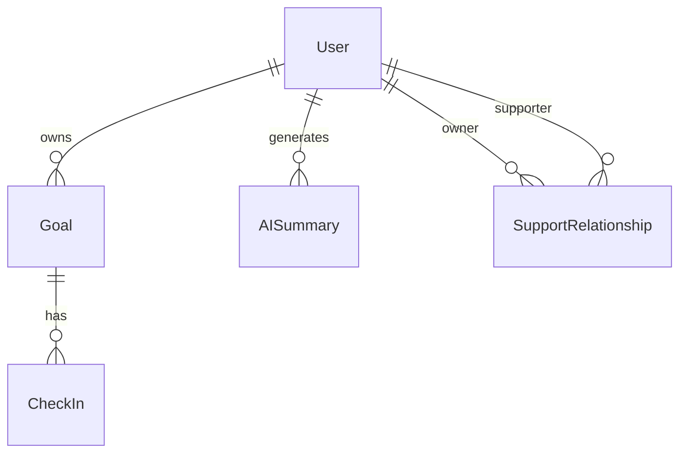
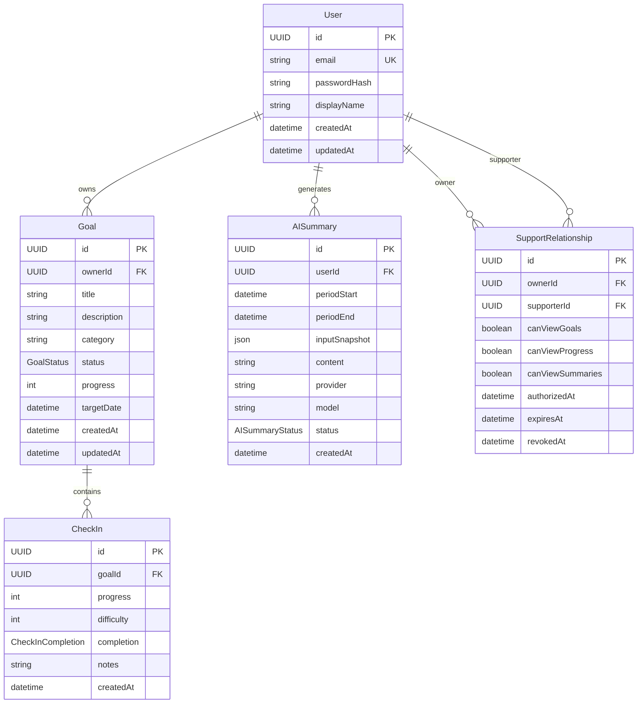

# ADR-001 — Esquema relacional y modelo de datos de NeuroConnect

**Estado:** Aceptado para implementación  
**Fecha:** 14 de octubre de 2026  
**Proyecto:** NeuroConnect  
**Decisión:** Esquema y modelo de persistencia principal  
**Responsable:** Carlos Benjamín Armenta Márquez  

---

# 1. Contexto

NeuroConnect es una plataforma multiplataforma orientada al seguimiento de objetivos personales de personas neurodivergentes y a la gestión controlada de una red de apoyo.

El sistema requiere persistir información relacionada con:

- usuarios;
- objetivos;
- check-ins;
- historial temporal de progreso;
- información utilizada por el módulo analítico;
- resúmenes generados mediante inteligencia artificial;
- relaciones entre propietarios de información y miembros de su red de apoyo;
- permisos de acceso;
- vigencia y revocación de dichos permisos.

El dominio presenta relaciones naturales entre entidades y requiere garantizar:

- integridad referencial;
- ownership de los datos;
- consultas temporales;
- aislamiento entre usuarios;
- trazabilidad de información utilizada por IA;
- consulta eficiente de historiales;
- consistencia entre objetivos y check-ins;
- posibilidad de evolucionar incrementalmente hacia la red de apoyo.

Por estas razones se requiere definir formalmente el esquema de persistencia antes de continuar con la implementación.

---

# 2. Decisión

NeuroConnect utilizará:

```text
PostgreSQL 16
+
Prisma ORM
```

como mecanismo principal de persistencia.

La base de datos seguirá un modelo:

```text
relacional
normalizado
orientado al dominio
```

con excepciones puntuales de desnormalización únicamente cuando exista una justificación explícita de rendimiento o simplicidad operativa.

El modelo principal estará compuesto por:

```text
User
Goal
CheckIn
AISummary
SupportRelationship
```

Los primeros cuatro modelos forman parte del esquema inicial.

`SupportRelationship` queda definido desde este ADR como parte del modelo global de NeuroConnect, pero su implementación física podrá aplazarse hasta el MVP-3.

---

# 3. Principios de modelado

El esquema seguirá los siguientes principios.

## 3.1 Identificadores UUID

Todas las entidades utilizarán UUID como identificador primario.

Ejemplo:

```text
550e8400-e29b-41d4-a716-446655440000
```

Razones:

- evitar IDs secuenciales expuestos;
- desacoplar generación de identificadores;
- facilitar posibles futuras integraciones;
- evitar inferir cantidad de registros;
- mantener consistencia entre entidades.

En Prisma se utilizará conceptualmente:

```prisma
id String @id @default(uuid()) @db.Uuid
```

---

## 3.2 Fechas en UTC

Todas las fechas persistidas deberán manejarse internamente en UTC.

Se utilizarán columnas equivalentes a:

```text
TIMESTAMPTZ
```

y la conversión a zona horaria local será responsabilidad del cliente.

Campos temporales comunes:

```text
createdAt
updatedAt
authorizedAt
expiresAt
revokedAt
periodStart
periodEnd
```

---

## 3.3 Integridad en dos niveles

Las reglas importantes deberán validarse tanto:

```text
API
+
Base de datos
```

La API utilizará DTO y validaciones de dominio.

La base de datos utilizará:

- NOT NULL;
- UNIQUE;
- FOREIGN KEY;
- CHECK;
- índices.

Ejemplo:

```text
Goal.progress >= 0
AND
Goal.progress <= 100
```

No se dependerá exclusivamente de validaciones del frontend.

---

# 4. Modelo conceptual global



Conceptualmente:

```text
User
 ├── Goal
 │    └── CheckIn
 │
 ├── AISummary
 │
 ├── SupportRelationship como propietario
 │
 └── SupportRelationship como miembro de apoyo
```

---

# 5. Modelo User

`User` representa cualquier cuenta autenticada dentro de NeuroConnect.

No existirán inicialmente tipos globales de usuario como:

```text
PATIENT
FAMILY
TEACHER
TUTOR
PROFESSIONAL
```

porque una misma persona puede actuar como:

```text
propietario de sus datos
+
miembro de apoyo de otro usuario
```

El rol de apoyo será contextual y estará determinado por `SupportRelationship`.

---

## 5.1 Estructura

```text
User
--------------------------------
id              UUID PK
email           VARCHAR UNIQUE
passwordHash    VARCHAR
displayName     VARCHAR
createdAt       TIMESTAMPTZ
updatedAt       TIMESTAMPTZ
```

---

## 5.2 Prisma conceptual

```prisma
model User {
  id           String   @id @default(uuid()) @db.Uuid
  email        String   @unique
  passwordHash String
  displayName  String

  createdAt DateTime @default(now()) @db.Timestamptz(3)
  updatedAt DateTime @updatedAt @db.Timestamptz(3)

  goals       Goal[]
  aiSummaries AISummary[]

  supportOwned SupportRelationship[] @relation("SupportOwner")
  supportGiven SupportRelationship[] @relation("SupportMember")
}
```

---

## 5.3 Reglas

`email`:

- obligatorio;
- válido;
- único;
- normalizado a minúsculas antes de persistir.

Ejemplo:

```text
Carlos@Correo.com
```

se almacena como:

```text
carlos@correo.com
```

`passwordHash`:

- jamás debe devolverse mediante API;
- jamás debe enviarse al módulo de IA;
- jamás debe almacenarse como texto plano.

`displayName`:

- obligatorio;
- destinado únicamente a identificación visual dentro del sistema.

---

# 6. Modelo Goal

`Goal` representa un objetivo personal creado y administrado por un usuario.

Cada objetivo pertenece exactamente a un usuario.

Relación:

```text
User 1 ──────── N Goal
```

---

## 6.1 Estructura

```text
Goal
--------------------------------
id              UUID PK
ownerId         UUID FK -> User.id

title           VARCHAR
description     TEXT NULL
category        VARCHAR NULL

status          GoalStatus
progress        INTEGER

targetDate      TIMESTAMPTZ NULL

createdAt       TIMESTAMPTZ
updatedAt       TIMESTAMPTZ
```

---

# 7. GoalStatus

Estados permitidos:

```text
ACTIVE
PAUSED
COMPLETED
```

Enum conceptual:

```prisma
enum GoalStatus {
  ACTIVE
  PAUSED
  COMPLETED
}
```

Semántica:

### ACTIVE

El objetivo se encuentra actualmente en seguimiento.

### PAUSED

El usuario mantiene el objetivo pero ha detenido temporalmente su seguimiento.

### COMPLETED

El usuario ha marcado explícitamente el objetivo como terminado.

---

# 8. Progreso del objetivo

`progress` será un número entero:

```text
0 <= progress <= 100
```

Ejemplo:

```text
0
25
50
75
100
```

No se utilizarán decimales durante el MVP.

---

## 8.1 Regla importante

```text
progress = 100
```

NO implica automáticamente:

```text
status = COMPLETED
```

La finalización del objetivo requiere una acción explícita del usuario.

Razón:

el porcentaje representa una percepción o medida de progreso, mientras que el estado representa una decisión del propietario respecto al ciclo de vida del objetivo.

Se evita mezclar:

```text
progreso cuantitativo
```

con:

```text
estado semántico
```

---

# 9. Goal.progress como snapshot

Los check-ins contienen su propio valor de progreso.

Sin embargo, `Goal` también conservará:

```text
progress
```

Esto constituye una desnormalización intencional.

La fuente histórica continuará siendo:

```text
CheckIn.progress
```

mientras que:

```text
Goal.progress
```

representará el último progreso conocido.

Esto permite consultar listas de objetivos sin buscar el último check-in de cada objetivo.

---

## 9.1 Regla de actualización

Cuando se crea un nuevo check-in:

```text
Goal.progress = CheckIn.progress
```

La creación del check-in y la actualización del objetivo deberán ejecutarse dentro de una misma transacción.

Conceptualmente:

```text
BEGIN

INSERT CheckIn

UPDATE Goal.progress

COMMIT
```

De esta manera se evita que:

```text
CheckIn.progress != Goal.progress
```

después de una operación exitosa.

---

# 10. Eliminación del último check-in

Durante el MVP-1 se permitirá eliminar un check-in creado por error.

Si el check-in eliminado era el registro más reciente del objetivo, el sistema deberá recalcular:

```text
Goal.progress
```

utilizando el check-in inmediatamente anterior.

Si no existen check-ins restantes:

```text
Goal.progress = 0
```

Esta operación deberá ejecutarse transaccionalmente.

---

# 11. Category

`Goal.category` será inicialmente:

```text
String?
```

y no un enum.

Ejemplos:

```text
Académico
Personal
Organización
Hábitos
Trabajo
```

La decisión evita crear prematuramente una taxonomía cerrada.

NeuroConnect todavía no cuenta con evidencia suficiente para determinar un catálogo definitivo de categorías.

En caso de requerirse posteriormente una taxonomía controlada podrá crearse:

```text
GoalCategory
```

sin alterar el concepto principal de `Goal`.

---

# 12. Prisma conceptual de Goal

```prisma
model Goal {
  id      String @id @default(uuid()) @db.Uuid
  ownerId String @db.Uuid

  title       String
  description String?
  category    String?

  status   GoalStatus @default(ACTIVE)
  progress Int        @default(0)

  targetDate DateTime? @db.Timestamptz(3)

  createdAt DateTime @default(now()) @db.Timestamptz(3)
  updatedAt DateTime @updatedAt @db.Timestamptz(3)

  owner    User      @relation(fields: [ownerId], references: [id], onDelete: Cascade)
  checkIns CheckIn[]

  @@index([ownerId])
  @@index([ownerId, status])
}
```

---

# 13. Modelo CheckIn

`CheckIn` representa una observación puntual realizada por el usuario sobre el avance de un objetivo.

Es la principal entidad temporal del sistema.

Relación:

```text
Goal 1 ──────── N CheckIn
```

Cada check-in pertenece exactamente a un objetivo.

---

# 14. Estructura CheckIn

```text
CheckIn
--------------------------------
id              UUID PK
goalId          UUID FK -> Goal.id

progress        INTEGER
difficulty      INTEGER
completion      CheckInCompletion
notes           TEXT NULL

createdAt       TIMESTAMPTZ
```

---

# 15. Progress

Representa el progreso reportado al momento del check-in.

Restricción:

```text
0 <= progress <= 100
```

---

# 16. Difficulty

Representa dificultad percibida por el usuario.

Escala:

```text
1
2
3
4
5
```

Restricción:

```text
1 <= difficulty <= 5
```

La dificultad:

- es autorreportada;
- no constituye una medición clínica;
- no representa diagnóstico;
- no debe utilizarse para inferir condiciones psicológicas.

---

# 17. CheckInCompletion

Enum:

```text
NOT_MET
PARTIAL
MET
```

Conceptualmente:

### NOT_MET

El usuario considera que durante ese periodo no alcanzó lo esperado.

### PARTIAL

El usuario considera que el cumplimiento fue parcial.

### MET

El usuario considera que alcanzó lo esperado para el periodo observado.

Prisma:

```prisma
enum CheckInCompletion {
  NOT_MET
  PARTIAL
  MET
}
```

---

# 18. Notes

Campo:

```text
notes TEXT NULL
```

Permite al usuario incluir contexto adicional.

Ejemplo:

```text
Esta semana tuve dificultades para organizar dos entregas.
```

El campo será opcional.

No deberá ser analizado automáticamente para:

- detectar emociones;
- diagnosticar condiciones;
- clasificar salud mental;
- inferir intención.

En fases posteriores podrá formar parte del contexto enviado al LLM únicamente si existe una necesidad funcional explícita y bajo los principios de minimización de datos.

---

# 19. Inmutabilidad conceptual de CheckIn

Un check-in representa un registro histórico.

Por esta razón no se implementará inicialmente:

```text
PATCH /check-ins/:id
```

No se permitirá modificar un check-in después de haber sido creado.

Durante MVP-1 podrá permitirse:

```text
DELETE
```

como mecanismo para eliminar registros introducidos por error.

Esta decisión será revisada durante MVP-4.

Una posible evolución sería sustituir eliminación física por:

```text
deletedAt
```

si se requieren mayores capacidades de auditoría.

---

# 20. Prisma conceptual CheckIn

```prisma
model CheckIn {
  id     String @id @default(uuid()) @db.Uuid
  goalId String @db.Uuid

  progress   Int
  difficulty Int
  completion CheckInCompletion

  notes String?

  createdAt DateTime @default(now()) @db.Timestamptz(3)

  goal Goal @relation(fields: [goalId], references: [id], onDelete: Cascade)

  @@index([goalId])
  @@index([goalId, createdAt])
}
```

---

# 21. Restricciones CHECK

Además de DTOs, la migración PostgreSQL deberá incluir conceptualmente:

```sql
CHECK ("progress" >= 0 AND "progress" <= 100)
```

para:

```text
Goal.progress
CheckIn.progress
```

y:

```sql
CHECK ("difficulty" >= 1 AND "difficulty" <= 5)
```

para:

```text
CheckIn.difficulty
```

De esta manera, incluso una escritura externa a NestJS no podrá introducir valores inválidos.

---

# 22. Historial

No existirá inicialmente una tabla independiente:

```text
GoalHistory
```

El historial de progreso se obtiene directamente de:

```text
CheckIn
```

ordenado por:

```text
createdAt ASC
```

Ejemplo:

```text
CheckIn 1 → 40 %
CheckIn 2 → 55 %
CheckIn 3 → 70 %
CheckIn 4 → 65 %
```

Esto constituye la línea temporal del objetivo.

---

# 23. Analítica derivada

No se almacenarán inicialmente entidades como:

```text
GoalAnalytics
Trend
Metric
DashboardSnapshot
```

Los indicadores se calcularán dinámicamente a partir de:

```text
Goal
+
CheckIn
```

Esto evita mantener datos derivados que puedan quedar obsoletos.

---

# 24. Indicadores derivados

El `AnalyticsModule` calculará:

```text
CompletionRate
CheckInFrequency
ProgressDelta
averageDifficulty
averageProgress
daysSinceLastCheckIn
checkInsLast28Days
inactiveGoals
```

Estos valores:

```text
NO
```

serán persistidos durante MVP-1.

---

# 25. Tendencias

La tendencia también será derivada.

Valores:

```text
PROGRESSING
STABLE
DECLINING
INACTIVE
```

No se almacenará:

```text
Goal.trend
```

porque la tendencia depende de la información temporal disponible al momento de la consulta.

Persistirla generaría riesgo de inconsistencia.

---

# 26. Regla de cálculo de tendencia

```text
INACTIVE
```

si:

```text
no existen check-ins
```

o:

```text
último check-in > 7 días
```

---

```text
PROGRESSING
```

si:

```text
ProgressDelta >= 5
```

---

```text
DECLINING
```

si:

```text
ProgressDelta <= -5
```

---

```text
STABLE
```

si:

```text
-5 < ProgressDelta < 5
```

---

Con un único check-in:

```text
trend = STABLE
insufficientHistory = true
```

---

# 27. Modelo AISummary

`AISummary` almacenará el resultado de una generación realizada por el módulo de IA.

Su función no es almacenar analítica.

Su función es proporcionar:

```text
trazabilidad
+
historial
+
reproducibilidad
```

de los resultados generados.

---

# 28. Estructura AISummary

```text
AISummary
--------------------------------
id              UUID PK
userId          UUID FK -> User.id

periodStart     TIMESTAMPTZ
periodEnd       TIMESTAMPTZ

inputSnapshot   JSONB
content         TEXT NULL

provider        VARCHAR NULL
model           VARCHAR NULL

status          AISummaryStatus

createdAt       TIMESTAMPTZ
```

---

# 29. AISummaryStatus

```text
PENDING
COMPLETED
FAILED
```

Prisma:

```prisma
enum AISummaryStatus {
  PENDING
  COMPLETED
  FAILED
}
```

---

# 30. inputSnapshot

`inputSnapshot` será un campo:

```text
JSONB
```

que almacenará exactamente los datos estructurados utilizados durante una generación.

Ejemplo:

```json
{
  "periodDays": 28,
  "totalGoals": 3,
  "completedGoals": 1,
  "completionRate": 33.33,
  "checkInFrequencyPerWeek": 3,
  "goals": [
    {
      "title": "Organizar actividades académicas",
      "progress": 70,
      "trend": "PROGRESSING",
      "averageDifficulty": 3.2
    }
  ]
}
```

Este snapshot permite responder posteriormente:

```text
¿Qué información recibió el modelo
cuando produjo este resumen?
```

---

# 31. Principio de minimización para inputSnapshot

`inputSnapshot` no deberá contener:

```text
passwordHash
JWT
tokens
credenciales
email
datos de otros usuarios
identificadores innecesarios
```

Solo deberá contener los datos necesarios para la generación.

---

# 32. Provider y Model

Campos:

```text
provider
model
```

permitirán identificar el sistema utilizado.

Ejemplo:

```text
provider = openai
model = <modelo configurado>
```

o:

```text
provider = google
model = <modelo configurado>
```

La selección definitiva del proveedor no forma parte de este ADR.

---

# 33. Prisma conceptual AISummary

```prisma
model AISummary {
  id     String @id @default(uuid()) @db.Uuid
  userId String @db.Uuid

  periodStart DateTime @db.Timestamptz(3)
  periodEnd   DateTime @db.Timestamptz(3)

  inputSnapshot Json
  content       String?

  provider String?
  model    String?

  status AISummaryStatus @default(PENDING)

  createdAt DateTime @default(now()) @db.Timestamptz(3)

  user User @relation(fields: [userId], references: [id], onDelete: Cascade)

  @@index([userId])
  @@index([userId, createdAt])
}
```

---

# 34. Modelo SupportRelationship

`SupportRelationship` forma parte del modelo global de NeuroConnect pero será implementado durante MVP-3.

Representa una autorización otorgada por un usuario a otro usuario.

Relación conceptual:

```text
User Owner
    |
    |
SupportRelationship
    |
    |
User Supporter
```

Ejemplo:

```text
Carlos
  ↓ autoriza
Tutor
```

---

# 35. Decisión sobre roles

No se utilizará:

```text
User.role
```

para definir:

```text
OWNER
SUPPORTER
```

porque esos roles dependen del contexto.

Un mismo usuario puede ser:

```text
propietario de sus objetivos
```

y simultáneamente:

```text
miembro de apoyo de otra persona
```

El rol será derivado de la relación.

---

# 36. Estructura SupportRelationship

```text
SupportRelationship
--------------------------------
id                  UUID PK

ownerId             UUID FK -> User.id
supporterId         UUID FK -> User.id

canViewGoals        BOOLEAN
canViewProgress     BOOLEAN
canViewSummaries    BOOLEAN

authorizedAt        TIMESTAMPTZ
expiresAt           TIMESTAMPTZ NULL
revokedAt           TIMESTAMPTZ NULL
```

---

# 37. Permisos iniciales

Durante MVP-3 se utilizarán tres permisos explícitos:

```text
VIEW_GOALS
VIEW_PROGRESS
VIEW_SUMMARIES
```

Persistidos inicialmente como:

```text
canViewGoals
canViewProgress
canViewSummaries
```

Razón:

el conjunto de permisos del MVP es:

```text
pequeño
estable
conocido
```

Crear desde el inicio un sistema completo:

```text
Role
Permission
RolePermission
UserRole
```

sería complejidad innecesaria.

---

# 38. Evolución futura de permisos

Si posteriormente aparecen numerosos permisos dinámicos, el modelo podrá evolucionar hacia:

```text
SupportRelationship
       |
       N
RelationshipPermission
       |
       N
Permission
```

Esta normalización NO forma parte del MVP.

---

# 39. Vigencia

Una autorización será considerada activa cuando:

```text
revokedAt IS NULL
```

y:

```text
expiresAt IS NULL
OR
expiresAt > now()
```

Conceptualmente:

```text
active =
revokedAt == null
AND
(
  expiresAt == null
  OR
  expiresAt > now
)
```

---

# 40. Revocación

Revocar un acceso:

```text
NO
```

eliminará físicamente la relación.

Se establecerá:

```text
revokedAt = now()
```

Esto permite conservar evidencia de que existió una autorización.

---

# 41. Relación consigo mismo

Debe prohibirse:

```text
ownerId = supporterId
```

Un usuario no necesita agregarse a su propia red de apoyo.

La API deberá validar esta regla.

Idealmente también deberá existir una restricción de base de datos:

```sql
CHECK ("ownerId" <> "supporterId")
```

---

# 42. Unicidad de la relación

Durante el MVP existirá una única relación lógica por pareja:

```text
ownerId + supporterId
```

Restricción:

```text
UNIQUE(ownerId, supporterId)
```

Si una autorización revocada necesita volver a activarse:

```text
authorizedAt = now()
expiresAt = nuevaFecha
revokedAt = NULL
```

y se actualizarán los permisos.

Esto simplifica el MVP y evita múltiples relaciones activas simultáneamente entre las mismas cuentas.

---

# 43. Prisma conceptual SupportRelationship

```prisma
model SupportRelationship {
  id String @id @default(uuid()) @db.Uuid

  ownerId     String @db.Uuid
  supporterId String @db.Uuid

  canViewGoals     Boolean @default(false)
  canViewProgress  Boolean @default(false)
  canViewSummaries Boolean @default(false)

  authorizedAt DateTime  @default(now()) @db.Timestamptz(3)
  expiresAt    DateTime? @db.Timestamptz(3)
  revokedAt    DateTime? @db.Timestamptz(3)

  owner User @relation(
    "SupportOwner",
    fields: [ownerId],
    references: [id],
    onDelete: Cascade
  )

  supporter User @relation(
    "SupportMember",
    fields: [supporterId],
    references: [id],
    onDelete: Cascade
  )

  @@unique([ownerId, supporterId])
  @@index([ownerId])
  @@index([supporterId])
}
```

---

# 44. Diagrama ER completo



---

# 45. Índices

Además de las PK y UNIQUE, se crearán los siguientes índices.

## User

```text
UNIQUE(email)
```

---

## Goal

```text
INDEX(ownerId)

INDEX(ownerId, status)
```

Permiten:

- listar objetivos de un usuario;
- filtrar por estado.

---

## CheckIn

```text
INDEX(goalId)

INDEX(goalId, createdAt)
```

Especialmente importante porque la analítica consulta:

```text
check-ins de un objetivo
ordenados temporalmente
```

---

## AISummary

```text
INDEX(userId)

INDEX(userId, createdAt)
```

Permite consultar historial de resúmenes.

---

## SupportRelationship

```text
UNIQUE(ownerId, supporterId)

INDEX(ownerId)

INDEX(supporterId)
```

Permite consultar eficientemente:

```text
mi red de apoyo
```

y:

```text
personas a las que apoyo
```

---

# 46. Política de eliminación

## User

Actualmente no existe funcionalidad de eliminación de cuenta dentro del MVP.

Si en el futuro se elimina físicamente un usuario:

```text
Goals
CheckIns
AISummaries
SupportRelationships
```

asociados podrán eliminarse mediante `ON DELETE CASCADE`.

Esta política deberá revisarse antes de introducir eliminación de cuentas en producción.

---

## Goal

En MVP-1:

```text
DELETE /goals/:id
```

realizará eliminación física.

Como consecuencia:

```text
CheckIns
```

asociados serán eliminados en cascada.

Esta decisión se acepta por:

- naturaleza académica del prototipo;
- utilización de datos sintéticos/de prueba;
- ausencia de requisitos regulatorios de conservación.

Antes de convertir NeuroConnect en un producto real deberá evaluarse migrar hacia:

```text
soft delete
```

o:

```text
archivedAt
```

para conservar historial.

---

## CheckIn

Se permite eliminación física durante MVP-1 para corregir errores.

No existe edición.

---

## AISummary

No se eliminará automáticamente cuando cambien los datos que lo originaron.

Representa un resultado histórico generado utilizando:

```text
inputSnapshot
```

específico.

---

# 47. Ownership y seguridad de datos

La seguridad de NeuroConnect no dependerá únicamente de conocer un UUID.

Cada consulta deberá contener el contexto del usuario autenticado.

Ejemplo incorrecto:

```text
SELECT Goal
WHERE id = goalId
```

Ejemplo esperado:

```text
SELECT Goal
WHERE
id = goalId
AND
ownerId = currentUserId
```

Esto aplica a:

```text
Goal
CheckIn
Analytics
AISummary
```

hasta que MVP-3 introduzca acceso delegado mediante `SupportRelationship`.

---

# 48. Estrategia de 404 para recursos ajenos

Si un usuario intenta acceder mediante UUID a un recurso de otro usuario:

```text
GET /goals/{otroGoal}
```

el backend responderá preferentemente:

```text
404 Not Found
```

en lugar de:

```text
403 Forbidden
```

Esto evita confirmar que el recurso existe.

---

# 49. Analytics y persistencia

El módulo analítico deberá leer datos de:

```text
Goal
CheckIn
```

pero no modificarlos.

Flujo:

```text
PostgreSQL
    ↓
Prisma
    ↓
AnalyticsModule
    ↓
Metrics DTO
```

El resultado analítico será efímero.

No se creará una tabla:

```text
AnalyticsResult
```

durante el MVP.

---

# 50. IA y persistencia

El pipeline será:

```text
Goal + CheckIn
      ↓
AnalyticsModule
      ↓
SummaryContextBuilder
      ↓
Structured Context
      ↓
PromptBuilder
      ↓
AiProvider
      ↓
Generated Summary
      ↓
AISummary
```

La IA:

```text
NO
```

consultará directamente PostgreSQL.

El acceso a los datos será mediado por servicios de dominio.

Esto permite controlar exactamente qué información llega al proveedor externo.

---

# 51. Separación entre datos y resultados generados

Se establece una separación explícita:

```text
Datos del usuario
    =
User
Goal
CheckIn
```

```text
Resultados determinísticos
    =
AnalyticsModule
```

```text
Resultados generativos
    =
AISummary
```

Esto evita mezclar información objetiva con contenido producido por un LLM.

---

# 52. Schema Prisma global propuesto

El esquema de referencia será aproximadamente:

```prisma
enum GoalStatus {
  ACTIVE
  PAUSED
  COMPLETED
}

enum CheckInCompletion {
  NOT_MET
  PARTIAL
  MET
}

enum AISummaryStatus {
  PENDING
  COMPLETED
  FAILED
}

model User {
  id           String @id @default(uuid()) @db.Uuid
  email        String @unique
  passwordHash String
  displayName  String

  createdAt DateTime @default(now()) @db.Timestamptz(3)
  updatedAt DateTime @updatedAt @db.Timestamptz(3)

  goals       Goal[]
  aiSummaries AISummary[]

  supportOwned SupportRelationship[] @relation("SupportOwner")
  supportGiven SupportRelationship[] @relation("SupportMember")
}

model Goal {
  id      String @id @default(uuid()) @db.Uuid
  ownerId String @db.Uuid

  title       String
  description String?
  category    String?

  status   GoalStatus @default(ACTIVE)
  progress Int        @default(0)

  targetDate DateTime? @db.Timestamptz(3)

  createdAt DateTime @default(now()) @db.Timestamptz(3)
  updatedAt DateTime @updatedAt @db.Timestamptz(3)

  owner User @relation(
    fields: [ownerId],
    references: [id],
    onDelete: Cascade
  )

  checkIns CheckIn[]

  @@index([ownerId])
  @@index([ownerId, status])
}

model CheckIn {
  id     String @id @default(uuid()) @db.Uuid
  goalId String @db.Uuid

  progress   Int
  difficulty Int
  completion CheckInCompletion

  notes String?

  createdAt DateTime @default(now()) @db.Timestamptz(3)

  goal Goal @relation(
    fields: [goalId],
    references: [id],
    onDelete: Cascade
  )

  @@index([goalId])
  @@index([goalId, createdAt])
}

model AISummary {
  id     String @id @default(uuid()) @db.Uuid
  userId String @db.Uuid

  periodStart DateTime @db.Timestamptz(3)
  periodEnd   DateTime @db.Timestamptz(3)

  inputSnapshot Json
  content       String?

  provider String?
  model    String?

  status AISummaryStatus @default(PENDING)

  createdAt DateTime @default(now()) @db.Timestamptz(3)

  user User @relation(
    fields: [userId],
    references: [id],
    onDelete: Cascade
  )

  @@index([userId])
  @@index([userId, createdAt])
}

model SupportRelationship {
  id String @id @default(uuid()) @db.Uuid

  ownerId     String @db.Uuid
  supporterId String @db.Uuid

  canViewGoals     Boolean @default(false)
  canViewProgress  Boolean @default(false)
  canViewSummaries Boolean @default(false)

  authorizedAt DateTime  @default(now()) @db.Timestamptz(3)
  expiresAt    DateTime? @db.Timestamptz(3)
  revokedAt    DateTime? @db.Timestamptz(3)

  owner User @relation(
    "SupportOwner",
    fields: [ownerId],
    references: [id],
    onDelete: Cascade
  )

  supporter User @relation(
    "SupportMember",
    fields: [supporterId],
    references: [id],
    onDelete: Cascade
  )

  @@unique([ownerId, supporterId])
  @@index([ownerId])
  @@index([supporterId])
}
```

---

# 53. Restricciones SQL adicionales

Debido a que ciertas restricciones de dominio no se expresan completamente mediante el schema Prisma, las migraciones deberán considerar constraints equivalentes a:

```sql
ALTER TABLE "Goal"
ADD CONSTRAINT "Goal_progress_check"
CHECK ("progress" >= 0 AND "progress" <= 100);
```

```sql
ALTER TABLE "CheckIn"
ADD CONSTRAINT "CheckIn_progress_check"
CHECK ("progress" >= 0 AND "progress" <= 100);
```

```sql
ALTER TABLE "CheckIn"
ADD CONSTRAINT "CheckIn_difficulty_check"
CHECK ("difficulty" >= 1 AND "difficulty" <= 5);
```

Cuando se implemente MVP-3:

```sql
ALTER TABLE "SupportRelationship"
ADD CONSTRAINT "SupportRelationship_not_self"
CHECK ("ownerId" <> "supporterId");
```

---

# 54. Migraciones

Todas las modificaciones al esquema deberán realizarse mediante Prisma Migrate.

No se permitirá:

```text
editar manualmente producción
```

sin migración correspondiente.

Flujo:

```bash
npx prisma migrate dev
```

durante desarrollo.

Las migraciones deberán versionarse en Git.

---

# 55. Seed

El seed inicial deberá crear datos reproducibles.

Mínimo:

```text
1 usuario demo

3 objetivos

4–6 check-ins por objetivo
```

Los objetivos deberán representar:

```text
PROGRESSING
STABLE
INACTIVE
```

Esto permitirá validar:

- consultas;
- historial;
- dashboard;
- analítica;
- gráficos;
- pipeline de IA.

---

# 56. Opciones consideradas

## Opción A — PostgreSQL relacional

### Ventajas

- fuerte integridad referencial;
- consultas temporales naturales;
- relaciones claras;
- soporte de transacciones;
- JSONB para snapshots de IA;
- adecuado para Prisma;
- modelo consistente con el dominio.

### Desventajas

- requiere migraciones;
- requiere diseño previo de relaciones.

### Resultado

```text
ACEPTADA
```

---

## Opción B — MongoDB

### Ventajas

- flexibilidad documental;
- integración sencilla con objetos JSON.

### Desventajas

- relaciones `User → Goal → CheckIn` son naturales en modelo relacional;
- permisos entre usuarios requieren relaciones consistentes;
- PostgreSQL ya cubre contenido semiestructurado mediante JSONB;
- no existe ventaja suficiente para introducir otro paradigma.

### Resultado

```text
RECHAZADA
```

---

## Opción C — Firebase / Firestore

### Ventajas

- velocidad inicial;
- servicios administrados;
- integración móvil.

### Desventajas

- modelo documental menos natural para relaciones;
- mayor acoplamiento con plataforma;
- consultas analíticas requieren diseño específico;
- la arquitectura aprobada ya contempla backend NestJS propio.

### Resultado

```text
RECHAZADA
```

---

## Opción D — Base relacional + almacenamiento separado para analítica

Ejemplo:

```text
PostgreSQL
+
Data Warehouse
```

### Ventajas

- adecuada para grandes volúmenes;
- separación OLTP/OLAP.

### Desventajas

- completamente innecesaria para el MVP;
- añade infraestructura;
- aumenta complejidad operativa.

### Resultado

```text
RECHAZADA PARA MVP
```

---

# 57. Consecuencias positivas

La decisión permite:

- utilizar un único motor de base de datos;
- representar claramente ownership;
- construir historiales mediante check-ins;
- realizar analítica temporal;
- mantener integridad referencial;
- aislar información de usuarios;
- conservar trazabilidad de IA;
- evolucionar posteriormente hacia la red de apoyo;
- evitar persistencia redundante de métricas;
- mantener el sistema suficientemente pequeño para el periodo académico.

---

# 58. Consecuencias negativas

La decisión introduce:

- necesidad de migraciones;
- sincronización transaccional de `Goal.progress`;
- lógica adicional cuando se elimina el último check-in;
- futura complejidad en permisos cuando se implemente MVP-3;
- necesidad de mantener constraints SQL adicionales a Prisma.

Estas consecuencias se consideran aceptables frente a los beneficios obtenidos.

---

# 59. Riesgos

## Riesgo 1 — Desincronización de Goal.progress

Puede ocurrir:

```text
Goal.progress != último CheckIn.progress
```

Mitigación:

```text
transacción
```

para crear/eliminar check-ins y actualizar el objetivo.

---

## Riesgo 2 — Métricas persistidas inconsistentes

Mitigación:

```text
no persistir analytics durante MVP
```

Las métricas se calculan en tiempo de consulta.

---

## Riesgo 3 — Exposición de información mediante IA

Mitigación:

```text
SummaryContextBuilder
```

será el único componente autorizado para construir contexto destinado al proveedor.

---

## Riesgo 4 — Acceso a recursos ajenos

Mitigación:

todas las consultas incorporan:

```text
currentUserId
```

como condición de ownership.

---

## Riesgo 5 — Historial eliminado

Durante MVP se permiten eliminaciones físicas.

Mitigación actual:

- datos académicos;
- uso prioritario de datos sintéticos;
- no existe uso clínico.

Trabajo futuro:

```text
soft deletion
```

si NeuroConnect evoluciona fuera del contexto académico.

---

# 60. Decisiones explícitamente diferidas

Este ADR NO decide todavía:

- proveedor final de IA;
- modelo final del LLM;
- esquema avanzado de permisos;
- taxonomía definitiva de categorías;
- mecanismo de soft delete;
- almacenamiento de logs de auditoría;
- retención de información;
- eliminación de cuenta;
- cifrado de campos específicos a nivel de aplicación;
- anonimización para investigación;
- arquitectura de reporting a gran escala.

Estas decisiones deberán resolverse mediante ADR posteriores si llegan a ser necesarias.

---

# 61. Implementación por fases

## Avance 1

Se implementarán físicamente:

```text
User
Goal
CheckIn
AISummary
```

Se crearán:

```text
migraciones
constraints
índices
seed
```

`SupportRelationship` podrá permanecer únicamente documentado.

---

## MVP-2

Se utilizará:

```text
AISummary
```

para persistencia real de resultados generados.

---

## MVP-3

Se agregará físicamente:

```text
SupportRelationship
```

junto con:

```text
ownership delegado
permisos
expiración
revocación
```

---

## MVP-4

Se revisarán:

```text
eliminaciones
auditoría
seguridad
índices
retención
integridad final
```

---

# 62. Criterios de aceptación del esquema

El modelo se considerará correctamente implementado cuando:

- las migraciones funcionen desde una base vacía;
- Prisma genere el cliente correctamente;
- el seed pueda ejecutarse repetidamente sobre una base limpia;
- `email` sea único;
- no puedan existir porcentajes fuera de 0–100;
- no puedan existir dificultades fuera de 1–5;
- cada Goal pertenezca a un User;
- cada CheckIn pertenezca a un Goal;
- eliminar un Goal elimine sus CheckIns;
- crear un CheckIn actualice `Goal.progress`;
- eliminar el último CheckIn recalcule `Goal.progress`;
- un usuario no pueda consultar información perteneciente a otro;
- Analytics pueda calcular resultados exclusivamente desde Goal y CheckIn;
- el contexto de IA pueda construirse sin exponer datos sensibles.

---

# 63. Estado de la decisión

```text
ACEPTADA PARA IMPLEMENTACIÓN
```

La implementación correspondiente al Avance 1 deberá respetar este ADR.

Cualquier cambio estructural deberá:

1. documentar el problema;
2. explicar por qué el modelo actual no es suficiente;
3. evaluar alternativas;
4. actualizar este ADR o generar uno nuevo;
5. obtener aprobación antes de modificar el esquema.

---

# 64. Resumen de la decisión

```text
PostgreSQL 16
        +
Prisma ORM
        ↓
User
 ├── Goal
 │    └── CheckIn
 │
 ├── AISummary
 │
 └── SupportRelationship
```

Con las siguientes reglas principales:

```text
UUID como PK

UTC para timestamps

ownership estricto

Goal.progress como snapshot del último check-in

CheckIn como historial temporal

Analytics calculado, no persistido

Tendencias calculadas, no persistidas

AISummary con inputSnapshot para trazabilidad

Roles de apoyo contextuales mediante SupportRelationship

Permisos básicos mediante flags durante MVP

Integridad validada tanto por API como por PostgreSQL
```text

Esta estructura constituye la baseline de persistencia de NeuroConnect.
```

Hay dos decisiones de diseño particularmente relevantes que cerré en este ADR: **no existe un `User.role` global**, porque una persona puede ser simultáneamente propietaria de sus datos y miembro de apoyo de otra; y **las métricas/tendencias no se persisten**, sino que se derivan de `Goal + CheckIn`, evitando inconsistencias. Esto encaja con la separación que ya establecimos entre información persistida, análisis determinístico y resultado generativo. 
