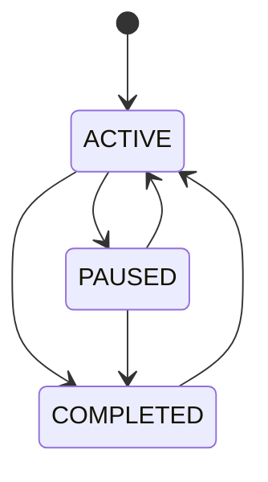
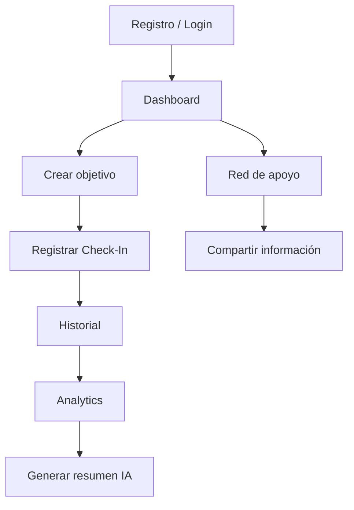
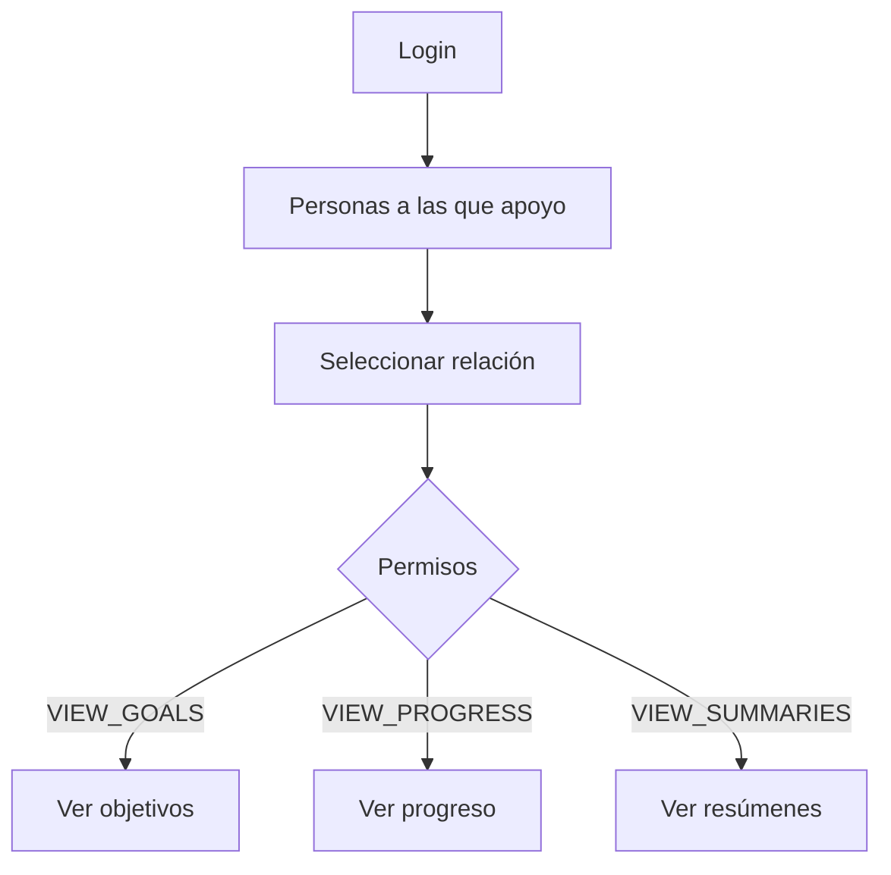
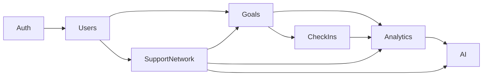

# ADR-002 — Diseño funcional, dominio y reglas de negocio de NeuroConnect v1.0.0

**Estado:** Aceptado para implementación  
**Fecha:** 14 de octubre de 2026  
**Proyecto:** NeuroConnect  
**Versión objetivo:** v1.0.0  
**Decisión:** Baseline funcional, reglas de dominio y comportamiento del sistema  
**Responsable:** Carlos Benjamín Armenta Márquez  

---

# 1. Contexto

NeuroConnect es una plataforma multiplataforma orientada al seguimiento de objetivos personales de personas neurodivergentes y a la gestión controlada de una red de apoyo.

La versión v1.0.0 debe proporcionar un flujo funcional completo que permita:

```text
usuario
    ↓
define objetivos
    ↓
registra check-ins
    ↓
construye historial
    ↓
obtiene indicadores
    ↓
consulta tendencias
    ↓
genera resúmenes mediante IA
    ↓
autoriza información
    ↓
miembro de apoyo
```

El proyecto tiene naturaleza académica y deberá completarse dentro del periodo agosto–diciembre de 2026.

Por esta razón, la versión 1.0.0 deberá priorizar:

- funcionalidad completa;
- coherencia de dominio;
- simplicidad;
- trazabilidad;
- privacidad;
- capacidad de demostración;
- pruebas reproducibles;

sobre:

- funcionalidades comerciales;
- escalabilidad prematura;
- automatización compleja;
- características clínicas;
- infraestructura distribuida.

---

# 2. Relación con otros documentos

Este ADR forma parte de la baseline documental de NeuroConnect.

Jerarquía de referencia:

```text
Anteproyecto oficial
        ↓
ADR-001 — Persistencia y modelo de datos
        ↓
ADR-002 — Dominio y reglas de negocio v1.0.0
        ↓
Planes de implementación
        ↓
Documentación técnica
        ↓
Código
```

## 2.1 Anteproyecto

Define:

- propósito;
- población objetivo;
- alcance académico;
- arquitectura general;
- separación entre analítica e IA;
- roadmap por MVP.

## 2.2 ADR-001

Define:

- PostgreSQL + Prisma;
- entidades;
- relaciones;
- ownership;
- constraints;
- historial;
- snapshots;
- persistencia de IA;
- relación de apoyo.

ADR-002 NO reemplaza ADR-001.

## 2.3 Plan de Implementación

Define:

- orden de implementación;
- alcance por avance;
- pruebas;
- Definition of Done;
- entregables técnicos.

Si existe conflicto entre una regla de negocio del plan y este ADR:

```text
ADR-002
```

tendrá prioridad para reglas de dominio.

Si existe conflicto relacionado con estructura física de base de datos:

```text
ADR-001
```

tendrá prioridad.

---

# 3. Definición de NeuroConnect v1.0.0

La versión 1.0.0 se define como:

> Un MVP académico completo que permite a una persona gestionar objetivos, registrar periódicamente su progreso, consultar indicadores y tendencias calculadas de forma determinística, generar resúmenes mediante inteligencia artificial y compartir información seleccionada con otros usuarios autorizados como integrantes de su red de apoyo.

La versión 1.0.0:

```text
NO
```

representa un producto clínico.

```text
NO
```

representa una plataforma de salud.

```text
NO
```

representa una herramienta de diagnóstico.

```text
NO
```

representa una solución lista para uso productivo con pacientes.

---

# 4. Principios rectores del dominio

Todas las decisiones funcionales deberán respetar los siguientes principios.

## 4.1 El usuario es propietario de sus datos

Un usuario controla:

- sus objetivos;
- sus check-ins;
- sus resúmenes;
- su red de apoyo;
- las autorizaciones otorgadas.

Por defecto:

```text
todo es privado
```

hasta que exista una autorización explícita.

---

## 4.2 No inferencia clínica

NeuroConnect no deberá utilizar:

- datos de comportamiento;
- dificultad;
- progreso;
- comentarios;
- tendencias;
- IA;

para inferir:

- diagnósticos;
- trastornos;
- síntomas clínicos;
- riesgo psicológico;
- estado de salud mental;
- necesidad de tratamiento.

---

## 4.3 Analítica antes que IA

El pipeline obligatorio será:

```text
datos registrados
      ↓
cálculo determinístico
      ↓
métricas
      ↓
tendencias
      ↓
contexto estructurado
      ↓
IA generativa
      ↓
explicación
```

Nunca:

```text
datos crudos
      ↓
LLM
      ↓
decisión analítica
```

---

## 4.4 IA como herramienta explicativa

La IA:

- explica;
- resume;
- organiza información;
- ofrece sugerencias generales;

pero no:

- calcula métricas oficiales;
- decide permisos;
- modifica objetivos;
- modifica check-ins;
- diagnostica;
- prescribe;
- actúa autónomamente.

---

## 4.5 Privacidad por diseño

La implementación debe aplicar:

```text
mínimos datos necesarios
+
mínimos permisos necesarios
+
mínima información enviada a IA
```

---

## 4.6 Preferencia por reglas explícitas

Cuando una funcionalidad pueda implementarse mediante una regla determinística sencilla y comprensible, se preferirá dicha regla frente a modelos probabilísticos.

Ejemplo:

```text
PROGRESSING
STABLE
DECLINING
INACTIVE
```

se calcula mediante reglas.

No mediante Machine Learning.

---

# 5. Actores del sistema

La versión 1.0.0 tendrá un único tipo técnico de cuenta:

```text
User
```

No existen roles globales como:

```text
PATIENT
TEACHER
FAMILY
TUTOR
PROFESSIONAL
```

Una cuenta puede actuar en diferentes contextos.

---

# 6. Usuario propietario

Todo usuario es propietario de:

```text
Goals
CheckIns
AISummaries
SupportRelationships otorgadas
```

Puede:

- administrar su perfil;
- crear objetivos;
- modificar objetivos;
- pausar objetivos;
- completar objetivos;
- reactivar objetivos;
- registrar check-ins;
- consultar historial;
- consultar dashboard;
- consultar analítica;
- generar resúmenes IA;
- administrar su red de apoyo;
- otorgar permisos;
- modificar permisos;
- revocar permisos.

---

# 7. Miembro de apoyo

Un usuario se convierte en miembro de apoyo de otro únicamente mediante:

```text
SupportRelationship
```

No existe una cuenta especial de "supporter".

Ejemplo:

```text
Usuario A
    ↓ autoriza
Usuario B
```

Usuario B adquiere permisos sobre información específica de Usuario A.

Al mismo tiempo, Usuario B puede continuar siendo propietario de sus propios objetivos.

---

# 8. Registro de usuarios

La versión 1.0.0 utilizará:

```text
email
+
password
+
displayName
```

para registro.

No se solicitará:

- diagnóstico;
- condición neurodivergente;
- edad;
- género;
- institución;
- información clínica;
- expediente médico.

---

# 9. Autenticación

La autenticación será mediante:

```text
email + password
```

y sesiones API mediante:

```text
JWT Bearer
```

La v1.0.0 no requiere:

- Google Login;
- Apple Login;
- Microsoft Login;
- OAuth externo;
- MFA;
- passwordless;
- biometría.

---

# 10. Verificación de correo

La versión académica 1.0.0 no requerirá verificación real de correo electrónico.

Motivo:

- elimina dependencia de un servicio de correo;
- simplifica despliegue;
- no afecta el flujo académico principal.

Será considerada funcionalidad futura.

---

# 11. Recuperación de contraseña

No se implementará recuperación mediante correo durante v1.0.0.

La funcionalidad deberá documentarse como:

```text
fuera de alcance
```

para la entrega académica.

---

# 12. Administración de cuentas

No existirá:

```text
Admin
SuperAdmin
Moderator
```

durante v1.0.0.

No habrá panel administrativo global.

Cada cuenta administra exclusivamente su información.

---

# 13. Definición de Goal

Un `Goal` representa un objetivo definido voluntariamente por el usuario.

Ejemplos:

```text
Entregar todas mis actividades esta semana.

Mantener organizada mi agenda académica.

Leer durante treinta minutos cada día.

Completar el módulo pendiente del proyecto.
```

Un objetivo NO representa:

- diagnóstico;
- prescripción;
- tratamiento;
- plan clínico.

---

# 14. Creación de objetivos

Para crear un objetivo se requiere:

```text
title
```

Opcionalmente:

```text
description
category
targetDate
```

El sistema asignará:

```text
status = ACTIVE
progress = 0
```

---

# 15. Decisión sobre progreso inicial

En v1.0.0:

```text
Goal.progress
```

NO será especificado directamente por el usuario durante la creación.

Siempre comienza:

```text
0
```

Si el usuario desea registrar un progreso previo:

```text
deberá crear un CheckIn
```

Esto mantiene una única fuente histórica de progreso.

---

# 16. Modificación directa de progreso

El endpoint de actualización de Goal:

```text
PATCH /goals/:id
```

NO deberá permitir modificar directamente:

```text
progress
```

Los campos modificables serán:

```text
title
description
category
targetDate
status
```

`Goal.progress` cambia únicamente mediante operaciones de check-in.

Esta decisión refina cualquier ambigüedad existente en planes anteriores.

---

# 17. Estados de Goal

Los estados oficiales son:

```text
ACTIVE
PAUSED
COMPLETED
```

---

# 18. ACTIVE

Significa:

> El usuario mantiene actualmente el objetivo en seguimiento.

Solo los objetivos `ACTIVE` podrán recibir nuevos check-ins.

---

# 19. PAUSED

Significa:

> El usuario conserva el objetivo, pero ha detenido temporalmente su seguimiento.

Un Goal `PAUSED`:

- permanece visible;
- conserva historial;
- conserva progreso;
- no acepta nuevos check-ins.

Para continuar registrando progreso deberá cambiarse a:

```text
ACTIVE
```

---

# 20. COMPLETED

Significa:

> El usuario considera que el objetivo ha finalizado.

Un Goal `COMPLETED`:

- conserva historial;
- conserva progreso;
- no acepta nuevos check-ins;
- permanece disponible para consulta.

---

# 21. Reapertura de objetivos

La finalización no será irreversible.

Un usuario podrá cambiar:

```text
COMPLETED → ACTIVE
```

de manera explícita.

Esto permite corregir errores o continuar un objetivo previamente considerado terminado.

---

# 22. Transiciones válidas de Goal



No existen transiciones automáticas.

---

# 23. Progreso y estado son independientes

La regla:

```text
progress = 100
```

NO implica:

```text
status = COMPLETED
```

Y:

```text
status = COMPLETED
```

NO requiere necesariamente:

```text
progress = 100
```

Ejemplo:

Un usuario puede decidir cerrar un objetivo en:

```text
80 %
```

porque dejó de ser relevante.

---

# 24. Categorías

`category` será texto libre opcional.

No existirá catálogo cerrado durante v1.0.0.

Ejemplos sugeridos por interfaz:

```text
Académico
Personal
Organización
Hábitos
Trabajo
Otro
```

Estas sugerencias:

```text
NO
```

constituyen un enum de dominio.

---

# 25. Eliminación de objetivos

Durante v1.0.0 el propietario podrá eliminar un objetivo.

La eliminación:

```text
elimina también sus CheckIns
```

de acuerdo con ADR-001.

La interfaz deberá solicitar confirmación explícita antes de realizar esta acción.

---

# 26. Definición de CheckIn

Un `CheckIn` representa una observación realizada voluntariamente por el usuario respecto a un objetivo en un momento determinado.

Cada check-in contiene:

```text
progress
difficulty
completion
notes?
createdAt
```

---

# 27. Quién puede crear un CheckIn

Únicamente:

```text
el propietario del Goal
```

puede registrar check-ins.

Los miembros de la red de apoyo:

```text
NO
```

pueden registrar check-ins por otra persona.

---

# 28. Goals que aceptan CheckIn

Solo:

```text
Goal.status = ACTIVE
```

puede aceptar nuevos check-ins.

Para:

```text
PAUSED
COMPLETED
```

el backend deberá rechazar la operación.

---

# 29. Frecuencia de CheckIn

No existirá una restricción de:

```text
1 check-in por día
```

El usuario podrá registrar más de uno.

Razones:

- evitar reglas artificiales;
- permitir correcciones mediante nuevo registro;
- permitir seguimiento más frecuente;
- simplificar dominio.

La analítica siempre utilizará orden temporal.

---

# 30. Progress de CheckIn

Rango:

```text
0..100
```

Representa:

> estimación cuantitativa del avance del objetivo en ese momento.

No representa:

- rendimiento clínico;
- puntuación psicológica;
- diagnóstico.

---

# 31. Difficulty

Rango:

```text
1..5
```

Semántica de interfaz:

```text
1 = muy baja
2 = baja
3 = media
4 = alta
5 = muy alta
```

La dificultad es:

```text
subjetiva
autorreportada
```

No deberá ser reinterpretada como escala clínica.

---

# 32. Completion

Los valores serán:

```text
NOT_MET
PARTIAL
MET
```

Representan la percepción del usuario respecto al cumplimiento esperado durante el periodo.

No modifican automáticamente:

```text
Goal.status
```

---

# 33. Notes

El comentario será opcional.

Puede contener contexto libre proporcionado por el usuario.

Ejemplo:

```text
Esta semana tuve dos entregas adicionales y avancé menos de lo esperado.
```

Durante v1.0.0:

```text
notes
```

será información privada del propietario.

NO se compartirá con miembros de apoyo mediante ningún permiso de la v1.

---

# 34. Edición de CheckIn

Los check-ins serán conceptualmente históricos.

No existirá:

```text
PATCH CheckIn
```

durante v1.0.0.

---

# 35. Eliminación de CheckIn

El propietario podrá eliminar un check-in creado por error.

Si se elimina el último check-in:

```text
Goal.progress
```

será recalculado mediante ADR-001.

---

# 36. Historial

El historial de un objetivo estará compuesto por:

```text
CheckIns ordenados cronológicamente
```

La UI podrá visualizar:

- fecha;
- progreso;
- dificultad;
- cumplimiento;
- notes para el propietario.

---

# 37. Dashboard

El dashboard tiene como objetivo:

> convertir la información registrada en una visión resumida del seguimiento del usuario.

No realizará análisis clínico.

---

# 38. Métricas globales de v1.0.0

El dashboard mostrará como mínimo:

```text
totalGoals
activeGoals
pausedGoals
completedGoals
completionRate
averageProgress
checkInsLast28Days
checkInFrequencyPerWeek
inactiveGoals
```

---

# 39. CompletionRate

Se define:

```text
completedGoals
---------------- × 100
 totalGoals
```

Si:

```text
totalGoals = 0
```

el resultado será:

```text
0
```

y no:

```text
NaN
null
Infinity
```

---

# 40. AverageProgress

Se calcula sobre:

```text
todos los Goals del usuario
```

incluyendo:

```text
ACTIVE
PAUSED
COMPLETED
```

Si no existen Goals:

```text
averageProgress = 0
```

---

# 41. Periodo analítico estándar

La ventana temporal predeterminada será:

```text
28 días
```

equivalente a:

```text
4 semanas
```

Se utilizará en:

```text
checkInsLast28Days
checkInFrequencyPerWeek
AI Summary v1
```

---

# 42. CheckInFrequency

Se define:

```text
check-ins registrados durante últimos 28 días
------------------------------------------------
                       4
```

Resultado:

```text
checkIns por semana
```

---

# 43. Analytics por objetivo

El sistema calculará:

```text
currentProgress
previousProgress
progressDelta
averageDifficulty
totalCheckIns
checkInsLast28Days
daysSinceLastCheckIn
trend
insufficientHistory
timeline
```

---

# 44. CurrentProgress

Será:

```text
Goal.progress
```

que de acuerdo con ADR-001 representa el último progreso conocido.

---

# 45. PreviousProgress

Será el valor del:

```text
penúltimo CheckIn
```

Si no existe:

```text
previousProgress = null
```

---

# 46. ProgressDelta

Si existen al menos dos check-ins:

```text
currentProgress - previousProgress
```

Si no existen dos registros suficientes:

```text
progressDelta = null
```

---

# 47. AverageDifficulty

Se calcula utilizando los check-ins disponibles del objetivo.

Para v1.0.0 se utilizará:

```text
todo el historial
```

del objetivo.

Si no existen check-ins:

```text
averageDifficulty = null
```

---

# 48. DaysSinceLastCheckIn

Si existe historial:

```text
fechaActual - últimoCheckIn.createdAt
```

expresado en días completos.

Si no existe historial:

```text
daysSinceLastCheckIn = null
```

---

# 49. Definición de Trend

Valores:

```text
PROGRESSING
STABLE
DECLINING
INACTIVE
```

Son:

```text
clasificaciones descriptivas
```

No:

```text
clasificaciones psicológicas
```

---

# 50. Regla INACTIVE

Para un objetivo `ACTIVE`:

```text
INACTIVE
```

si:

```text
no existen check-ins
```

o:

```text
han pasado más de 7 días desde el último check-in
```

---

# 51. Regla PROGRESSING

Si:

```text
ProgressDelta >= 5
```

entonces:

```text
PROGRESSING
```

---

# 52. Regla DECLINING

Si:

```text
ProgressDelta <= -5
```

entonces:

```text
DECLINING
```

---

# 53. Regla STABLE

Si:

```text
-5 < ProgressDelta < 5
```

entonces:

```text
STABLE
```

---

# 54. Historial insuficiente

Si existe únicamente un check-in:

```text
trend = STABLE
insufficientHistory = true
```

Esto debe interpretarse como:

> No existe todavía información suficiente para inferir cambio temporal.

---

# 55. PAUSED y COMPLETED en analítica

Los Goals:

```text
PAUSED
COMPLETED
```

mantendrán disponible su historial y métricas históricas.

Sin embargo:

```text
inactiveGoals
```

solo contará objetivos:

```text
ACTIVE
```

que cumplan la regla de inactividad.

La interfaz no deberá presentar un Goal `COMPLETED` como "objetivo inactivo".

---

# 56. Tendencia visible de objetivos no activos

Para Goals:

```text
PAUSED
COMPLETED
```

la API podrá conservar el último cálculo histórico de tendencia derivado de sus check-ins.

La interfaz deberá contextualizarlo como:

```text
Tendencia histórica
```

y no como estado actual de actividad.

---

# 57. Analítica no persistida

Los resultados del módulo analítico:

```text
NO
```

se almacenarán como entidades durante v1.0.0.

Siempre se recalcularán desde:

```text
Goal
+
CheckIn
```

---

# 58. Dashboard y red de apoyo

El dashboard completo pertenece al propietario.

Los miembros de apoyo:

```text
NO
```

recibirán acceso automático al dashboard completo.

El acceso delegado dependerá de permisos específicos.

---

# 59. IA generativa en v1.0.0

La v1.0.0 incluirá generación real mediante un proveedor externo de LLM.

La arquitectura continuará siendo:

```text
AiProvider
```

para mantener independencia del proveedor.

La selección concreta de proveedor:

```text
NO
```

forma parte de este ADR.

---

# 60. Generación bajo demanda

Los resúmenes IA serán generados:

```text
solo cuando el propietario los solicite
```

No existirán:

- generaciones automáticas;
- tareas programadas;
- generación en background periódica;
- agentes autónomos.

---

# 61. Periodo del resumen IA

En v1.0.0 el periodo estándar será:

```text
últimos 28 días
```

No se implementará todavía selección arbitraria de fechas desde la interfaz.

---

# 62. Fuente del resumen IA

La fuente será:

```text
AnalyticsModule
```

y no consultas directas del LLM a base de datos.

Flujo:

```text
Goal + CheckIn
      ↓
Analytics
      ↓
SummaryContext
      ↓
Prompt
      ↓
AiProvider
      ↓
AISummary
```

---

# 63. Datos permitidos en contexto IA

Podrán incluirse:

```text
periodDays
goal title
goal status
goal progress
trend
completionRate
checkInFrequency
averageDifficulty
daysSinceLastCheckIn
```

Siempre que sean necesarios para el resumen.

---

# 64. Datos excluidos de IA

Nunca se enviarán:

```text
password
passwordHash
JWT
tokens
email
credenciales
SupportRelationship
permisos internos
IDs innecesarios
información de otros propietarios
```

---

# 65. CheckIn.notes e IA

Durante v1.0.0:

```text
CheckIn.notes
```

NO formará parte del contexto enviado al proveedor de IA.

Razones:

- contiene texto libre;
- puede contener información sensible;
- no es necesaria para demostrar el objetivo académico;
- simplifica validación del resumen;
- reduce riesgo de privacidad.

Podrá evaluarse en versiones posteriores mediante un ADR específico.

---

# 66. Tipo de salida IA

La IA deberá producir:

```text
resumen
+
recomendación general opcional
```

Ejemplo válido:

> Durante las últimas cuatro semanas se observa progreso constante en dos objetivos. Un objetivo activo no ha registrado seguimiento reciente. Puede resultar útil revisar si ese objetivo continúa siendo prioritario.

---

# 67. Salidas prohibidas de IA

Ejemplo inválido:

> Tu falta de seguimiento indica síntomas de TDAH.

Ejemplo inválido:

> Debes consultar a un psiquiatra.

Ejemplo inválido:

> Estás experimentando ansiedad.

Ejemplo inválido:

> Necesitas tomar descansos de veinte minutos porque tu condición lo requiere.

---

# 68. Recomendaciones permitidas

Las recomendaciones deberán limitarse a acciones generales relacionadas con:

- revisión de objetivos;
- organización;
- división de tareas;
- continuidad del seguimiento;
- reflexión sobre prioridades.

No podrán incluir:

- diagnóstico;
- terapia;
- medicación;
- recomendaciones clínicas;
- instrucciones de emergencia.

---

# 69. Transparencia de IA

Toda pantalla que muestre contenido generado deberá indicar que:

```text
el contenido fue generado mediante IA
```

y que:

```text
es informativo
```

No se presentará como evaluación profesional.

---

# 70. Regeneración

El propietario podrá solicitar un nuevo resumen.

Cada generación exitosa producirá:

```text
un nuevo AISummary
```

No se sobrescribirán automáticamente resúmenes previos.

---

# 71. Fallo de proveedor IA

Si el proveedor falla:

```text
AISummary.status = FAILED
```

No se deberá:

- inventar contenido local;
- presentar el mock como resultado real;
- ocultar el error.

La interfaz mostrará un mensaje recuperable.

---

# 72. MockAiProvider

El mock:

```text
solo puede utilizarse en desarrollo y pruebas
```

Nunca deberá mostrarse como inteligencia artificial real en una entrega donde se declare completado MVP-2.

---

# 73. Red de apoyo v1.0.0

La red de apoyo estará formada únicamente por:

```text
usuarios existentes de NeuroConnect
```

Para v1.0.0 no se implementará:

- invitación por correo;
- enlaces mágicos;
- cuentas temporales;
- usuarios externos.

---

# 74. Creación de relación de apoyo

El propietario deberá indicar:

```text
email exacto del usuario
```

que desea agregar.

El backend resolverá internamente la cuenta correspondiente.

No se expondrá un buscador global de usuarios.

---

# 75. Protección contra enumeración

La aplicación no deberá permitir explorar:

```text
directorio completo de cuentas
```

Ni devolver detalles de otras cuentas antes de establecer la relación.

Los errores de asociación deberán minimizar información innecesaria sobre cuentas existentes.

---

# 76. Autoridad sobre la relación

Solo:

```text
ownerId
```

podrá:

- crear la relación;
- modificar permisos;
- modificar expiración;
- revocar;
- reactivar.

El supporter:

```text
NO
```

puede modificar permisos.

---

# 77. Auto-relaciones

Está prohibido:

```text
ownerId = supporterId
```

de acuerdo con ADR-001.

---

# 78. Permisos v1.0.0

Permisos:

```text
VIEW_GOALS
VIEW_PROGRESS
VIEW_SUMMARIES
```

Persistidos mediante:

```text
canViewGoals
canViewProgress
canViewSummaries
```

---

# 79. VIEW_GOALS

Permite consultar:

```text
title
description
category
status
progress
targetDate
```

de los objetivos del propietario.

NO permite:

```text
notes de CheckIn
```

---

# 80. VIEW_PROGRESS

Permite consultar:

- progreso actual;
- línea temporal;
- fechas de check-in;
- porcentajes;
- completion;
- dificultad;
- tendencia;
- métricas relacionadas con progreso.

No permite:

```text
notes
```

---

# 81. VIEW_SUMMARIES

Permite consultar:

```text
AISummary.status = COMPLETED
```

generados previamente por el propietario.

El supporter:

```text
NO
```

puede generar un resumen IA en nombre del propietario.

---

# 82. Dependencias entre permisos

Para evitar configuraciones incoherentes:

```text
VIEW_PROGRESS
```

requiere:

```text
VIEW_GOALS
```

y:

```text
VIEW_SUMMARIES
```

requiere:

```text
VIEW_GOALS
```

Una solicitud inválida como:

```text
canViewGoals = false
canViewProgress = true
```

deberá ser rechazada.

---

# 83. Permiso mínimo válido

Será válido:

```text
VIEW_GOALS = true
VIEW_PROGRESS = false
VIEW_SUMMARIES = false
```

No será válida una relación donde:

```text
todos los permisos = false
```

porque no otorgaría acceso funcional alguno.

---

# 84. Expiración

`expiresAt` será:

```text
opcional
```

Si es `null`:

```text
la autorización permanece activa hasta revocación
```

Si existe:

```text
el acceso termina automáticamente al alcanzar la fecha
```

---

# 85. Regla de relación activa

Una relación está activa si:

```text
revokedAt == null
AND
(
  expiresAt == null
  OR
  expiresAt > now
)
```

---

# 86. Revocación

Revocar acceso:

```text
NO elimina la relación
```

Establece:

```text
revokedAt = now()
```

El acceso debe finalizar inmediatamente.

---

# 87. Reactivación

Una relación revocada podrá reactivarse.

Al reactivar:

```text
authorizedAt = now()
revokedAt = null
expiresAt = nueva configuración
```

Los permisos deberán confirmarse nuevamente.

---

# 88. Información nunca compartida

Independientemente de permisos, un miembro de apoyo nunca podrá consultar:

- email del propietario;
- passwordHash;
- tokens;
- credenciales;
- notes de CheckIn;
- configuración interna;
- snapshots internos completos de IA;
- relaciones privadas no relevantes.

---

# 89. AISummary compartido

Cuando `VIEW_SUMMARIES = true`, el supporter podrá consultar:

```text
content
periodStart
periodEnd
createdAt
```

No deberá recibir necesariamente:

```text
inputSnapshot
provider
model
```

Estos son datos técnicos internos.

---

# 90. Supporter y modificación de datos

Un miembro de apoyo no podrá:

- editar Goals;
- crear Goals;
- eliminar Goals;
- crear CheckIns;
- eliminar CheckIns;
- cambiar status;
- generar IA;
- cambiar relaciones del propietario.

La red de apoyo en v1.0.0 es:

```text
read-only
```

---

# 91. Perfil de usuario

La pantalla de perfil permitirá únicamente:

```text
displayName
email visible como identificador de cuenta
```

En v1.0.0 el cambio de email podrá quedar fuera de alcance si introduce complejidad de identidad.

El usuario podrá modificar:

```text
displayName
```

---

# 92. Terminología de interfaz

Se utilizarán términos:

```text
Objetivo
Check-in
Progreso
Dificultad
Cumplimiento
Historial
Tendencia
Resumen IA
Red de apoyo
Miembro de apoyo
```

Se evitarán términos:

```text
Paciente
Diagnóstico
Tratamiento
Síntoma
Patología
Caso clínico
```

salvo cuando se utilicen explícitamente para indicar que el sistema NO realiza dichas funciones.

---

# 93. Diseño visual

La v1.0.0 utilizará:

```text
Material 3
```

con:

- contraste suficiente;
- jerarquía clara;
- espacios amplios;
- navegación consistente;
- labels explícitos;
- feedback visible;
- diseño responsive.

---

# 94. Sobrecarga visual

Se evitarán:

- dashboards excesivamente densos;
- múltiples gráficas simultáneas;
- animaciones continuas;
- gradientes agresivos;
- uso excesivo de colores;
- información parpadeante;
- estímulos visuales innecesarios.

---

# 95. Uso del color

El color:

```text
NO
```

será el único mecanismo para comunicar estado.

Ejemplo correcto:

```text
PROGRESSING
↑ Progreso creciente
```

acompañado de color.

No únicamente:

```text
verde
```

---

# 96. Gamificación

v1.0.0 no implementará:

- rachas obligatorias;
- puntos;
- rankings;
- comparaciones entre usuarios;
- penalizaciones visuales;
- badges competitivos.

El sistema deberá evitar convertir la falta de seguimiento en una experiencia punitiva.

---

# 97. Inactividad

La etiqueta:

```text
INACTIVE
```

será presentada como una observación neutral.

Ejemplo:

```text
Sin seguimiento reciente
```

Evitar mensajes como:

```text
Fallaste esta semana.
```

---

# 98. Navegación principal

La aplicación contará conceptualmente con:

```text
Dashboard
Objetivos
Red de apoyo
Perfil
```

La IA se integrará dentro del dashboard o sección de resumen.

No requiere una navegación independiente compleja.

---

# 99. Flujo principal del propietario



---

# 100. Flujo principal del supporter



---

# 101. Aislamiento entre propietarios

Sin una `SupportRelationship` activa:

```text
User A
```

NO puede consultar ningún recurso propiedad de:

```text
User B
```

aunque conozca su UUID.

---

# 102. Semántica de recursos inexistentes o ajenos

Para recursos propietarios:

```text
Goal
CheckIn
AISummary
```

si el usuario no tiene acceso:

```text
404 Not Found
```

será la respuesta preferida.

Esto evita revelar existencia de recursos.

---

# 103. Autorización delegada

Cuando se implemente MVP-3, la autorización se evaluará en este orden:

```text
¿Es propietario?
      ↓ sí
permitir
      ↓ no
¿Existe SupportRelationship activa?
      ↓ no
404
      ↓ sí
¿Tiene permiso requerido?
      ↓ no
404 / acceso denegado
      ↓ sí
permitir lectura
```

---

# 104. Acciones de escritura delegadas

No existirán durante v1.0.0.

Todos los permisos delegados serán:

```text
READ ONLY
```

---

# 105. API pública de aplicación

La API utilizará:

```text
REST
JSON
HTTPS
```

---

# 106. Versionado API

La versión 1 utilizará un prefijo:

```text
/api/v1
```

Ejemplo:

```text
POST /api/v1/auth/register
GET  /api/v1/goals
GET  /api/v1/analytics/overview
```

Swagger podrá exponerse en:

```text
/api/docs
```

---

# 107. Respuestas temporales

Todas las fechas intercambiadas mediante API utilizarán:

```text
ISO 8601
```

Ejemplo:

```text
2026-10-14T20:35:00.000Z
```

---

# 108. Validación

Toda validación de negocio ocurrirá:

```text
backend
```

independientemente de las validaciones Flutter.

El frontend:

```text
NO
```

es fuente de autoridad.

---

# 109. Errores de autenticación

Sin token válido:

```text
401 Unauthorized
```

---

# 110. Errores de validación

DTO inválido:

```text
400 Bad Request
```

con información suficiente para que el cliente muestre un mensaje comprensible.

---

# 111. Conflictos

Ejemplos:

```text
email duplicado
SupportRelationship duplicada incompatible
```

podrán utilizar:

```text
409 Conflict
```

---

# 112. Recursos ajenos

Como regla general:

```text
404 Not Found
```

para recursos existentes pero no visibles para el usuario.

---

# 113. Paginación

No se requerirá paginación compleja durante Avance 1.

Para v1.0.0 deberá evaluarse al menos en:

```text
historial de CheckIns
AISummaries
```

Si el volumen sigue siendo pequeño en el prototipo académico podrá mantenerse una respuesta acotada.

No se implementará paginación universal sin necesidad.

---

# 114. Orden predeterminado

Goals:

```text
updatedAt DESC
```

CheckIns:

```text
createdAt DESC
```

para listados de UI.

Para cálculos temporales internos:

```text
createdAt ASC
```

AISummaries:

```text
createdAt DESC
```

---

# 115. Timezone

Persistencia:

```text
UTC
```

Presentación:

```text
zona horaria del dispositivo
```

La lógica de inactividad deberá calcularse utilizando timestamps UTC.

---

# 116. Datos sintéticos

Durante desarrollo, pruebas, capturas y demostración académica se utilizarán preferentemente:

```text
datos sintéticos
```

No se necesita recopilar información clínica de personas reales.

---

# 117. Seed oficial de demostración

El proyecto mantendrá un seed reproducible con objetivos diseñados para producir:

```text
PROGRESSING
STABLE
INACTIVE
```

Esto será considerado:

```text
fixture académico
```

y no dataset científico.

---

# 118. Privacidad de datos de demostración

El seed no deberá incluir:

- nombres completos reales sin necesidad;
- correos personales;
- diagnósticos;
- historias clínicas;
- información sensible real.

---

# 119. Logging

Los logs del backend podrán incluir:

```text
request
endpoint
status
error técnico
```

No deberán registrar:

```text
password
JWT
passwordHash
texto sensible
prompt completo con información de usuario
```

---

# 120. Seguridad mínima obligatoria

v1.0.0 deberá contar como mínimo con:

- hashing de password;
- JWT;
- validación DTO;
- ownership;
- autorización de supporter;
- secretos vía environment;
- CORS configurable;
- HTTPS en deployment;
- aislamiento de datos;
- restricciones de DB definidas en ADR-001.

---

# 121. Hardening fuera del alcance

No se exige para v1.0.0 académico:

- WAF;
- SIEM;
- MFA;
- penetration test profesional;
- HSM;
- secretos rotatorios automatizados;
- SOC 2;
- HIPAA;
- certificaciones.

---

# 122. Plataforma cliente

La base de código oficial será:

```text
Flutter
```

Objetivos:

```text
Web
Android
iOS compatible
```

La aceptación académica mínima requerirá:

```text
Web funcional
+
Android demostrable
```

La publicación en stores no es requisito de v1.0.0.

---

# 123. Backend

El backend será:

```text
NestJS
```

con arquitectura:

```text
monolito modular
```

---

# 124. Módulos funcionales v1.0.0

```text
AuthModule
UsersModule
GoalsModule
CheckInsModule
AnalyticsModule
AiModule
SupportNetworkModule
```

No se requiere:

```text
AdminModule
NotificationModule
ChatModule
BillingModule
```

---

# 125. Dependencias de dominio



---

# 126. MVP-0

Incluye:

```text
Auth
Users
Goals
CheckIns
```

Se considera completo cuando existe el flujo:

```text
register
→ login
→ create goal
→ create check-in
→ history
```

---

# 127. MVP-1

Incluye:

```text
Analytics
Dashboard
```

Se considera completo cuando:

- indicadores son correctos;
- reglas de tendencia están probadas;
- dashboard usa datos reales.

---

# 128. MVP-2

Incluye:

```text
IA generativa real
AISummary
```

Se considera completo cuando:

- existe proveedor real;
- el contexto proviene de Analytics;
- se genera contenido;
- se persiste snapshot;
- se muestra disclaimer;
- se validan restricciones básicas.

---

# 129. MVP-3

Incluye:

```text
SupportRelationship
Permissions
Expiration
Revocation
```

Se considera completo cuando:

- owner puede otorgar acceso;
- supporter puede consultar solo lo permitido;
- revocación bloquea acceso;
- expiración bloquea acceso;
- supporter no puede escribir.

---

# 130. MVP-4

Incluye:

```text
testing
UX
security review
deployment
documentation
```

Se considera completo cuando existe un release demostrable de extremo a extremo.

---

# 131. Criterio de v1.0.0

La versión:

```text
v1.0.0
```

solo podrá etiquetarse cuando:

```text
MVP-0 = completo
MVP-1 = completo
MVP-2 = completo
MVP-3 = completo
MVP-4 = completo
```

---

# 132. Flujo de aceptación v1.0.0

El escenario principal será:

```text
Usuario A se registra
        ↓
crea un objetivo
        ↓
registra varios check-ins
        ↓
consulta historial
        ↓
consulta dashboard
        ↓
Analytics calcula métricas
        ↓
solicita resumen IA
        ↓
AISummary se genera
        ↓
Usuario B se registra
        ↓
Usuario A agrega B como supporter
        ↓
otorga VIEW_GOALS + VIEW_PROGRESS
        ↓
Usuario B consulta lo autorizado
        ↓
Usuario B no puede consultar summaries
        ↓
Usuario A habilita VIEW_SUMMARIES
        ↓
Usuario B puede consultarlos
        ↓
Usuario A revoca la relación
        ↓
Usuario B pierde acceso
```

Si este recorrido funciona:

```text
la funcionalidad esencial de NeuroConnect v1.0.0 está completa
```

---

# 133. Funcionalidades explícitamente fuera de v1.0.0

No forman parte de esta versión:

- diagnóstico psicológico;
- diagnóstico neuropsicológico;
- tratamiento;
- recomendaciones médicas;
- historia clínica;
- detección automática de trastornos;
- análisis de voz;
- reconocimiento facial;
- análisis de cámara;
- biometría;
- wearables;
- chat;
- mensajería;
- videollamadas;
- llamadas;
- notificaciones push;
- correo automático;
- OAuth;
- MFA;
- recuperación automática de password;
- calendario externo;
- integraciones médicas;
- integración con instituciones;
- pagos;
- suscripciones;
- planes premium;
- administración organizacional;
- multi-tenancy;
- Machine Learning predictivo;
- clustering de usuarios;
- scoring psicológico;
- RAG;
- embeddings;
- base vectorial;
- agentes autónomos;
- fine-tuning;
- entrenamiento de modelos;
- social feed;
- gamificación competitiva.

---

# 134. Decisiones diferidas

No se decide todavía:

- proveedor final de IA;
- modelo específico de LLM;
- mecanismo de refresh token;
- edición avanzada de permisos;
- invitaciones por email;
- exportación de datos;
- eliminación de cuenta;
- soft delete;
- auditoría completa;
- selección personalizada del rango temporal;
- incorporación de notes al contexto IA;
- notificaciones;
- internacionalización;
- accesibilidad formal WCAG certificada;
- publicación en stores.

Estas decisiones requerirán ADR adicional si se incorporan.

---

# 135. Reglas que Codex no puede reinterpretar

Codex no podrá modificar por iniciativa propia:

```text
User no tiene role global

Goal.progress se actualiza mediante CheckIn

progress no completa Goal automáticamente

solo ACTIVE acepta CheckIn

CheckIn no se edita

notes son owner-only

Analytics es determinístico

Analytics no se persiste

INACTIVE solo cuenta como métrica global para Goals ACTIVE

IA no calcula métricas

IA no recibe notes en v1.0.0

IA se genera bajo demanda

SupportRelationship es read-only para supporter

Supporter no genera IA

VIEW_PROGRESS requiere VIEW_GOALS

VIEW_SUMMARIES requiere VIEW_GOALS

relaciones pueden expirar o revocarse

no existe funcionalidad clínica
```

Cualquier modificación requiere decisión explícita.

---

# 136. Invariantes del dominio

En todo momento deben cumplirse:

```text
0 <= Goal.progress <= 100

0 <= CheckIn.progress <= 100

1 <= CheckIn.difficulty <= 5

Goal.progress = último CheckIn.progress
si existen check-ins

User solo modifica recursos propios

Supporter nunca escribe recursos del owner

revoked relationship = sin acceso

expired relationship = sin acceso

IA nunca decide autorización

IA nunca modifica dominio
```

---

# 137. Pruebas de reglas de dominio

Como mínimo deberán existir pruebas para:

```text
Goal creado → ACTIVE + progress 0

PATCH Goal.progress → rechazado

CheckIn en ACTIVE → permitido

CheckIn en PAUSED → rechazado

CheckIn en COMPLETED → rechazado

CheckIn actualiza Goal.progress

progress 100 no cambia status

COMPLETED puede reabrirse a ACTIVE

CheckIn no permite PATCH

otro owner no puede acceder

Supporter sin relación no puede acceder

Supporter con VIEW_GOALS puede ver Goal

Supporter sin VIEW_PROGRESS no puede ver progreso detallado

Supporter sin VIEW_SUMMARIES no puede ver summaries

relación expirada bloquea acceso

relación revocada bloquea acceso

supporter no puede modificar Goal

notes nunca aparecen en vistas de supporter
```

---

# 138. Pruebas analíticas

Casos mínimos:

```text
0 goals → completionRate 0

0 goals → averageProgress 0

sin CheckIn → INACTIVE para Goal ACTIVE

1 CheckIn → STABLE + insufficientHistory

delta >= 5 → PROGRESSING

delta <= -5 → DECLINING

-5 < delta < 5 → STABLE

PAUSED no incrementa inactiveGoals

COMPLETED no incrementa inactiveGoals

28 días → frecuencia correcta
```

---

# 139. Pruebas IA

Se deberá comprobar:

```text
context no contiene passwordHash

context no contiene JWT

context no contiene email

context no contiene notes

context no contiene SupportRelationship

prompt contiene prohibición de diagnóstico

prompt contiene prohibición médica

provider failure → AISummary FAILED

success → AISummary COMPLETED

inputSnapshot coincide con contexto enviado
```

---

# 140. Pruebas de red de apoyo

Se deberá comprobar:

```text
self relationship → reject

duplicate active relationship → reject/update controlado

all permissions false → reject

progress=true + goals=false → reject

summaries=true + goals=false → reject

expired relation → deny

revoked relation → deny

reactivated relation → allow según permisos

supporter cannot write
```

---

# 141. Criterios de lenguaje y ética

El sistema no debe presentar:

```text
errores
dificultades
inactividad
bajo progreso
```

mediante lenguaje culpabilizante.

Ejemplo aceptado:

> No se han registrado check-ins durante los últimos siete días.

Ejemplo no aceptado:

> Has fallado en mantener tu objetivo.

---

# 142. Neutralidad de la información

Las métricas deberán describir:

```text
qué muestran los datos
```

y no:

```text
por qué la persona se comportó de esa forma
```

Ejemplo:

```text
El progreso disminuyó 8 puntos.
```

No:

```text
Perdiste motivación.
```

---

# 143. Responsabilidad del usuario

El usuario conserva control sobre:

- interpretación de resultados;
- creación de objetivos;
- decisión de completar;
- red de apoyo;
- permisos;
- generación IA;
- revocación.

NeuroConnect no toma decisiones personales por el usuario.

---

# 144. Estrategia ante datos insuficientes

Cuando no exista información suficiente:

```text
el sistema debe decirlo
```

en lugar de inventar una conclusión.

Ejemplo:

```text
Aún no existen suficientes check-ins para identificar una tendencia.
```

---

# 145. Errores de IA y datos objetivos

Si un resumen IA contradice:

```text
Analytics
```

la fuente autoritativa será:

```text
Analytics
```

La IA no modifica el resultado determinístico.

---

# 146. Separación visual de IA

La interfaz deberá diferenciar claramente:

```text
Métricas
```

de:

```text
Resumen generado por IA
```

No deberán mostrarse como si ambos fueran el mismo tipo de resultado.

---

# 147. Release v1.0.0

La release deberá utilizar Semantic Versioning:

```text
1.0.0
```

cuando el flujo completo definido en este ADR haya sido validado.

Antes de eso podrán utilizarse versiones:

```text
0.1.0
0.2.0
0.3.0
...
```

o tags equivalentes por MVP.

---

# 148. Estado de la decisión

```text
ACEPTADA PARA IMPLEMENTACIÓN
```

Este ADR constituye la baseline de dominio y diseño funcional de NeuroConnect v1.0.0.

---

# 149. Política de modificación

Una modificación que afecte cualquiera de los siguientes elementos deberá requerir revisión arquitectónica:

```text
entidades principales
ownership
lifecycle de Goal
semántica de CheckIn
métricas oficiales
reglas de tendencias
límites de IA
red de apoyo
permisos
privacidad
alcance clínico
```

Un cambio menor compatible podrá incorporarse actualizando este ADR.

Una decisión que cambie significativamente la arquitectura o semántica deberá producir:

```text
un nuevo ADR
```

---

# 150. Resumen de decisiones v1.0.0

```text
NeuroConnect
│
├── User
│
├── Goals
│   ├── ACTIVE
│   ├── PAUSED
│   └── COMPLETED
│
├── CheckIns
│   ├── progress
│   ├── difficulty
│   ├── completion
│   └── notes owner-only
│
├── Analytics
│   ├── determinístico
│   ├── no persistido
│   └── no clínico
│
├── IA
│   ├── bajo demanda
│   ├── 28 días
│   ├── contexto mínimo
│   ├── sin notes
│   ├── sin diagnóstico
│   └── AISummary trazable
│
└── Red de apoyo
    ├── relaciones entre usuarios
    ├── read-only
    ├── VIEW_GOALS
    ├── VIEW_PROGRESS
    ├── VIEW_SUMMARIES
    ├── expiración
    └── revocación
```

La filosofía funcional de la v1.0.0 puede resumirse como:

> **El usuario registra y controla sus datos; NeuroConnect calcula hechos observables; la IA explica esos resultados; la red de apoyo únicamente accede a aquello que el propietario autoriza.**

```notes
Hay tres refinamientos que considero importantes frente a lo que habíamos dejado hasta ahora. Primero, **`Goal.progress` deja de ser modificable directamente**: desde v1.0.0 su única fuente funcional son los check-ins, lo cual hace coherente la decisión de ADR-001 de tratarlo como snapshot del último registro. :chatgpt-content-reference{index="2"} Segundo, cerré que **solo Goals `ACTIVE` aceptan check-ins** y que `PAUSED`/`COMPLETED` no cuentan como objetivos inactivos en el dashboard. Tercero, hice que `CheckIn.notes` sea **owner-only y quede fuera del LLM durante v1.0.0**, que es una reducción bastante útil del riesgo de privacidad sin afectar la propuesta académica.
```
