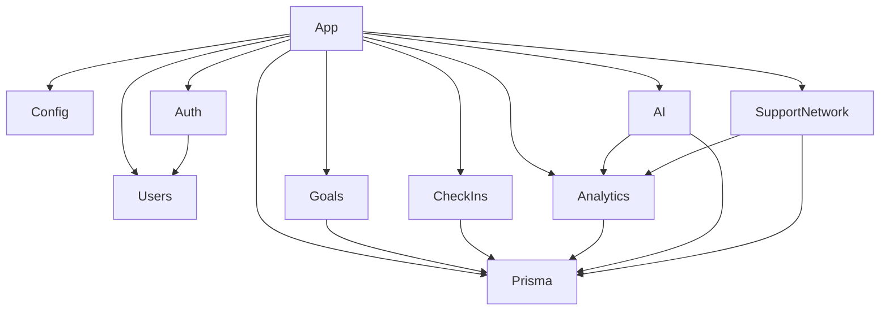

# ADR-003 — Arquitectura y diseño del backend de NeuroConnect v1.0.0

**Estado:** Aceptado para implementación  
**Fecha:** 14 de octubre de 2026  
**Proyecto:** NeuroConnect  
**Versión objetivo:** v1.0.0  
**Decisión:** Arquitectura, contratos, seguridad, integración y organización del backend  
**Responsable:** Carlos Benjamín Armenta Márquez  

---

# 1. Contexto

NeuroConnect requiere un backend capaz de soportar el flujo funcional completo definido para la versión v1.0.0:

```text
autenticación
      ↓
usuarios
      ↓
objetivos
      ↓
check-ins
      ↓
analítica
      ↓
IA generativa
      ↓
red de apoyo
      ↓
autorización delegada
```

El backend será responsable de:

- autenticación;
- autorización;
- validación;
- reglas de negocio;
- ownership;
- persistencia;
- transacciones;
- cálculo analítico;
- integración con IA;
- gestión de la red de apoyo;
- exposición de una API REST;
- documentación OpenAPI;
- logging;
- manejo de errores;
- pruebas;
- configuración;
- seguridad básica.

La versión v1.0.0 es un MVP académico.

Por esta razón el diseño deberá priorizar:

```text
simplicidad
+
modularidad
+
testabilidad
+
seguridad suficiente
+
trazabilidad
+
velocidad de implementación
```

sobre:

```text
arquitectura distribuida
+
escalabilidad prematura
+
abstracciones innecesarias
+
infraestructura compleja
```

---

# 2. Relación con otros documentos

Este ADR forma parte de la baseline arquitectónica de NeuroConnect.

La jerarquía será:

```text
Anteproyecto
    ↓
ADR-001 — Persistencia y modelo de datos
    ↓
ADR-002 — Dominio y reglas de negocio
    ↓
ADR-003 — Backend
    ↓
Planes de implementación
    ↓
Documentación técnica
    ↓
Código
```

---

# 3. Responsabilidad de ADR-001

ADR-001 continúa siendo la autoridad para:

- PostgreSQL;
- Prisma;
- entidades;
- relaciones;
- constraints;
- UUID;
- timestamps;
- cascadas;
- índices;
- ownership persistente;
- `Goal.progress` como snapshot;
- `CheckIn` como historial;
- `AISummary`;
- `SupportRelationship`.

ADR-003 no modifica esas decisiones.

---

# 4. Responsabilidad de ADR-002

ADR-002 continúa siendo la autoridad para:

- actores;
- reglas de Goal;
- lifecycle de Goal;
- semántica de CheckIn;
- analítica;
- IA;
- red de apoyo;
- permisos;
- privacidad;
- alcance clínico;
- comportamiento funcional de v1.0.0.

El backend deberá implementar esas reglas.

No podrá reinterpretarlas.

---

# 5. Decisión arquitectónica principal

El backend de NeuroConnect v1.0.0 será implementado como:

```text
NestJS
+
Modular Monolith
+
REST API
+
Prisma ORM
+
PostgreSQL 16
```

La aplicación será un único proceso desplegable.

```text
Flutter
    │
    │ HTTPS / JSON
    ▼
NestJS
    │
    ├── Auth
    ├── Users
    ├── Goals
    ├── CheckIns
    ├── Analytics
    ├── AI
    └── SupportNetwork
    │
    ▼
Prisma
    │
    ▼
PostgreSQL
```

---

# 6. Razón para utilizar monolito modular

El dominio actual no requiere distribución física.

Un monolito modular permite:

- desarrollo rápido;
- una única configuración;
- una única API;
- una única conexión a base de datos;
- transacciones sencillas;
- debugging directo;
- deployment simple;
- pruebas E2E sencillas;
- separación lógica entre dominios.

No existe justificación para introducir:

- microservicios;
- service mesh;
- API Gateway externo;
- brokers;
- eventos distribuidos;
- múltiples bases de datos.

---

# 7. Opciones rechazadas

## 7.1 Microservicios

```text
RECHAZADO
```

Motivos:

- equipo de una persona;
- periodo académico corto;
- dominio pequeño;
- mayor complejidad de despliegue;
- mayor complejidad de observabilidad;
- transacciones distribuidas innecesarias.

---

## 7.2 GraphQL

```text
RECHAZADO
```

La API requerida puede representarse de manera clara mediante REST.

GraphQL no aporta un beneficio suficiente para justificar:

- nueva capa de esquema;
- resolvers;
- autorización adicional;
- tooling adicional.

---

## 7.3 Backend serverless completo

```text
RECHAZADO
```

Se prioriza una aplicación NestJS controlada directamente.

---

## 7.4 Arquitectura Clean completa

```text
RECHAZADA PARA v1.0.0
```

No se implementarán múltiples capas ceremoniales como:

```text
entities
use-cases
ports
adapters
repositories
mappers
gateways
```

para cada operación si no existe una necesidad real.

Se utilizará separación modular y servicios de aplicación suficientemente claros.

---

# 8. Principio de arquitectura

La regla será:

> **Separar responsabilidades sin multiplicar capas innecesarias.**

Se utilizará:

```text
Controller
    ↓
Service
    ↓
Prisma / servicio dependiente
```

junto con:

```text
DTO
Guards
Policies
Pure domain functions
Provider adapters
```

cuando exista una razón funcional.

---

# 9. Módulos de v1.0.0

El backend estará compuesto por:

```text
AppModule

ConfigModule
PrismaModule

AuthModule
UsersModule
GoalsModule
CheckInsModule
AnalyticsModule
AiModule
SupportNetworkModule
```

Componentes transversales podrán residir en:

```text
common/
```

---

# 10. Dependencias generales



---

# 11. Regla de dependencias

Los módulos deberán evitar dependencias circulares.

En particular:

```text
Analytics
```

no depende de:

```text
AI
```

La dirección correcta es:

```text
Analytics
    ↓
AI
```

Nunca:

```text
AI
    ↓
Analytics
    ↓
AI
```

---

# 12. Controllers

Los Controllers deberán ser delgados.

Responsabilidades:

- recibir HTTP;
- leer parámetros;
- ejecutar validación DTO;
- obtener usuario autenticado;
- llamar al Service;
- retornar resultado.

No deberán contener:

- queries Prisma;
- cálculo analítico;
- reglas de autorización complejas;
- hashing;
- prompts;
- acceso directo al LLM.

---

# 13. Services

Los Services serán responsables de:

- reglas de aplicación;
- coordinación de persistencia;
- transacciones;
- ownership;
- autorización;
- invocación entre módulos;
- conversión a contratos de respuesta cuando aplique.

---

# 14. Acceso a Prisma

Prisma deberá ser utilizado mediante:

```text
PrismaModule
+
PrismaService
```

compartido por la aplicación.

No se crearán múltiples instancias independientes de `PrismaClient`.

---

# 15. Repository Pattern

No se implementará un Repository Pattern genérico durante v1.0.0.

Ejemplo que no se requiere:

```text
IGoalRepository
PrismaGoalRepository
GoalRepositoryFactory
```

Los servicios podrán utilizar `PrismaService` directamente.

Razones:

- Prisma ya actúa como abstracción tipada de persistencia;
- el sistema utiliza un único motor;
- no se planea intercambiar ORM;
- reducir código ceremonial.

---

# 16. Excepción al acceso directo a Prisma

Cuando exista una regla compleja reutilizable podrá encapsularse en:

- servicio específico;
- helper puro;
- policy;
- query service.

No se duplicarán queries críticas entre módulos.

---

# 17. Organización propuesta del backend

```text
backend/
│
├── prisma/
│   ├── schema.prisma
│   ├── migrations/
│   └── seed.ts
│
├── src/
│   ├── main.ts
│   ├── app.module.ts
│   │
│   ├── config/
│   │
│   ├── common/
│   │   ├── decorators/
│   │   ├── filters/
│   │   ├── guards/
│   │   ├── interceptors/
│   │   ├── types/
│   │   └── utils/
│   │
│   ├── prisma/
│   │
│   ├── auth/
│   ├── users/
│   ├── goals/
│   ├── check-ins/
│   ├── analytics/
│   ├── ai/
│   └── support-network/
│
├── test/
│   └── e2e/
│
├── .env.example
├── Dockerfile
├── package.json
└── README.md
```

---

# 18. Organización interna de módulo

La estructura estándar podrá ser:

```text
goals/
│
├── dto/
│   ├── create-goal.dto.ts
│   └── update-goal.dto.ts
│
├── goals.controller.ts
├── goals.service.ts
├── goals.module.ts
└── goals.service.spec.ts
```

No se crearán carpetas vacías solo para cumplir patrones arquitectónicos.

---

# 19. API

La API será:

```text
REST
+
JSON
+
HTTPS
```

La versión pública será:

```text
/api/v1
```

Ejemplo:

```text
POST /api/v1/auth/register
GET  /api/v1/goals
```

---

# 20. Swagger

La documentación OpenAPI se expondrá en:

```text
/api/docs
```

Swagger documentará:

- autenticación;
- parámetros;
- DTO;
- respuestas;
- códigos HTTP;
- Bearer authentication.

---

# 21. Versionado de API

La versión `v1` forma parte de la URL.

No se utilizará inicialmente:

- versionado por header;
- versionado por media type;
- versionado por query string.

---

# 22. Formato de fechas

Todas las fechas entregadas por la API serán ISO 8601.

Ejemplo:

```text
2026-10-14T20:35:00.000Z
```

Persistencia y backend operarán en UTC.

---

# 23. ValidationPipe global

NestJS deberá utilizar globalmente:

```typescript
new ValidationPipe({
  whitelist: true,
  forbidNonWhitelisted: true,
  transform: true,
});
```

Objetivos:

- ignorar ninguna propiedad inesperada;
- impedir mass assignment;
- convertir parámetros cuando proceda;
- centralizar validación DTO.

---

# 24. DTO como frontera de entrada

Toda entrada HTTP modificable deberá utilizar DTO explícito.

Ejemplo:

```text
CreateGoalDto
UpdateGoalDto
CreateCheckInDto
CreateSupportRelationshipDto
UpdateSupportPermissionsDto
```

No se utilizarán directamente tipos Prisma como contrato HTTP de entrada.

---

# 25. Entidades Prisma y API

Los tipos Prisma:

```text
NO
```

constituyen automáticamente el contrato público.

La API deberá impedir exponer accidentalmente:

- `passwordHash`;
- snapshots internos;
- IDs técnicos innecesarios;
- datos owner-only;
- datos restringidos por permisos.

---

# 26. Contratos de salida

Para respuestas sencillas podrá devolverse un objeto tipado directamente.

No se impondrá un envelope obligatorio como:

```json
{
  "success": true,
  "data": {}
}
```

en todas las respuestas.

El recurso será la respuesta principal.

---

# 27. Errores

Los errores tendrán estructura consistente.

Formato conceptual:

```json
{
  "statusCode": 400,
  "code": "VALIDATION_ERROR",
  "message": "Datos de entrada inválidos",
  "path": "/api/v1/goals",
  "timestamp": "2026-10-14T20:35:00.000Z"
}
```

`message` podrá ser string o lista cuando provenga de validación.

---

# 28. Global Exception Filter

Se implementará un filtro global para:

- normalizar errores;
- ocultar detalles internos;
- evitar stack traces en respuestas;
- registrar excepciones inesperadas.

Errores no reconocidos devolverán:

```text
500 Internal Server Error
```

sin exponer implementación.

---

# 29. Códigos HTTP

La API utilizará:

```text
200 OK
201 Created
204 No Content

400 Bad Request
401 Unauthorized
404 Not Found
409 Conflict
429 Too Many Requests

500 Internal Server Error
502 Bad Gateway / 503 Service Unavailable
```

cuando corresponda.

---

# 30. 404 para aislamiento

Cuando un recurso:

```text
existe
```

pero no pertenece al usuario y no existe autorización delegada válida:

```text
404 Not Found
```

será la respuesta preferida.

Esta regla aplica a:

- Goal;
- CheckIn;
- AISummary;
- recursos compartidos.

---

# 31. Autenticación

La autenticación de v1.0.0 utilizará:

```text
email
+
password
+
JWT Bearer
```

---

# 32. Hash de contraseñas

La implementación utilizará:

```text
Argon2id
```

mediante una biblioteca mantenida compatible con Node.js.

No se almacenarán passwords en texto plano.

---

# 33. Flujo de registro

```text
POST /auth/register
        ↓
normalizar email
        ↓
validar
        ↓
comprobar unique
        ↓
Argon2id
        ↓
crear User
        ↓
retornar usuario seguro
```

El registro no devolverá `passwordHash`.

---

# 34. Normalización de email

Antes de consultar o persistir:

```text
trim
+
lowercase
```

Ejemplo:

```text
 Carlos@Correo.com
```

se transforma en:

```text
carlos@correo.com
```

---

# 35. Login

Flujo:

```text
email
+
password
      ↓
buscar usuario
      ↓
verify Argon2
      ↓
firmar JWT
      ↓
accessToken
```

Un login inválido deberá devolver:

```text
401 Unauthorized
```

sin indicar si falló:

```text
email
```

o:

```text
password
```

---

# 36. Contenido del JWT

El payload deberá ser mínimo.

Ejemplo:

```json
{
  "sub": "<user-uuid>"
}
```

Podrá contener claims estándar:

```text
iat
exp
```

No incluirá:

- password;
- passwordHash;
- permisos de SupportRelationship;
- Goals;
- diagnósticos;
- información mutable.

---

# 37. Duración del JWT

Para el MVP académico se utilizará un access token de duración configurable.

Variable:

```text
JWT_EXPIRES_IN
```

Valor de desarrollo sugerido:

```text
8h
```

El tiempo exacto deberá configurarse por environment.

---

# 38. Refresh tokens

v1.0.0 no requiere refresh tokens.

Cuando el access token expire:

```text
usuario vuelve a autenticarse
```

La introducción de refresh tokens requerirá una decisión posterior.

---

# 39. Logout

Al no existir sesión persistente en servidor:

```text
logout
```

consiste en eliminar el token del cliente.

No existirá blacklist de JWT durante v1.0.0.

---

# 40. Guard de autenticación

Se utilizará:

```text
JwtAuthGuard
```

o equivalente basado en Passport JWT.

Por defecto, todos los endpoints de negocio serán privados.

Los endpoints públicos deberán marcarse explícitamente.

---

# 41. Endpoints públicos

Únicamente:

```text
POST /api/v1/auth/register
POST /api/v1/auth/login
```

además de endpoints operacionales explícitamente definidos como públicos.

---

# 42. Current User

Se implementará un decorator equivalente a:

```typescript
@CurrentUser()
```

para obtener el usuario autenticado.

Los Controllers no deberán parsear manualmente el JWT.

---

# 43. UsersModule

Responsabilidades:

- consultar perfil propio;
- modificar `displayName`;
- resolver internamente usuarios por email para SupportNetwork.

No expondrá directorio público de usuarios.

---

# 44. Endpoints Users

```text
GET   /api/v1/users/me
PATCH /api/v1/users/me
```

`PATCH /users/me` permitirá modificar:

```text
displayName
```

El email no será modificable en v1.0.0.

---

# 45. Auth /me

Por compatibilidad con el plan inicial existirá:

```text
GET /api/v1/auth/me
```

Su responsabilidad será retornar la identidad asociada al token.

`/users/me` será el endpoint canónico de perfil.

---

# 46. GoalsModule

Responsabilidades:

- creación;
- listado;
- detalle;
- actualización permitida;
- lifecycle;
- eliminación;
- ownership.

---

# 47. Endpoints Goal

```text
POST   /api/v1/goals
GET    /api/v1/goals
GET    /api/v1/goals/:goalId
PATCH  /api/v1/goals/:goalId
DELETE /api/v1/goals/:goalId
```

---

# 48. CreateGoalDto

Aceptará:

```text
title
description?
category?
targetDate?
```

No aceptará:

```text
ownerId
progress
status
```

El backend asignará:

```text
ownerId = currentUser.id
progress = 0
status = ACTIVE
```

---

# 49. UpdateGoalDto

Permitirá:

```text
title?
description?
category?
targetDate?
status?
```

No permitirá:

```text
progress
ownerId
id
createdAt
updatedAt
```

---

# 50. Lifecycle de Goal

`GoalsService` deberá validar las transiciones establecidas en ADR-002.

Las transiciones válidas son:

```text
ACTIVE → PAUSED
ACTIVE → COMPLETED

PAUSED → ACTIVE
PAUSED → COMPLETED

COMPLETED → ACTIVE
```

---

# 51. CheckInsModule

Responsabilidades:

- crear registro;
- consultar historial;
- consultar detalle;
- eliminar registro erróneo;
- mantener `Goal.progress`.

---

# 52. Endpoints CheckIn

```text
POST   /api/v1/goals/:goalId/check-ins
GET    /api/v1/goals/:goalId/check-ins
GET    /api/v1/goals/:goalId/check-ins/:checkInId
DELETE /api/v1/goals/:goalId/check-ins/:checkInId
```

No existirá:

```text
PATCH
```

---

# 53. CreateCheckInDto

Aceptará:

```text
progress
difficulty
completion
notes?
```

No aceptará:

```text
goalId
createdAt
ownerId
```

`goalId` proviene de la URL.

---

# 54. Validación antes de CheckIn

Antes de crear:

1. localizar Goal del usuario;
2. verificar ownership;
3. comprobar `status = ACTIVE`;
4. validar DTO;
5. iniciar transacción.

---

# 55. Transacción de creación CheckIn

La operación será atómica:

```text
BEGIN

INSERT CheckIn

UPDATE Goal
SET progress = CheckIn.progress

COMMIT
```

Prisma utilizará:

```text
$transaction
```

---

# 56. Eliminación de CheckIn

La eliminación deberá:

1. verificar ownership;
2. identificar si es el check-in más reciente;
3. eliminar;
4. recalcular `Goal.progress` si corresponde;
5. ejecutar operación transaccionalmente.

Si no quedan registros:

```text
Goal.progress = 0
```

---

# 57. Orden temporal

Para UI:

```text
CheckIns
ORDER BY createdAt DESC
```

Para Analytics:

```text
CheckIns
ORDER BY createdAt ASC
```

---

# 58. AnalyticsModule

El módulo de analítica será:

```text
read-only
+
determinístico
+
sin persistencia propia
```

No modificará:

- Goal;
- CheckIn;
- AISummary.

---

# 59. Responsabilidades Analytics

Calcular:

```text
totalGoals
activeGoals
pausedGoals
completedGoals
completionRate
averageProgress
checkInsLast28Days
checkInFrequencyPerWeek
inactiveGoals
```

y por objetivo:

```text
currentProgress
previousProgress
progressDelta
averageDifficulty
totalCheckIns
checkInsLast28Days
daysSinceLastCheckIn
trend
insufficientHistory
timeline
```

---

# 60. Endpoints Analytics

```text
GET /api/v1/analytics/overview

GET /api/v1/analytics/goals/:goalId
```

Ambos operarán sobre el usuario autenticado.

---

# 61. Implementación de reglas analíticas

Las fórmulas y reglas deberán implementarse preferentemente mediante funciones puras.

Ejemplo conceptual:

```typescript
calculateCompletionRate(...)
calculateProgressDelta(...)
classifyTrend(...)
calculateAverageDifficulty(...)
```

Esto facilita:

- unit tests;
- reproducibilidad;
- independencia de NestJS;
- lectura de reglas.

---

# 62. Datos insuficientes

Las funciones no deberán inventar valores.

Ejemplos:

```text
previousProgress = null
progressDelta = null
averageDifficulty = null
daysSinceLastCheckIn = null
```

cuando corresponda.

---

# 63. inactiveGoals

Solo Goals:

```text
ACTIVE
```

podrán contribuir a:

```text
inactiveGoals
```

Un objetivo:

```text
PAUSED
COMPLETED
```

nunca será contado como inactivo.

---

# 64. AiModule

Responsabilidades:

- construir contexto;
- construir prompt;
- invocar proveedor;
- persistir `AISummary`;
- gestionar estados;
- devolver historial;
- proteger datos.

---

# 65. Componentes AiModule

```text
AiController
AiSummaryService
SummaryContextBuilder
PromptBuilder
AiProvider
MockAiProvider
<ProviderReal>AiProvider
```

---

# 66. AiProvider

Se utilizará una interfaz interna:

```typescript
interface AiProvider {
  generateSummary(
    context: SummaryContext
  ): Promise<GeneratedSummary>;
}
```

La lógica de negocio no dependerá directamente del SDK de un proveedor.

---

# 67. Provider Adapter

Cada proveedor externo deberá estar encapsulado.

Ejemplo:

```text
AiProvider
    ↑
GeminiAiProvider
```

o:

```text
AiProvider
    ↑
OpenAiProvider
```

La selección concreta se realizará mediante configuración.

---

# 68. Configuración del proveedor

Variables conceptuales:

```text
AI_PROVIDER
AI_API_KEY
AI_MODEL
AI_TIMEOUT_MS
```

La aplicación deberá fallar al iniciar si:

```text
AI_PROVIDER = proveedor real
```

y faltan sus variables críticas.

---

# 69. MockAiProvider

`MockAiProvider` se utilizará:

- desarrollo;
- pruebas;
- Avance 1.

No se podrá considerar MVP-2 completo con:

```text
AI_PROVIDER=mock
```

---

# 70. SummaryContextBuilder

Será la única pieza responsable de convertir resultados internos en información enviada al LLM.

Entrada:

```text
Analytics
```

Salida:

```text
SummaryContext
```

---

# 71. Contexto IA permitido

Podrá contener:

```text
periodDays

goal.title
goal.status
goal.progress
goal.trend
goal.averageDifficulty
goal.daysSinceLastCheckIn

completionRate
checkInFrequencyPerWeek
```

---

# 72. Contexto IA prohibido

No podrá incluir:

```text
password
passwordHash
JWT
email
notes
SupportRelationship
permissions
internal IDs innecesarios
información de otro owner
```

---

# 73. PromptBuilder

Será responsable de:

- system prompt;
- restricciones;
- incorporación del JSON;
- formato de respuesta solicitado.

No deberá consultar base de datos.

---

# 74. System prompt mínimo

Deberá contener explícitamente reglas equivalentes a:

```text
Resume exclusivamente los datos proporcionados.

No inventes información.

No diagnostiques.

No infieras emociones.

No proporciones recomendaciones médicas.

No presentes resultados como evaluación profesional.

Mantén un lenguaje neutral y no culpabilizante.
```

---

# 75. Generación IA

El propietario solicitará generación mediante:

```text
POST /api/v1/ai/summaries
```

No se ejecutará generación automática.

---

# 76. Flujo de generación

```text
request
   ↓
owner autenticado
   ↓
Analytics
   ↓
SummaryContextBuilder
   ↓
PromptBuilder
   ↓
crear AISummary PENDING
   ↓
AiProvider
   ↓
resultado
   ↓
AISummary COMPLETED
```

En error:

```text
AISummary FAILED
```

---

# 77. Regla de transacción para IA

Nunca se mantendrá una transacción PostgreSQL abierta mientras se espera una respuesta HTTP del LLM.

Flujo correcto:

```text
INSERT AISummary(PENDING)
COMMIT

        ↓

HTTP LLM

        ↓

UPDATE AISummary(COMPLETED | FAILED)
```

Esto evita:

- locks prolongados;
- transacciones abiertas por red;
- desperdicio de conexiones.

---

# 78. Timeout IA

Toda llamada externa deberá tener timeout.

Configuración:

```text
AI_TIMEOUT_MS
```

No se permitirá una solicitud externa sin límite de tiempo.

---

# 79. Retries IA

v1.0.0 no realizará retries automáticos ilimitados.

Ante fallo:

```text
status = FAILED
```

y el usuario podrá solicitar una nueva generación.

Esto evita:

- costos duplicados;
- múltiples resultados inesperados;
- comportamiento difícil de demostrar.

---

# 80. Historial IA

Endpoints:

```text
POST /api/v1/ai/summaries

GET /api/v1/ai/summaries

GET /api/v1/ai/summaries/:summaryId
```

Solo el propietario puede generar.

Acceso delegado de lectura dependerá de `VIEW_SUMMARIES`.

---

# 81. AI Preview

Durante desarrollo podrá existir:

```text
GET /api/v1/ai/summary/context
```

para inspeccionar:

- contexto;
- prompt;
- providerConfigured.

Este endpoint:

```text
NO
```

es parte funcional necesaria de la release final.

Podrá deshabilitarse mediante environment.

---

# 82. SupportNetworkModule

Responsabilidades:

- crear relación;
- listar relaciones;
- actualizar permisos;
- actualizar expiración;
- revocar;
- reactivar;
- listar personas a las que apoyo;
- autorizar vistas delegadas.

---

# 83. Asociación por email

El cliente enviará:

```text
supporterEmail
```

El backend:

1. normaliza;
2. busca usuario;
3. evita self relationship;
4. verifica unicidad;
5. crea relación.

Nunca devolverá un directorio global.

---

# 84. Endpoints de propietario

```text
POST /api/v1/support-network/relationships

GET  /api/v1/support-network/relationships

GET  /api/v1/support-network/relationships/:relationshipId

PATCH /api/v1/support-network/relationships/:relationshipId

POST /api/v1/support-network/relationships/:relationshipId/revoke

POST /api/v1/support-network/relationships/:relationshipId/reactivate
```

---

# 85. Endpoints de supporter

```text
GET /api/v1/support-network/supporting
```

Retorna las relaciones donde:

```text
supporterId = currentUser.id
```

y que puedan ser presentadas al usuario.

---

# 86. Lectura delegada

La lectura de datos de otra persona se expondrá mediante rutas dedicadas.

```text
GET /api/v1/support-network/owners/:ownerId/goals

GET /api/v1/support-network/owners/:ownerId/goals/:goalId

GET /api/v1/support-network/owners/:ownerId/goals/:goalId/progress

GET /api/v1/support-network/owners/:ownerId/summaries
```

Esto evita mezclar accidentalmente:

```text
ownership
```

con:

```text
delegated access
```

en los endpoints normales del propietario.

---

# 87. Motivo para rutas delegadas separadas

Los endpoints:

```text
/goals
/check-ins
/analytics
/ai
```

están diseñados inicialmente desde la perspectiva del owner.

La lectura delegada utiliza proyecciones distintas:

- oculta notes;
- oculta información técnica;
- depende de permisos;
- es read-only.

Por ello se mantendrá una frontera HTTP explícita.

---

# 88. SupportAccessService

El módulo de red de apoyo tendrá un servicio central equivalente a:

```text
SupportAccessService
```

Responsabilidades:

```text
assertActiveRelationship()
assertCanViewGoals()
assertCanViewProgress()
assertCanViewSummaries()
```

No se duplicará esta lógica en múltiples Controllers.

---

# 89. Regla de autorización delegada

```text
owner?
  ↓ sí
owner flow
  ↓ no
active relationship?
  ↓ no
404
  ↓ sí
required permission?
  ↓ no
404
  ↓ sí
read projection
```

---

# 90. Permisos

Los permisos de v1.0.0 son:

```text
VIEW_GOALS
VIEW_PROGRESS
VIEW_SUMMARIES
```

persistidos mediante:

```text
canViewGoals
canViewProgress
canViewSummaries
```

---

# 91. Validación de permisos

El backend deberá rechazar:

```text
canViewGoals = false
canViewProgress = true
```

y:

```text
canViewGoals = false
canViewSummaries = true
```

---

# 92. Relación sin permisos

Deberá rechazarse:

```text
false
false
false
```

con:

```text
400 Bad Request
```

---

# 93. Expiración

Cada request delegado deberá validar en tiempo real:

```text
revokedAt == null

AND

(
  expiresAt == null
  OR expiresAt > now
)
```

No se requiere job para "desactivar" relaciones expiradas.

---

# 94. Revocación

La revocación deberá tener efecto en:

```text
la siguiente request
```

No dependerá de cache.

---

# 95. Caché

v1.0.0 no utilizará:

```text
Redis
in-memory permission cache
distributed cache
```

para autorización.

Las decisiones de permisos se consultarán desde PostgreSQL.

---

# 96. Escritura delegada

Ningún endpoint de SupportNetwork permitirá al supporter:

- modificar Goal;
- crear CheckIn;
- eliminar CheckIn;
- generar resumen;
- modificar relación.

---

# 97. Proyecciones de lectura

El backend deberá construir respuestas específicas para supporter.

Ejemplo `VIEW_PROGRESS` puede incluir:

```text
date
progress
difficulty
completion
trend
```

pero nunca:

```text
notes
```

---

# 98. Ownership

Todo acceso propietario deberá filtrar por:

```text
currentUser.id
```

No se considera seguro:

```text
findUnique({ id })
```

seguido únicamente de validación en frontend.

---

# 99. Ownership en query

Siempre que sea posible:

```text
WHERE
id = resourceId
AND
ownerId = currentUserId
```

se utilizará directamente en la consulta.

---

# 100. Regla para CheckIn ownership

Un CheckIn hereda ownership mediante Goal.

La consulta deberá verificar:

```text
CheckIn.goal.ownerId = currentUserId
```

o resolver primero un Goal propiedad del usuario.

---

# 101. Transacciones

Se utilizarán cuando varias escrituras formen una única operación de negocio.

Casos obligatorios:

```text
Create CheckIn + Update Goal.progress

Delete CheckIn + Recalculate Goal.progress
```

---

# 102. Operaciones que no requieren transacción compleja

Ejemplos:

```text
create Goal
update profile
update SupportRelationship
```

cuando consistan en una escritura atómica.

---

# 103. Transacciones y servicios externos

Nunca incluir:

```text
HTTP a LLM
```

dentro de:

```text
Prisma transaction
```

---

# 104. Concurrencia

La v1.0.0 está diseñada para bajo volumen y un usuario interactivo.

No se introducirán:

- distributed locks;
- optimistic version columns;
- message queues;
- serialización global.

Las operaciones multiescritura continuarán siendo atómicas mediante PostgreSQL.

Problemas de alta concurrencia podrán evaluarse posteriormente.

---

# 105. Idempotencia

v1.0.0 no implementará infraestructura general de `Idempotency-Key`.

Las acciones de UI deberán evitar doble submit.

La generación repetida de IA se considera una generación nueva.

---

# 106. Configuración

Toda configuración variable estará en environment.

No se hardcodearán:

- secretos;
- URLs productivas;
- credenciales;
- JWT secret;
- API keys;
- CORS origins.

---

# 107. Variables mínimas

```env
NODE_ENV=

PORT=

DATABASE_URL=

JWT_SECRET=
JWT_EXPIRES_IN=

CORS_ORIGINS=

AI_PROVIDER=
AI_API_KEY=
AI_MODEL=
AI_TIMEOUT_MS=

SWAGGER_ENABLED=
AI_PREVIEW_ENABLED=
```

---

# 108. Validación de configuración

La aplicación deberá validar configuración al iniciar.

Si falta:

```text
DATABASE_URL
JWT_SECRET
```

la aplicación deberá:

```text
fail fast
```

y no iniciar parcialmente.

---

# 109. AI config condicional

Si:

```text
AI_PROVIDER=mock
```

`AI_API_KEY` podrá omitirse.

Si:

```text
AI_PROVIDER=<real>
```

deberán exigirse las credenciales correspondientes.

---

# 110. CORS

CORS deberá ser configurable mediante:

```text
CORS_ORIGINS
```

No se utilizará:

```text
origin: *
```

en deployment final.

---

# 111. Helmet

El backend utilizará:

```text
helmet
```

como hardening HTTP básico.

---

# 112. Rate limiting

Se utilizará throttling básico mediante NestJS Throttler o equivalente.

La protección se aplicará particularmente a:

```text
/auth/register
/auth/login
/ai/summaries
```

La configuración exacta podrá ajustarse mediante variables/configuración.

No se busca construir un sistema anti-DDoS.

---

# 113. Password logging

Bajo ninguna circunstancia deberán aparecer en logs:

```text
password
passwordHash
```

---

# 114. Token logging

No se registrará:

```text
Authorization
JWT completo
```

---

# 115. Logging

Se utilizará inicialmente el mecanismo de logging de NestJS.

Deberá registrar como mínimo:

- inicio;
- errores;
- fallos de infraestructura;
- fallos de proveedor IA;
- contexto técnico suficiente.

No se requiere plataforma externa de logging.

---

# 116. Información sensible en logs

No registrar:

```text
CheckIn.notes
AI prompt completo
AI inputSnapshot completo
password
JWT
email cuando no sea necesario
```

---

# 117. Request ID

Cada request podrá recibir un identificador de correlación.

Header:

```text
X-Request-Id
```

Si el cliente no lo proporciona:

```text
backend genera UUID
```

El identificador podrá incluirse en logs y respuestas de error.

Esta funcionalidad se considera recomendable para v1.0.0 pero no deberá retrasar el Avance 1 si todavía no está implementada.

---

# 118. Health endpoint

Existirá:

```text
GET /api/v1/health
```

Respuesta mínima:

```json
{
  "status": "ok"
}
```

Podrá comprobar conectividad con PostgreSQL en una variante de readiness.

---

# 119. Health y autenticación

`/health` será público.

No devolverá:

- variables de entorno;
- credenciales;
- versión de base de datos;
- detalles internos sensibles.

---

# 120. Swagger y entornos

Swagger podrá habilitarse mediante:

```text
SWAGGER_ENABLED=true
```

Para la entrega académica podrá permanecer habilitado.

---

# 121. AI Preview y entornos

El endpoint:

```text
/ai/summary/context
```

deberá depender de:

```text
AI_PREVIEW_ENABLED
```

Deberá poder deshabilitarse en el release final.

---

# 122. Prisma migrations

La evolución de DB se realizará únicamente mediante:

```text
Prisma Migrate
```

Las migraciones estarán versionadas.

El backend no deberá ejecutar alteraciones improvisadas al iniciar.

---

# 123. Startup en desarrollo

Flujo esperado:

```text
PostgreSQL disponible
      ↓
migrations aplicadas
      ↓
NestJS
```

---

# 124. Producción

En despliegue:

```text
prisma migrate deploy
```

deberá ejecutarse antes de iniciar la nueva versión.

No se utilizará:

```text
prisma migrate dev
```

en producción.

---

# 125. Seed

El seed:

```text
NO
```

se ejecutará automáticamente en producción.

Será una acción explícita para:

- desarrollo;
- testing;
- demostración.

---

# 126. Docker

El backend tendrá:

```text
Dockerfile
```

y PostgreSQL podrá levantarse mediante:

```text
docker-compose.yml
```

durante desarrollo.

---

# 127. Imagen backend

La imagen deberá:

- instalar dependencias reproducibles;
- generar Prisma Client;
- compilar NestJS;
- ejecutar artefacto compilado.

Se preferirá build multi-stage si no incrementa excesivamente la complejidad.

---

# 128. Node.js

El proyecto utilizará una versión LTS de Node.js compatible con la versión de NestJS seleccionada.

La versión exacta deberá quedar fijada mediante al menos uno de:

```text
.nvmrc
package.json engines
Dockerfile
```

No se permitirá depender implícitamente de "cualquier Node".

---

# 129. Lockfile

El repositorio deberá versionar:

```text
package-lock.json
```

o el lockfile del package manager elegido.

No se mezclarán package managers.

---

# 130. Package manager

v1.0.0 utilizará:

```text
npm
```

para backend.

---

# 131. Calidad TypeScript

El backend utilizará:

```text
TypeScript strict
```

siempre que sea compatible con NestJS y Prisma utilizados.

No deberá recurrirse a:

```text
any
```

como solución general.

---

# 132. Lint y format

Se mantendrán:

```text
ESLint
Prettier
```

con configuración del proyecto.

---

# 133. Build obligatorio

Antes de considerar cualquier incremento terminado:

```bash
npm run build
```

deberá finalizar correctamente.

---

# 134. Unit tests

Se utilizará:

```text
Jest
```

para pruebas unitarias.

Se priorizarán pruebas sobre:

- reglas de dominio;
- analítica;
- permisos;
- builders IA;
- servicios con lógica relevante.

---

# 135. Qué no necesita unit test exhaustivo

No se requiere cubrir trivialmente:

- getters;
- módulos sin lógica;
- DTO simples;
- decoradores sin comportamiento relevante.

Se priorizará riesgo funcional.

---

# 136. Analytics unit tests

Deberán cubrir como mínimo:

```text
0 goals

sin CheckIns

1 CheckIn

PROGRESSING

STABLE

DECLINING

INACTIVE

PAUSED no inactive

COMPLETED no inactive

completionRate

averageProgress

frequency 28 días
```

---

# 137. Goal unit/integration tests

Cubrir:

```text
default ACTIVE
default progress 0

progress no actualizable por PATCH

transiciones válidas

CheckIn solo ACTIVE

progress 100 no completa automáticamente
```

---

# 138. Support authorization tests

Cubrir:

```text
sin relación

relación activa

relación expirada

relación revocada

VIEW_GOALS

VIEW_PROGRESS dependency

VIEW_SUMMARIES dependency

all false

supporter write denied
```

---

# 139. AI tests

Cubrir:

```text
context minimization

notes excluded

email excluded

password excluded

prompt restrictions

MockAiProvider

provider failure

PENDING → COMPLETED

PENDING → FAILED

snapshot consistency
```

---

# 140. E2E

Las pruebas E2E deberán ejecutar la aplicación NestJS real contra PostgreSQL.

No se utilizará SQLite como sustituto de PostgreSQL.

Razón:

- PostgreSQL es parte de la arquitectura;
- existen constraints específicos;
- comportamiento relacional real debe validarse.

---

# 141. Base de datos de testing

Se utilizará una base separada.

Ejemplo:

```text
neuroconnect_test
```

No se ejecutarán E2E destructivos contra la DB de desarrollo.

---

# 142. E2E MVP-0/MVP-1

Flujo:

```text
register
login
create Goal
create CheckIn
create second CheckIn
get history
get analytics
```

---

# 143. E2E aislamiento

```text
User A crea Goal
User B intenta consultarlo
→ 404
```

---

# 144. E2E v1.0.0

El escenario completo deberá probar:

```text
User A register
User B register

A creates Goal
A creates CheckIns

A gets Analytics

A generates AI Summary

A creates SupportRelationship with B

B reads permitted Goals
B reads permitted Progress

B cannot read Summary

A enables VIEW_SUMMARIES

B reads Summary

B cannot write Goal

A revokes relationship

B receives no further access
```

---

# 145. Coverage

No se establecerá como objetivo académico un porcentaje artificial como:

```text
100 %
```

La aceptación se basará en:

- reglas críticas cubiertas;
- E2E completos;
- errores relevantes;
- Definition of Done.

---

# 146. API contracts

Swagger deberá considerarse parte de la documentación técnica.

Cambios incompatibles en un contrato v1 deberán:

- documentarse;
- actualizar frontend;
- actualizar tests;
- actualizar OpenAPI.

---

# 147. Naming

Se utilizará inglés para:

- código;
- clases;
- propiedades;
- enums;
- endpoints.

Ejemplos:

```text
Goal
CheckIn
SupportRelationship
completionRate
```

La interfaz de usuario podrá utilizar español.

---

# 148. Naming de módulos

```text
AuthModule
UsersModule
GoalsModule
CheckInsModule
AnalyticsModule
AiModule
SupportNetworkModule
```

---

# 149. Naming de endpoints

Los recursos serán sustantivos plurales.

Correcto:

```text
/goals
/check-ins
/summaries
/relationships
```

Evitar:

```text
/createGoal
/getAllGoals
/deleteCheckIn
```

---

# 150. Side effects

Los métodos que realizan escrituras deberán ser explícitos.

Ejemplo:

```text
createGoal
createCheckIn
deleteCheckIn
generateSummary
revokeRelationship
```

El cálculo analítico deberá permanecer libre de efectos secundarios.

---

# 151. Integración entre módulos

Un módulo no deberá invocar Controllers de otro módulo.

Debe utilizar:

```text
Service
```

o contratos internos apropiados.

---

# 152. Exposición de Services

Solo se exportarán Services que necesiten ser utilizados por otros módulos.

No exportar indiscriminadamente todos los providers.

---

# 153. Circular dependencies

No se utilizará:

```typescript
forwardRef()
```

como solución por defecto.

Si aparece una dependencia circular:

1. revisar responsabilidades;
2. extraer servicio común;
3. redefinir dirección;
4. utilizar `forwardRef` únicamente si existe una justificación real.

---

# 154. Analytics y AI

La relación correcta:

```text
AiModule
    ↓
AnalyticsModule
```

El AnalyticsModule no conoce AiModule.

---

# 155. SupportNetwork y Analytics

Las vistas delegadas podrán utilizar Analytics para obtener resultados.

Analytics deberá recibir explícitamente:

```text
ownerId autorizado
```

desde una capa que ya verificó permiso.

Analytics no deberá decidir por sí mismo un permiso de SupportRelationship.

---

# 156. Separación autenticación/autorización

```text
Authentication
```

responde:

> ¿Quién eres?

```text
Authorization
```

responde:

> ¿Puedes realizar esta operación?

No se mezclarán ambos conceptos.

---

# 157. Autorización owner

Regla:

```text
resource.ownerId == currentUser.id
```

---

# 158. Autorización supporter

Regla:

```text
activeRelationship
+
requiredPermission
```

---

# 159. Políticas de SupportNetwork

La lógica de permisos deberá estar centralizada.

No se permiten bloques repetidos del tipo:

```typescript
if (
  relationship &&
  !relationship.revokedAt &&
  ...
)
```

distribuidos por Controllers.

---

# 160. No acceso directo del LLM

El proveedor de IA:

```text
NO
```

recibirá:

- DB connection;
- PrismaService;
- repositories;
- tools de lectura;
- capacidad autónoma de consultar datos.

Solo recibe:

```text
SummaryContext
```

---

# 161. No function calling

v1.0.0 no utilizará:

- tool calling;
- function calling;
- agents;
- MCP;
- acciones automáticas del LLM.

---

# 162. No streaming obligatorio

La generación IA podrá realizarse mediante una respuesta HTTP normal.

No se requiere:

```text
SSE
WebSocket
streaming tokens
```

en v1.0.0.

---

# 163. Background jobs

No se utilizarán:

```text
BullMQ
RabbitMQ
Kafka
cron
worker separado
```

para generación IA.

La solicitud será síncrona a nivel HTTP dentro del timeout configurado.

---

# 164. Tamaño de payload

La aplicación aceptará únicamente JSON de tamaño razonable.

No existe upload de archivos durante v1.0.0.

Por tanto no se requiere:

- multipart;
- object storage;
- antivirus de archivos.

---

# 165. Paginación

La v1.0.0 podrá incorporar paginación sencilla en:

```text
CheckIns
AISummaries
```

si el volumen lo justifica.

Formato sugerido:

```text
?page=1
&limit=20
```

Límite máximo:

```text
100
```

No se requiere cursor pagination.

---

# 166. Listado Goals

Por defecto:

```text
updatedAt DESC
```

Podrá filtrar por:

```text
status
```

si se requiere para UI.

No se construirá un motor genérico de filtros.

---

# 167. Listado CheckIns

Por defecto:

```text
createdAt DESC
```

---

# 168. Listado AISummaries

Por defecto:

```text
createdAt DESC
```

---

# 169. Sanitización de datos de supporter

Las respuestas delegadas deberán utilizar DTO/projection explícito.

Nunca devolver el objeto Prisma completo y eliminar campos después de manera informal.

---

# 170. Seguridad de notes

`CheckIn.notes`:

```text
owner-only
```

No deberá aparecer en:

- endpoints delegados;
- contexto IA;
- logs.

---

# 171. Seguridad AISummary

El owner puede obtener:

```text
content
periodStart
periodEnd
status
createdAt
```

Los campos técnicos:

```text
inputSnapshot
provider
model
```

podrán limitarse a endpoints internos o respuesta owner cuando exista una razón de debugging.

El supporter nunca necesita `inputSnapshot`.

---

# 172. Datos sensibles

Aunque NeuroConnect v1.0.0 evita recopilar información clínica, los datos de seguimiento deberán tratarse como información privada.

La política del backend será:

```text
private by default
```

---

# 173. Acceso a DB

La base de datos no será accesible directamente desde Flutter.

Flujo obligatorio:

```text
Flutter
   ↓
NestJS
   ↓
Prisma
   ↓
PostgreSQL
```

---

# 174. Credenciales DB

`DATABASE_URL` solo existe en backend/infraestructura.

Nunca deberá:

- incluirse en Flutter;
- exponerse mediante endpoint;
- versionarse.

---

# 175. Deployment

El backend se desplegará como un único servicio.

Dependencias externas:

```text
PostgreSQL
LLM Provider
```

No requiere servicios adicionales obligatorios.

---

# 176. HTTPS

La API desplegada deberá consumirse sobre:

```text
HTTPS
```

La terminación TLS podrá realizarse en:

- reverse proxy;
- plataforma de hosting;
- servicio administrado.

NestJS no necesita administrar certificados directamente.

---

# 177. Reverse proxy

Nginx podrá utilizarse si la infraestructura elegida lo requiere.

No forma parte obligatoria de la lógica del backend.

---

# 178. Puerto

NestJS escuchará en:

```text
PORT
```

definido por environment.

No se hardcodeará el puerto productivo.

---

# 179. Graceful shutdown

La aplicación deberá habilitar hooks de shutdown de NestJS cuando corresponda para cerrar correctamente recursos.

---

# 180. Prisma lifecycle

`PrismaService` deberá gestionar:

- conexión;
- desconexión;
- lifecycle de aplicación.

---

# 181. Health y DB

Podrá existir:

```text
GET /api/v1/health/ready
```

que compruebe base de datos.

No deberá incluir credenciales ni detalles internos.

---

# 182. Respuestas del health

Ejemplo:

```json
{
  "status": "ok",
  "database": "reachable"
}
```

---

# 183. Observabilidad fuera de alcance

No se requiere:

- Prometheus;
- Grafana;
- OpenTelemetry;
- ELK;
- Datadog;
- APM.

Podrán añadirse únicamente si no afectan el alcance.

---

# 184. CI/CD

Un pipeline complejo no forma parte del core de v1.0.0.

Como mínimo podrá existir validación automatizada futura de:

```text
lint
test
build
```

pero no es requisito arquitectónico del backend.

---

# 185. Dependencias prohibidas sin ADR/revisión

No agregar por iniciativa propia:

```text
Redis

RabbitMQ

Kafka

BullMQ

GraphQL

TypeORM

Mongoose

MongoDB

Firebase Admin como persistencia

WebSockets

gRPC

microservices

vector database
```

---

# 186. Dependencias aceptables

Podrán utilizarse librerías pequeñas necesarias para:

- Argon2;
- JWT;
- Passport;
- validation;
- Swagger;
- Helmet;
- throttling;
- SDK del LLM seleccionado.

Cada dependencia debe tener una necesidad concreta.

---

# 187. Semantic Versioning

La API forma parte de:

```text
NeuroConnect v1.0.0
```

Antes del release podrán utilizarse versiones:

```text
0.x
```

La API HTTP continuará identificándose como:

```text
/api/v1
```

---

# 188. Definition of Done backend v1.0.0

El backend se considerará completo cuando:

```text
Auth
Users
Goals
CheckIns
Analytics
AI
SupportNetwork
```

estén implementados y sus flujos críticos probados.

---

# 189. DoD Auth

Debe existir:

```text
register
login
auth/me
users/me
```

y:

- hash Argon2id;
- JWT;
- guards;
- DTO;
- aislamiento.

---

# 190. DoD Goals

Debe existir:

- CRUD;
- lifecycle válido;
- progress protegido;
- ownership;
- delete cascade según ADR-001.

---

# 191. DoD CheckIns

Debe existir:

- create;
- history;
- detail;
- delete;
- atomic snapshot;
- rechazo para PAUSED;
- rechazo para COMPLETED.

---

# 192. DoD Analytics

Debe existir:

- overview;
- goal analytics;
- reglas probadas;
- datos insuficientes tratados correctamente;
- ninguna persistencia analítica.

---

# 193. DoD AI

Debe existir:

- proveedor real;
- interface;
- builder;
- prompt;
- timeout;
- PENDING;
- COMPLETED;
- FAILED;
- snapshot;
- exclusión de notes;
- generación bajo demanda.

---

# 194. DoD SupportNetwork

Debe existir:

- create;
- list;
- update;
- revoke;
- reactivate;
- expiration;
- dependencies de permisos;
- lectura delegada;
- bloqueo de escrituras.

---

# 195. DoD transversal

Debe pasar:

```bash
npm run lint
npm test
npm run test:e2e
npm run build
```

Además:

- migrations desde cero;
- seed;
- Swagger;
- health;
- Docker build;
- aislamiento manual/E2E.

---

# 196. Flujo E2E final de backend

```text
User A
  ↓
register
  ↓
login
  ↓
create Goal
  ↓
create CheckIns
  ↓
Analytics
  ↓
generate AISummary

User B
  ↓
register
  ↓
login

User A
  ↓
creates SupportRelationship B
  ↓
VIEW_GOALS
VIEW_PROGRESS

User B
  ↓
reads Goals
  ↓
reads Progress
  ↓
cannot read Summary
  ↓
cannot modify Goal

User A
  ↓
enables VIEW_SUMMARIES

User B
  ↓
reads Summary

User A
  ↓
revokes access

User B
  ↓
404 / no access
```

---

# 197. Reglas inmutables para Codex

Codex no podrá reinterpretar:

```text
NestJS modular monolith

REST /api/v1

Prisma como acceso DB

PostgreSQL como DB

controllers delgados

services con reglas

no repository ceremonial

JWT Bearer

Argon2id

email normalizado

Goal.progress no modificable por API

CheckIn + Goal.progress transaccional

Analytics read-only

Analytics no persistido

AI depende de Analytics

LLM sin acceso directo a DB

notes excluidas de IA

AI bajo demanda

no DB transaction durante llamada LLM

Supporter read-only

rutas delegadas separadas

permisos centralizados

recursos ajenos → 404

DTO validation global

Swagger

config por environment

secrets nunca versionados
```

---

# 198. Decisiones diferidas

Este ADR no decide todavía:

- proveedor específico final del LLM;
- hosting final;
- dominio público;
- refresh token;
- rotación automática de secrets;
- observabilidad externa;
- CI/CD definitivo;
- soft delete;
- eliminación de cuenta;
- exportación de datos;
- auditoría avanzada;
- cache;
- procesamiento asíncrono;
- escalamiento horizontal.

Si alguna de estas capacidades se vuelve necesaria deberá evaluarse separadamente.

---

# 199. Riesgos

## Riesgo 1 — Backend sobrediseñado

Mitigación:

```text
modular monolith
+
Prisma directo desde Services
+
sin capas ceremoniales
```

---

## Riesgo 2 — Reglas duplicadas

Mitigación:

centralizar:

- Analytics;
- SupportAccess;
- Goal lifecycle;
- SummaryContextBuilder.

---

## Riesgo 3 — Acceso accidental a recursos ajenos

Mitigación:

```text
ownership en query
+
SupportAccessService
+
E2E con múltiples usuarios
```

---

## Riesgo 4 — LLM accede a datos innecesarios

Mitigación:

```text
SummaryContextBuilder
```

como frontera única.

---

## Riesgo 5 — LLM bloquea transacción

Mitigación:

```text
PENDING commit
↓
HTTP externo
↓
COMPLETED / FAILED
```

---

## Riesgo 6 — Exposición por DTO automático

Mitigación:

- contratos explícitos;
- projections;
- nunca devolver modelos Prisma sensibles directamente.

---

## Riesgo 7 — Complejidad de permisos

Mitigación:

solo:

```text
VIEW_GOALS
VIEW_PROGRESS
VIEW_SUMMARIES
```

durante v1.0.0.

---

# 200. Consecuencias positivas

La arquitectura permite:

- construir rápido;
- mantener reglas claras;
- probar módulos aisladamente;
- utilizar una sola base;
- desplegar una sola aplicación;
- mantener IA reemplazable;
- mantener autorización centralizada;
- reutilizar Analytics;
- reducir superficie operativa.

---

# 201. Consecuencias negativas

La decisión implica:

- acoplamiento del backend a NestJS;
- acoplamiento de persistencia a Prisma;
- autenticación JWT sin revocación inmediata de token;
- llamadas IA síncronas;
- ausencia de cache;
- backend como único punto de escalamiento.

Estas limitaciones son aceptables para v1.0.0 académica.

---

# 202. Estado

```text
ACEPTADA PARA IMPLEMENTACIÓN
```

---

# 203. Política de modificación

Cambios sobre:

```text
arquitectura backend
framework
API style
authentication
authorization
module boundaries
persistence access
AI integration pattern
transaction boundaries
support authorization
```

requieren revisión de este ADR o creación de un ADR posterior.

---

# 204. Resumen de arquitectura

```text
Flutter
   │
   │ HTTPS + JSON
   ▼
┌───────────────────────────────────────────┐
│                 NestJS                    │
│                                           │
│  Auth                                     │
│  Users                                    │
│  Goals                                    │
│  CheckIns                                 │
│  Analytics                                │
│  AI                                       │
│  SupportNetwork                           │
│                                           │
│  Guards + DTO + Policies + Error Filter   │
└─────────────┬──────────────────┬──────────┘
              │                  │
              │ Prisma           │ HTTPS
              ▼                  ▼
       ┌────────────┐      ┌──────────────┐
       │ PostgreSQL │      │ LLM Provider │
       └────────────┘      └──────────────┘
```

---

# 205. Resumen de dependencias

```text
Auth
 ↓
Users

Goals
 ↓
Prisma

CheckIns
 ↓
Goals + Prisma transaction

Analytics
 ↓
Goal + CheckIn data

AI
 ↓
Analytics
 ↓
SummaryContext
 ↓
AiProvider
 ↓
AISummary

SupportNetwork
 ↓
SupportRelationship
 ↓
SupportAccess
 ↓
read-only delegated projections
```

---

# 206. Filosofía del backend v1.0.0

> **El backend es la autoridad de reglas y acceso: el cliente solicita, NestJS valida y autoriza, PostgreSQL conserva los hechos, Analytics calcula resultados determinísticos y la IA únicamente transforma esos resultados en una explicación controlada.**
