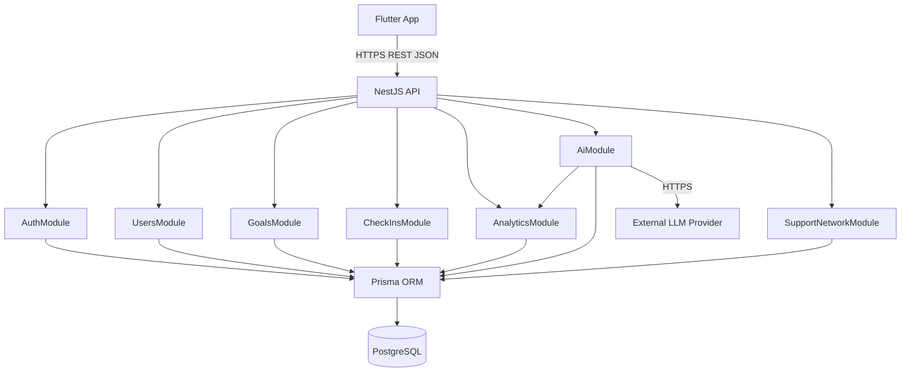
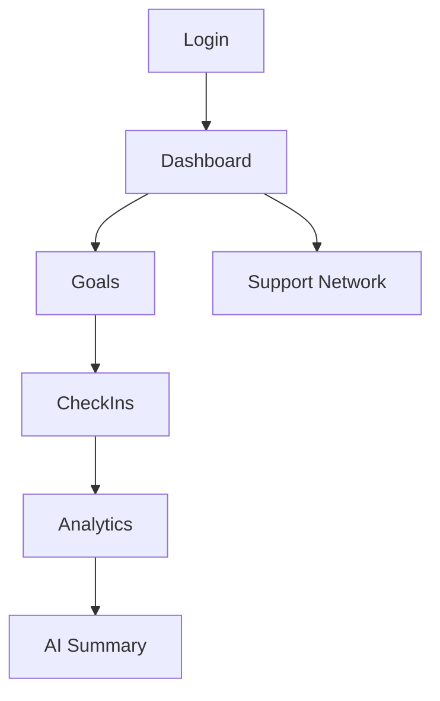
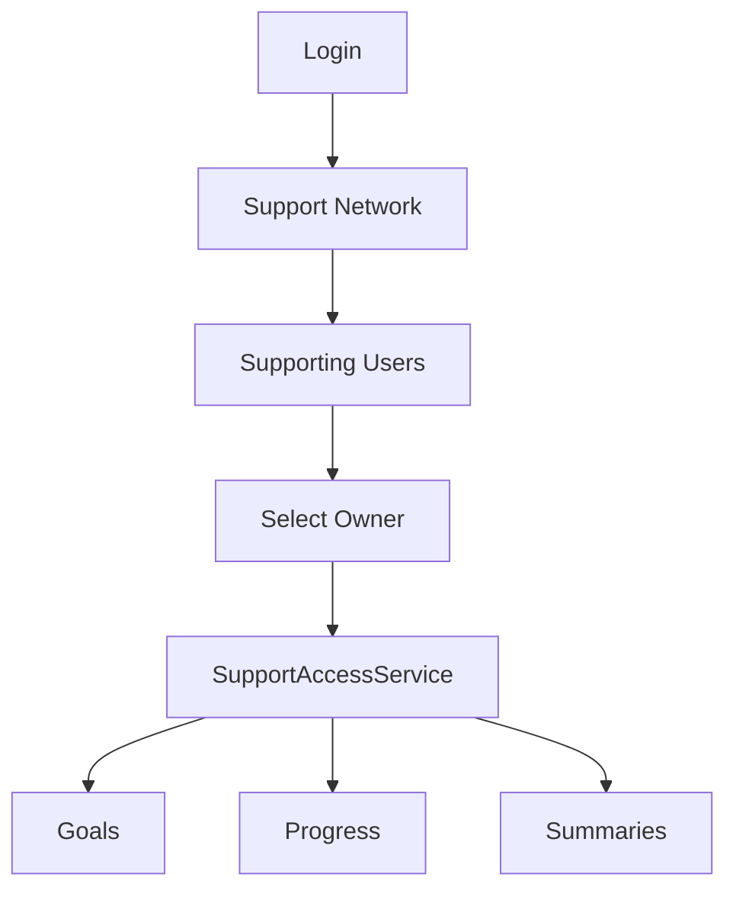
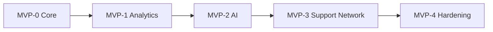
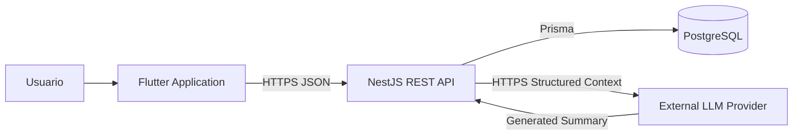

# ADR-006 — Arquitectura integral del sistema NeuroConnect v1.0.0

**Estado:** Aceptado para implementación  
**Fecha:** 14 de octubre de 2026  
**Proyecto:** NeuroConnect  
**Versión objetivo:** v1.0.0  
**Decisión:** Arquitectura integral del sistema, límites de componentes, comunicación, despliegue lógico y relaciones entre frontend, backend, persistencia, analítica e inteligencia artificial  
**Responsable:** Carlos Benjamín Armenta Márquez  

---

# 1. Contexto

NeuroConnect es una plataforma multiplataforma orientada al seguimiento de objetivos personales, análisis de progreso y gestión controlada de una red de apoyo.

La solución completa combina:

```text
cliente multiplataforma
+
API backend
+
persistencia relacional
+
analítica determinística
+
IA generativa
+
control de acceso
```

Los ADR anteriores han definido individualmente:

```text
ADR-001
Persistencia y modelo de datos

ADR-002
Dominio y reglas de negocio

ADR-003
Backend

ADR-004
Frontend

ADR-005
Integración con IA
```

Sin embargo, antes de iniciar formalmente el repositorio es necesario establecer una vista arquitectónica global que defina:

- componentes principales;
- responsabilidades;
- relaciones;
- dependencias;
- límites;
- flujos;
- comunicación;
- seguridad;
- despliegue;
- integración entre módulos;
- evolución por MVP;
- criterios de aceptación arquitectónica.

Este ADR constituye dicha baseline.

---

# 2. Objetivo

Definir la arquitectura integral de NeuroConnect v1.0.0 de manera consistente con todos los ADR anteriores.

La arquitectura deberá ser:

```text
simple
+
modular
+
implementable
+
testeable
+
desplegable
+
documentable
+
suficiente para el MVP académico
```

y evitar:

```text
microservicios innecesarios
+
infraestructura distribuida
+
duplicación de reglas
+
acoplamiento fuerte con proveedores externos
+
persistencia redundante
+
lógica de negocio en frontend
```

---

# 3. Jerarquía documental

La baseline documental queda organizada de la siguiente forma:

```text
Anteproyecto
    ↓
ADR-001 — Persistencia y modelo de datos
    ↓
ADR-002 — Dominio y reglas de negocio
    ↓
ADR-003 — Backend
    ↓
ADR-004 — Frontend
    ↓
ADR-005 — Integración con IA
    ↓
ADR-006 — Arquitectura integral
    ↓
Planes de implementación
    ↓
Documentación técnica
    ↓
Código
```

---

# 4. Rol de ADR-006

ADR-006:

```text
NO
```

redefine decisiones ya aceptadas.

Su función es:

```text
integrarlas
+
conectarlas
+
definir sus fronteras
```

Cuando exista conflicto:

```text
persistencia → ADR-001

dominio → ADR-002

backend → ADR-003

frontend → ADR-004

IA → ADR-005

visión integral → ADR-006
```

---

# 5. Decisión arquitectónica principal

NeuroConnect v1.0.0 utilizará una arquitectura:

```text
cliente-servidor
+
monolito modular
+
API REST
+
persistencia relacional
+
servicio externo de IA desacoplado
```

La solución estará compuesta por:

```text
Flutter Client

NestJS Backend

PostgreSQL 16

Prisma ORM

External LLM Provider
```

---

# 6. Vista arquitectónica general

```text
┌──────────────────────────────────────────────┐
│                 Flutter App                  │
│                                              │
│ Web               Android          iOS       │
│                                              │
│ Presentation                                  │
│ Riverpod State                                │
│ Repositories                                  │
│ Dio ApiClient                                 │
└──────────────────────┬───────────────────────┘
                       │
                       │ HTTPS
                       │ REST / JSON
                       ▼
┌──────────────────────────────────────────────┐
│               NestJS Backend                 │
│                                              │
│ AuthModule                                   │
│ UsersModule                                  │
│ GoalsModule                                  │
│ CheckInsModule                               │
│ AnalyticsModule                              │
│ AiModule                                     │
│ SupportNetworkModule                         │
│                                              │
│ Guards                                       │
│ DTO Validation                               │
│ Policies                                     │
│ Exception Filter                             │
│ PrismaService                                │
└───────────────────┬───────────────┬──────────┘
                    │               │
                    │               │ HTTPS
                    │               ▼
                    │        ┌─────────────────┐
                    │        │  LLM Provider   │
                    │        │                 │
                    │        │ OpenAI / Gemini │
                    │        │ Claude / etc.   │
                    │        └─────────────────┘
                    │
                    ▼
          ┌─────────────────────┐
          │    PostgreSQL 16    │
          │                     │
          │ User                │
          │ Goal                │
          │ CheckIn             │
          │ AISummary           │
          │ SupportRelationship │
          └─────────────────────┘
```

---

# 7. Principios arquitectónicos

La arquitectura deberá seguir los siguientes principios.

## 7.1 Backend como autoridad

El backend será responsable de:

```text
autenticación
autorización
reglas de dominio
ownership
analítica
persistencia
permisos
IA
```

El frontend no podrá sustituir estas reglas.

---

## 7.2 Frontend como capa de experiencia

Flutter será responsable de:

```text
presentación
navegación
estado de interfaz
consumo de API
validación de UX
responsive design
```

No será fuente autoritativa de reglas de negocio.

---

## 7.3 PostgreSQL como única persistencia

La v1.0.0 utilizará una única base principal:

```text
PostgreSQL
```

No existirán:

```text
MongoDB
Firestore
Redis
Data Warehouse
Vector Database
```

como persistencias adicionales obligatorias.

---

## 7.4 Analytics determinístico

Los indicadores serán calculados por backend a partir de:

```text
Goal
+
CheckIn
```

No se utilizará IA para calcular métricas oficiales.

---

## 7.5 IA desacoplada

La integración con IA utilizará:

```text
AiProvider
```

como frontera.

El dominio no dependerá directamente de:

```text
OpenAI
Gemini
Claude
Mistral
Cohere
Grok
```

---

## 7.6 Privacidad por defecto

Toda información será:

```text
privada
```

hasta que exista una relación de apoyo activa con permisos explícitos.

---

## 7.7 Baja complejidad operativa

La arquitectura evitará infraestructura que no sea necesaria para demostrar la propuesta académica.

---

# 8. Estilo arquitectónico

El sistema utilizará:

```text
Client–Server
```

con:

```text
Flutter
    ↓
REST API
    ↓
NestJS
    ↓
PostgreSQL
```

---

# 9. Tipo de backend

El backend será:

```text
Modular Monolith
```

y no:

```text
Microservices
```

Todos los módulos estarán dentro de:

```text
un único proceso NestJS
```

---

# 10. Motivo del monolito modular

Permite:

- separación de dominios;
- bajo costo de despliegue;
- transacciones simples;
- debugging directo;
- menor carga operativa;
- desarrollo individual viable;
- evolución posterior si fuera necesaria.

---

# 11. Componentes principales

La arquitectura tendrá cinco componentes lógicos principales:

```text
1. Client Application

2. Application Backend

3. Relational Database

4. Analytics Layer

5. Generative AI Provider
```

---

# 12. Client Application

Tecnología:

```text
Flutter
```

Responsabilidades:

- autenticación visual;
- gestión de objetivos;
- check-ins;
- dashboard;
- gráficas;
- resúmenes IA;
- red de apoyo;
- permisos;
- perfil;
- navegación responsive.

---

# 13. Application Backend

Tecnología:

```text
NestJS
```

Responsabilidades:

- API REST;
- JWT;
- hashing;
- DTO validation;
- ownership;
- lifecycle de Goal;
- transacciones;
- analytics;
- IA;
- red de apoyo;
- autorización delegada.

---

# 14. Relational Database

Tecnología:

```text
PostgreSQL 16
```

Acceso:

```text
Prisma ORM
```

Responsabilidades:

- persistencia;
- relaciones;
- integridad;
- constraints;
- índices;
- timestamps;
- historial;
- snapshots IA.

---

# 15. Analytics Layer

No será un servicio independiente.

Formará parte de:

```text
NestJS
```

mediante:

```text
AnalyticsModule
```

Responsabilidades:

```text
completionRate
averageProgress
checkInFrequency
progressDelta
averageDifficulty
daysSinceLastCheckIn
trend
```

---

# 16. AI Layer

La capa de IA estará compuesta por:

```text
SummaryContextBuilder
PromptBuilder
AiProvider
AiSummaryService
```

y un proveedor externo seleccionado posteriormente mediante ADR-005.

---

# 17. No AI Service independiente

No se desplegará:

```text
FastAPI AI Service
Python ML Service
LLM Microservice
```

durante v1.0.0.

La IA se integrará dentro del backend NestJS.

---

# 18. Razón para no separar IA

La lógica actual consiste en:

```text
Analytics
↓
Structured Context
↓
Prompt
↓
External API
```

No existe suficiente procesamiento local de IA que justifique otro servicio.

---

# 19. Diagrama de componentes



---

# 20. Dependencias entre módulos

La dirección general será:

```text
Auth
 ↓
Users

Goals
 ↓
Prisma

CheckIns
 ↓
Goals + Prisma

Analytics
 ↓
Goal + CheckIn data

AI
 ↓
Analytics

SupportNetwork
 ↓
Users + Prisma
```

---

# 21. Dependencias prohibidas

No deberá existir:

```text
Analytics → AI
```

ni:

```text
Database → Frontend
```

ni:

```text
Flutter → LLM Provider
```

ni:

```text
LLM Provider → PostgreSQL
```

---

# 22. Comunicación frontend-backend

Protocolo:

```text
HTTPS
```

Formato:

```text
JSON
```

Estilo:

```text
REST
```

Versión:

```text
/api/v1
```

---

# 23. Comunicación backend-base de datos

El backend utilizará:

```text
PrismaService
```

como único acceso de aplicación a PostgreSQL.

---

# 24. Comunicación backend-IA

El backend utilizará:

```text
HTTPS
```

hacia el proveedor seleccionado.

La API key existirá únicamente en backend.

---

# 25. Comunicación prohibida frontend-IA

Flutter:

```text
NO
```

se comunicará directamente con el proveedor LLM.

Razones:

- protección de API key;
- control de contexto;
- trazabilidad;
- validación;
- privacidad.

---

# 26. Flujo de autenticación

```text
Flutter
  ↓
POST /auth/login
  ↓
NestJS
  ↓
User lookup
  ↓
Argon2 verify
  ↓
JWT
  ↓
Flutter AuthTokenStore
```

---

# 27. Flujo autenticado

```text
Flutter
   ↓
Authorization: Bearer JWT
   ↓
JwtAuthGuard
   ↓
CurrentUser
   ↓
Service
   ↓
Prisma
```

---

# 28. Flujo de creación de Goal

```text
Flutter
   ↓
POST /goals
   ↓
GoalsController
   ↓
GoalsService
   ↓
ownerId = currentUser
   ↓
Prisma
   ↓
PostgreSQL
```

---

# 29. Flujo de CheckIn

```text
Flutter
   ↓
POST /goals/:id/check-ins
   ↓
CheckInsService
   ↓
validate ownership
   ↓
validate Goal ACTIVE
   ↓
transaction
      ├── create CheckIn
      └── update Goal.progress
   ↓
PostgreSQL
```

---

# 30. Flujo de Analytics

```text
Flutter
   ↓
GET /analytics/overview
   ↓
AnalyticsModule
   ↓
Goal + CheckIn
   ↓
deterministic calculations
   ↓
Analytics DTO
   ↓
Flutter Dashboard
```

---

# 31. Flujo de IA

```text
Flutter
   ↓
POST /ai/summaries
   ↓
AiSummaryService
   ↓
AnalyticsModule
   ↓
SummaryContextBuilder
   ↓
PromptBuilder
   ↓
AISummary(PENDING)
   ↓
LLM Provider
   ↓
AISummary(COMPLETED | FAILED)
   ↓
Flutter
```

---

# 32. Flujo de red de apoyo

```text
Owner
   ↓
Flutter
   ↓
SupportNetworkModule
   ↓
SupportRelationship
   ↓
PostgreSQL
```

---

# 33. Flujo de lectura delegada

```text
Supporter
   ↓
Flutter
   ↓
delegated endpoint
   ↓
SupportAccessService
   ↓
active relationship?
   ↓
required permission?
   ↓
read-only projection
   ↓
Flutter
```

---

# 34. Separación owner/supporter

Los flujos se mantendrán separados.

Propietario:

```text
/goals
/check-ins
/analytics
/ai
```

Supporter:

```text
/support-network/owners/:ownerId/...
```

---

# 35. Razón de separación

Evita:

- mezclar permisos;
- exponer datos owner-only;
- lógica condicional excesiva;
- errores de autorización.

---

# 36. Diagrama de flujo owner



---

# 37. Diagrama de flujo supporter



---

# 38. Seguridad arquitectónica

La seguridad se aplicará en múltiples capas.

```text
Flutter UX validation
        ↓
NestJS DTO validation
        ↓
Authentication
        ↓
Authorization
        ↓
Ownership
        ↓
PostgreSQL constraints
```

---

# 39. Autenticación

Tecnología:

```text
JWT Bearer
```

Password:

```text
Argon2id
```

---

# 40. Autorización

Existirán dos mecanismos.

## Owner authorization

```text
resource.ownerId == currentUser.id
```

## Delegated authorization

```text
active SupportRelationship
+
required permission
```

---

# 41. Permisos delegados

```text
VIEW_GOALS
VIEW_PROGRESS
VIEW_SUMMARIES
```

---

# 42. Supporter read-only

Los permisos delegados serán:

```text
READ ONLY
```

durante v1.0.0.

---

# 43. Seguridad de notes

```text
CheckIn.notes
```

será:

```text
owner-only
```

No aparecerá en:

- IA;
- vistas delegadas;
- logs.

---

# 44. Seguridad IA

El LLM recibirá únicamente:

```text
SummaryContext
```

No recibirá:

```text
DB access
JWT
email
notes
permissions
passwordHash
```

---

# 45. Arquitectura de privacidad

```text
Private data
   ↓
Backend authorization
   ↓
Minimal projection
   ↓
Consumer
```

El consumidor puede ser:

```text
owner
supporter
LLM
```

y cada uno recibe una proyección distinta.

---

# 46. Modelo de confianza

Se asume:

```text
Flutter = untrusted client

Backend = trust boundary

Database = protected resource

LLM Provider = external third party
```

---

# 47. Trust Boundary 1

Entre:

```text
Flutter
```

y:

```text
NestJS
```

Todo dato recibido deberá ser validado.

---

# 48. Trust Boundary 2

Entre:

```text
NestJS
```

y:

```text
LLM Provider
```

Solo se permitirá información construida por `SummaryContextBuilder`.

---

# 49. Diagrama de límites de confianza

```text
┌─────────────────┐
│ Flutter Client  │
│ Untrusted       │
└────────┬────────┘
         │
         │ Trust Boundary
         ▼
┌────────────────────────────┐
│ NestJS Backend             │
│                            │
│ Authentication             │
│ Authorization              │
│ Domain Rules               │
└────────┬───────────┬───────┘
         │           │
         │           │ Trust Boundary
         │           ▼
         │     ┌───────────────┐
         │     │ LLM Provider  │
         │     │ External      │
         │     └───────────────┘
         │
         ▼
┌────────────────────┐
│ PostgreSQL         │
│ Protected resource │
└────────────────────┘
```

---

# 50. Persistencia

La base de datos principal contiene:

```text
User
Goal
CheckIn
AISummary
SupportRelationship
```

de acuerdo con ADR-001.

---

# 51. Datos derivados

No se persistirán:

```text
AnalyticsResult
Trend
DashboardSnapshot
```

en v1.0.0.

---

# 52. Razón

Los resultados derivados pueden reconstruirse desde:

```text
Goal
+
CheckIn
```

y persistirlos introduciría riesgo de inconsistencia.

---

# 53. Excepción AISummary

`AISummary` sí se persiste porque representa:

```text
resultado histórico generado
```

y debe conservar:

```text
inputSnapshot
provider
model
content
```

---

# 54. Fuente de verdad

```text
User data
    ↓
PostgreSQL

Analytics
    ↓
calculated result

AI
    ↓
generated explanation
```

---

# 55. Orden de autoridad

```text
PostgreSQL domain data
        >
Analytics deterministic output
        >
AI generated text
```

---

# 56. Manejo temporal

Persistencia:

```text
UTC
```

API:

```text
ISO 8601 UTC
```

Frontend:

```text
local device timezone
```

---

# 57. Arquitectura frontend

El frontend utilizará:

```text
Feature-first
```

con:

```text
Widget
 ↓
Provider / Notifier
 ↓
Repository
 ↓
ApiClient
 ↓
Backend
```

---

# 58. Arquitectura backend

El backend utilizará:

```text
Controller
 ↓
Service
 ↓
Prisma / Module dependency
```

sin Repository Pattern ceremonial.

---

# 59. Arquitectura IA

```text
AnalyticsModule
 ↓
SummaryContextBuilder
 ↓
PromptBuilder
 ↓
AiProvider
 ↓
LLM
```

---

# 60. No Clean Architecture completa

Ni frontend ni backend utilizarán múltiples capas formales innecesarias.

La separación estará basada en:

```text
responsabilidad
+
testabilidad
+
fronteras reales
```

---

# 61. Configuración

Se utilizarán variables de entorno para configuración del backend.

Ejemplos:

```text
DATABASE_URL
JWT_SECRET
JWT_EXPIRES_IN
CORS_ORIGINS

AI_PROVIDER
AI_MODEL
AI_API_KEY
AI_TIMEOUT_MS
```

---

# 62. Configuración frontend

Flutter utilizará configuración de build para:

```text
API_BASE_URL
```

mediante:

```text
--dart-define
```

o equivalente.

---

# 63. Secretos

Nunca se versionarán:

```text
DATABASE_URL
JWT_SECRET
AI_API_KEY
passwords
production credentials
```

---

# 64. Repositorio

La estructura raíz propuesta será:

```text
neuro-connect/
│
├── app/
│   └── Flutter client
│
├── backend/
│   └── NestJS API
│
├── docs/
│   ├── ADRS/
│   │   ├── ADR-001 — Esquema relacional y modelo de datos de NeuroConnect.md
│   │   ├── ADR-002-DOMINIO-Y-DISENO-V1.md
│   │   ├── ADR-003-BACKEND-V1.md
│   │   ├── ADR-004-FRONTEND-V1.md
│   │   ├── ADR-005-INTEGRACION-IA-V1.md
│   │   └── ADR-006-ARQUITECTURA-SISTEMA-V1.md
│   │
│   ├── Planeacion/
│   │   └── PLAN_IMPLEMENTACION_AVANCE_1.md
│   │
│   └── Anteproyecto_NeuroConnect_IA_G_Carlos_Armenta.pdf
│
├── docker-compose.yml
├── .gitignore
├── README.md
└── LICENSE
```

---

# 65. Ajuste documental recomendado

Aunque actualmente el anteproyecto se encuentre dentro de:

```text
docs/ADRS/
```

se recomienda que al inicializar el repositorio se mueva a:

```text
docs/
```

porque:

```text
Anteproyecto
```

no es un Architecture Decision Record.

La estructura preferida será:

```text
docs/
│
├── Anteproyecto_NeuroConnect_IA_G_Carlos_Armenta.pdf
│
├── ADRS/
│
└── Planeacion/
```

Esto es una decisión organizativa y no afecta contenido.

---

# 66. Monorepo simple

NeuroConnect utilizará un único repositorio con:

```text
frontend
+
backend
+
docs
```

No se utilizarán:

```text
Nx
Turborepo
Bazel
Lerna
```

---

# 67. Razón del monorepo simple

Permite:

- documentación centralizada;
- commits coordinados;
- una sola baseline;
- facilidad para Codex;
- facilidad de entrega académica.

---

# 68. Docker

Docker se utilizará principalmente para:

```text
PostgreSQL
backend
```

durante desarrollo y/o deployment según conveniencia.

---

# 69. Docker Compose

Podrá contener:

```text
postgres
backend
```

Flutter se ejecutará independientemente en desarrollo.

---

# 70. No container obligatorio para Flutter dev

Durante desarrollo:

```text
flutter run
```

será suficiente.

No se requiere ejecutar Flutter dentro de Docker.

---

# 71. Deployment lógico

La arquitectura desplegada será conceptualmente:

```text
Internet
   ↓
Flutter Web / Android
   ↓
HTTPS
   ↓
NestJS API
   ↓
PostgreSQL

NestJS API
   ↓
HTTPS
   ↓
LLM Provider
```

---

# 72. Deployment físico

La selección del proveedor de hosting:

```text
NO
```

forma parte de este ADR.

Podrá elegirse más adelante según:

- costo;
- disponibilidad;
- SSL;
- facilidad;
- tiempo.

---

# 73. Web deployment

Flutter Web podrá desplegarse como archivos estáticos.

Opciones futuras:

```text
Vercel
Firebase Hosting
Cloudflare Pages
Netlify
Nginx
```

La elección queda diferida.

---

# 74. Backend deployment

NestJS podrá desplegarse en:

```text
VM
container hosting
PaaS
```

La elección específica queda diferida.

---

# 75. Database deployment

PostgreSQL podrá estar:

```text
managed
```

o:

```text
self-hosted
```

según infraestructura final.

---

# 76. HTTPS

Toda comunicación pública deberá utilizar:

```text
HTTPS
```

---

# 77. HTTP local

Podrá utilizarse únicamente para:

```text
desarrollo local
```

---

# 78. CORS

El backend permitirá únicamente:

```text
configured origins
```

No se utilizará:

```text
*
```

en release final.

---

# 79. Health

El backend expondrá:

```text
/api/v1/health
```

para verificar disponibilidad.

---

# 80. Swagger

La documentación se expondrá en:

```text
/api/docs
```

cuando esté habilitada.

---

# 81. Observabilidad

La v1.0.0 utilizará:

```text
application logs
+
request IDs si están disponibles
+
health endpoints
```

No requiere:

```text
Prometheus
Grafana
ELK
Datadog
OpenTelemetry
```

---

# 82. Escalabilidad

La arquitectura está diseñada para:

```text
MVP académico
+
bajo volumen
```

No se optimiza prematuramente para:

```text
millones de usuarios
```

---

# 83. Escalamiento futuro

Si fuera necesario, el primer paso sería:

```text
replicar backend stateless
+
managed PostgreSQL
```

antes de considerar microservicios.

---

# 84. Stateless backend

Salvo persistencia en PostgreSQL, NestJS deberá ser mayormente:

```text
stateless
```

El JWT no requiere sesión de servidor.

---

# 85. Cache

No se utilizará cache distribuido durante v1.0.0.

---

# 86. Queue

No se utilizarán:

```text
Kafka
RabbitMQ
BullMQ
SQS
```

---

# 87. Background workers

No existirán workers separados.

---

# 88. IA síncrona

La generación IA será una operación HTTP síncrona desde la perspectiva del cliente, dentro del timeout configurado.

Persistencia:

```text
PENDING
```

se realizará antes de llamar al proveedor.

---

# 89. No transaction externa

Una transacción PostgreSQL nunca permanecerá abierta durante la llamada al LLM.

---

# 90. Integridad

La integridad se protegerá mediante:

```text
DTO
+
domain validation
+
transactions
+
DB constraints
```

---

# 91. Consistencia Goal / CheckIn

La creación de CheckIn deberá mantener:

```text
Goal.progress
```

sincronizado con el último CheckIn.

---

# 92. Consistencia de analítica

Analytics siempre leerá la información actual de PostgreSQL.

---

# 93. Consistencia IA

`inputSnapshot` conservará los datos exactos utilizados para la generación.

---

# 94. Estrategia de errores

```text
Frontend
  ↓
AppException

Backend
  ↓
HTTP errors + normalized payload

Database
  ↓
handled by backend

LLM
  ↓
AiProviderError
```

---

# 95. Propagación controlada

Los errores internos no deberán filtrarse directamente hasta el usuario.

---

# 96. Errores LLM

Un fallo LLM deberá traducirse en:

```text
AISummary FAILED
+
respuesta controlada
```

sin afectar otros datos.

---

# 97. Estrategia de pruebas global

Existirán:

```text
Backend unit tests
Backend E2E

Frontend unit tests
Frontend widget tests
Frontend integration tests

AI benchmark
AI integration tests
```

---

# 98. Backend tests

Prioridad:

```text
domain
analytics
ownership
support access
AI pipeline
```

---

# 99. Frontend tests

Prioridad:

```text
auth state
navigation
forms
state management
critical flows
```

---

# 100. E2E global

El escenario completo será:

```text
User A registers
        ↓
creates Goal
        ↓
creates CheckIns
        ↓
views Analytics
        ↓
generates AI Summary
        ↓
User B registers
        ↓
A creates SupportRelationship
        ↓
B views permitted data
        ↓
B cannot edit
        ↓
A enables summaries
        ↓
B views summary
        ↓
A revokes access
        ↓
B loses access
```

---

# 101. Definition of Done arquitectónica

La arquitectura v1.0.0 se considerará implementada cuando:

```text
Flutter
+
NestJS
+
PostgreSQL
+
Analytics
+
AI real
+
SupportNetwork
```

funcionen de extremo a extremo.

---

# 102. MVP-0

Arquitectura activa:

```text
Flutter
 ↕
NestJS
 ↕
PostgreSQL
```

Funcionalidad:

```text
Auth
Users
Goals
CheckIns
```

---

# 103. MVP-1

Se incorpora:

```text
AnalyticsModule
+
Dashboard
```

---

# 104. MVP-2

Se incorpora:

```text
AiModule
+
real LLM provider
+
AISummary
```

---

# 105. MVP-3

Se incorpora:

```text
SupportNetworkModule
+
SupportRelationship
+
delegated authorization
```

---

# 106. MVP-4

Se completa:

```text
testing
security review
UX
deployment
documentation
```

---

# 107. Evolución por capas

```text
MVP-0
Client + API + DB

MVP-1
+ Analytics

MVP-2
+ AI

MVP-3
+ Support Network

MVP-4
+ Hardening + Deployment
```

---

# 108. Diagrama de evolución



---

# 109. Dependencias de implementación

```text
Database
   ↓
Backend Core
   ↓
Frontend Core
   ↓
Analytics
   ↓
AI
   ↓
SupportNetwork
   ↓
Hardening
```

Esta secuencia puede tener cierto solapamiento, pero las dependencias deben respetarse.

---

# 110. Documentación como parte de la arquitectura

Los ADR forman parte de la baseline.

Codex deberá leer:

```text
ADR-001
ADR-002
ADR-003
ADR-004
ADR-005
ADR-006
```

antes de implementar componentes afectados.

---

# 111. Prioridad documental

Ante contradicción entre código existente y ADR aceptado:

```text
ADR aceptado
```

será la baseline deseada salvo que exista una decisión posterior que lo reemplace.

---

# 112. Modificación arquitectónica

Cambios sobre:

```text
framework frontend

framework backend

database

architecture style

API style

authentication model

AI integration

persistence model

deployment topology

support authorization
```

requieren:

```text
ADR nuevo
```

o actualización formal del correspondiente.

---

# 113. No decisiones silenciosas

Codex no deberá introducir:

```text
Redis
microservices
GraphQL
Firebase backend
Supabase backend
WebSockets
queues
vector DB
RAG
agents
```

sin una decisión arquitectónica explícita.

---

# 114. Restricciones de tecnología

Frontend:

```text
Flutter
Riverpod
go_router
Dio
Material 3
fl_chart
```

Backend:

```text
NestJS
Prisma
PostgreSQL
JWT
Argon2id
Swagger
```

IA:

```text
AiProvider abstraction
external LLM
```

---

# 115. Sistema operativo / infraestructura

La aplicación no dependerá de un sistema operativo específico a nivel lógico.

El backend deberá poder ejecutarse en:

```text
Linux
```

como objetivo principal de deployment.

---

# 116. Entornos

Como mínimo:

```text
development
test
production
```

---

# 117. Development

Utiliza:

- datos sintéticos;
- MockAiProvider cuando corresponda;
- Swagger habilitado;
- Docker local.

---

# 118. Test

Utiliza:

- DB separada;
- datos controlados;
- mocks para IA en suites normales;
- proveedor real solo en tests específicos.

---

# 119. Production / Release académico

Utiliza:

- backend desplegado;
- PostgreSQL persistente;
- HTTPS;
- LLM real;
- secretos externos al repositorio.

---

# 120. Build matrix

Frontend:

```text
Web
Android
iOS compatible
```

Backend:

```text
Node.js LTS
```

Database:

```text
PostgreSQL 16
```

---

# 121. Compatibilidad mínima

La aceptación académica requiere:

```text
Web funcional
+
Android funcional
```

iOS deberá conservar compatibilidad de código.

---

# 122. Git

El proyecto utilizará:

```text
Git
+
GitHub
```

para control de versiones.

---

# 123. Commits

Se preferirán commits:

```text
pequeños
semánticos
revisables
```

---

# 124. Branching

La estrategia exacta de ramas podrá mantenerse sencilla.

Ejemplo:

```text
main
dev
feature/*
```

No se requiere GitFlow completo.

---

# 125. CI

CI/CD no es requisito inicial.

Podrá añadirse posteriormente para:

```text
lint
tests
build
```

---

# 126. Arquitectura de acceso a datos

Frontend:

```text
Repository
```

representa frontera HTTP.

Backend:

```text
PrismaService
```

representa frontera DB.

---

# 127. No acceso DB desde frontend

Prohibido:

```text
Flutter → PostgreSQL
```

---

# 128. No acceso IA desde frontend

Prohibido:

```text
Flutter → LLM Provider
```

---

# 129. No acceso dominio desde DB

La DB impone integridad estructural.

Las reglas complejas residen en backend.

---

# 130. No business logic en UI

Ejemplo:

```text
trend classification
```

no se recalculará en Flutter.

---

# 131. Proyecciones

El backend devolverá diferentes proyecciones según:

```text
owner
supporter
AI
```

---

# 132. Owner projection

Puede incluir:

```text
Goal
CheckIn
notes
Analytics
AISummary
```

según endpoint.

---

# 133. Supporter projection

Puede incluir solo información autorizada.

Nunca:

```text
notes
passwordHash
inputSnapshot
```

---

# 134. AI projection

Solo:

```text
SummaryContext
```

---

# 135. Arquitectura de permisos

```text
User A
  ↓
SupportRelationship
  ↓
User B
```

Permisos:

```text
canViewGoals
canViewProgress
canViewSummaries
```

---

# 136. Expiración

La relación será evaluada en tiempo de request.

No se requiere worker para expirar relaciones.

---

# 137. Revocación

Será efectiva en la siguiente request.

No habrá cache de autorización.

---

# 138. Arquitectura de datos

```text
User
 ├── Goal
 │    └── CheckIn
 │
 ├── AISummary
 │
 └── SupportRelationship
```

---

# 139. Arquitectura analítica

```text
Goal
+
CheckIn
   ↓
AnalyticsModule
   ↓
Metrics DTO
```

---

# 140. Arquitectura generativa

```text
Metrics DTO
   ↓
SummaryContext
   ↓
Prompt
   ↓
LLM
   ↓
AISummary
```

---

# 141. Arquitectura de dashboard

```text
Flutter Dashboard
   ↓
GET /analytics/overview
   ↓
AnalyticsModule
```

No consulta directamente tablas.

---

# 142. Arquitectura de historial

```text
Flutter
   ↓
GET /goals/:goalId/check-ins
   ↓
CheckInsModule
   ↓
PostgreSQL
```

---

# 143. Arquitectura de AI history

```text
Flutter
   ↓
GET /ai/summaries
   ↓
AiModule
   ↓
AISummary
```

---

# 144. Arquitectura de shared views

```text
Flutter Support View
   ↓
Delegated Endpoint
   ↓
SupportAccessService
   ↓
Projection
```

---

# 145. Integración de IA pendiente

ADR-005 mantiene pendiente:

```text
provider final
model final
```

ADR-006 no cambia esa decisión.

---

# 146. Arquitectura independiente del modelo

El sistema debe funcionar con cualquier adapter que implemente:

```text
AiProvider
```

---

# 147. Failure isolation

Si falla IA:

```text
Auth
Goals
CheckIns
Analytics
SupportNetwork
```

deben continuar operando.

---

# 148. Failure isolation DB

Si PostgreSQL falla:

```text
backend no podrá operar normalmente
```

y deberá reportar error controlado.

---

# 149. Failure isolation frontend

Si Flutter falla o se cierra:

```text
la información persistida permanece en backend
```

---

# 150. Disponibilidad

La v1.0.0 no define SLA formal.

---

# 151. Alta disponibilidad

No es requisito:

```text
load balancer
multi-region
database replica
failover cluster
```

---

# 152. Backup

La estrategia final de backup dependerá de infraestructura.

Para demo académica deberá existir al menos una forma de:

```text
recrear DB
+
migrations
+
seed
```

---

# 153. Reproducibilidad

Desde un entorno limpio deberá poder ejecutarse:

```text
PostgreSQL
↓
Prisma migrate
↓
seed
↓
NestJS
↓
Flutter
```

---

# 154. Arquitectura reproducible

Todo componente deberá estar documentado mediante:

```text
README
.env.example
migrations
Docker config
build commands
```

---

# 155. Seed

El seed constituye:

```text
fixture de desarrollo/demo
```

No datos científicos.

---

# 156. Datos reales

No son necesarios para validar arquitectura.

Se priorizarán:

```text
datos sintéticos
```

---

# 157. Auditoría

No se implementará una arquitectura de auditoría completa en v1.0.0.

La trazabilidad principal será:

```text
createdAt
updatedAt
AISummary.inputSnapshot
provider
model
SupportRelationship timestamps
```

---

# 158. Soft delete

No forma parte de la arquitectura v1.0.0.

---

# 159. Object storage

No existe necesidad de:

```text
S3
Blob Storage
file server
```

porque no hay uploads.

---

# 160. Search engine

No existe:

```text
Elasticsearch
OpenSearch
Algolia
```

---

# 161. CDN

Flutter Web podrá beneficiarse de CDN del proveedor de hosting.

No es componente obligatorio del diseño lógico.

---

# 162. Reverse proxy

Podrá existir:

```text
Nginx
```

delante de NestJS según deployment.

No es requisito del dominio.

---

# 163. Arquitectura opcional de deployment

```text
Internet
   ↓
Static Hosting
   ↓
Flutter Web

Internet
   ↓
HTTPS
   ↓
Reverse Proxy / Platform
   ↓
NestJS
   ↓
PostgreSQL
```

---

# 164. Android

Android consumirá la misma API que Web.

---

# 165. iOS

iOS consumirá la misma API.

---

# 166. No API específica por plataforma

No existirán:

```text
/api/android
/api/web
/api/ios
```

---

# 167. API única

Todas las plataformas utilizarán:

```text
/api/v1
```

---

# 168. Responsive vs APIs

Las diferencias de plataforma corresponden a UI, no a dominio.

---

# 169. Arquitectura académica

La solución deberá permitir demostrar claramente:

```text
software
+
base de datos
+
analytics
+
IA
+
privacidad
+
red de apoyo
```

---

# 170. Evidencias arquitectónicas

El proyecto final deberá poder mostrar:

```text
diagrama de arquitectura

diagrama de datos

Swagger

Flutter Web

Android

PostgreSQL

Analytics

LLM integration

Support permissions
```

---

# 171. Criterios de aceptación arquitectónica

La arquitectura será considerada correctamente implementada si:

- Flutter no accede directamente a DB;
- Flutter no accede directamente al LLM;
- backend valida negocio;
- PostgreSQL mantiene integridad;
- Analytics es determinístico;
- AI depende de Analytics;
- SupportNetwork controla acceso;
- owner/supporter están aislados;
- HTTPS se usa públicamente;
- secretos no están en repositorio;
- migrations funcionan desde cero;
- Web y Android consumen la misma API.

---

# 172. Prueba de arquitectura

El sistema deberá superar el flujo:

```text
Client
 ↓
API
 ↓
DB
 ↓
Analytics
 ↓
AI
 ↓
API
 ↓
Client
```

y:

```text
Supporter
 ↓
API
 ↓
SupportAccess
 ↓
authorized projection
```

---

# 173. Reglas inmutables para Codex

Codex no podrá reinterpretar:

```text
single repository

Flutter client

NestJS modular monolith

REST /api/v1

PostgreSQL 16

Prisma ORM

JWT

Argon2id

Analytics inside backend

AI inside backend integration layer

external LLM provider

AiProvider abstraction

SupportNetwork read-only delegation

no direct Flutter → DB

no direct Flutter → LLM

no microservices

no queues

no Redis

no GraphQL

no RAG

no vector DB

no separate ML service

no duplicated analytics

private by default
```

---

# 174. Tecnologías aceptadas

```text
Flutter
Dart
Material 3
Riverpod
go_router
Dio
fl_chart

NestJS
TypeScript
Prisma
PostgreSQL
JWT
Argon2id
Swagger

Docker
Git
GitHub

External LLM API
```

---

# 175. Tecnologías no justificadas para v1

```text
Kubernetes

Kafka

RabbitMQ

Redis

GraphQL

MongoDB

Firebase backend

Supabase backend

ElasticSearch

vector database

LangChain

RAG

microservices

service mesh

multiple databases
```

---

# 176. Decisiones diferidas

Este ADR no decide:

- hosting final;
- proveedor cloud;
- dominio;
- reverse proxy definitivo;
- proveedor LLM;
- modelo LLM;
- CI/CD final;
- monitoring externo;
- backup productivo;
- custom domain;
- store publication;
- horizontal scaling.

---

# 177. Política para decisiones diferidas

Solo se resolverán cuando:

```text
la implementación llegue a esa etapa
```

y exista información suficiente.

---

# 178. Riesgo 1 — Sobrediseño

Mitigación:

```text
monolito modular
+
single DB
+
single client codebase
```

---

# 179. Riesgo 2 — Duplicación de lógica

Mitigación:

```text
backend = authority
```

---

# 180. Riesgo 3 — Exposición de datos

Mitigación:

```text
ownership
+
SupportAccess
+
SummaryContextBuilder
```

---

# 181. Riesgo 4 — Dependencia de IA

Mitigación:

```text
AiProvider
```

y aislamiento de fallos.

---

# 182. Riesgo 5 — Complejidad multiplataforma

Mitigación:

```text
Flutter
+
single codebase
```

---

# 183. Riesgo 6 — Fallo de permisos

Mitigación:

```text
dedicated delegated routes
+
SupportAccessService
+
E2E tests
```

---

# 184. Riesgo 7 — Desalineación documental

Mitigación:

```text
ADRs versionados junto al código
```

---

# 185. Consecuencias positivas

La arquitectura permite:

- desarrollo por una persona;
- bajo costo operativo;
- integración clara;
- documentación sencilla;
- pruebas completas;
- separación funcional;
- evolución incremental;
- portabilidad;
- sustitución del proveedor IA;
- despliegue simple.

---

# 186. Consecuencias negativas

La decisión implica:

- backend centralizado;
- una única base de datos;
- dependencia del backend para todas las funciones;
- ausencia de offline-first;
- generación IA síncrona;
- ausencia de cache distribuido;
- escalamiento limitado inicialmente.

Estas consecuencias son aceptables para v1.0.0.

---

# 187. Estrategia de evolución futura

Si NeuroConnect creciera más allá del MVP, la evolución preferida sería:

```text
1. optimizar monolito

2. mejorar PostgreSQL

3. añadir cache solo si existe necesidad

4. escalar backend horizontalmente

5. separar servicios únicamente si aparecen límites claros
```

---

# 188. No microservices first

La arquitectura futura:

```text
NO
```

debe asumir que microservicios son el siguiente paso automático.

Solo se separarían componentes con una justificación medible.

---

# 189. Posibles candidatos futuros

Si el sistema creciera, podrían evaluarse:

```text
AI generation service

notifications service

analytics pipeline
```

pero ninguno forma parte de v1.0.0.

---

# 190. Arquitectura objetivo v1.0.0

```text
                         ┌─────────────────────┐
                         │    Flutter Client   │
                         │                     │
                         │ Web / Android / iOS │
                         └──────────┬──────────┘
                                    │
                                    │ HTTPS REST JSON
                                    ▼
              ┌────────────────────────────────────────┐
              │              NestJS API                │
              │                                        │
              │ Auth                                   │
              │ Users                                  │
              │ Goals                                  │
              │ CheckIns                               │
              │ Analytics                              │
              │ AI                                     │
              │ SupportNetwork                         │
              │                                        │
              │ Validation / Guards / Policies         │
              └──────────────┬──────────────┬──────────┘
                             │              │
                         Prisma             │ HTTPS
                             │              │
                             ▼              ▼
                   ┌────────────────┐  ┌────────────────┐
                   │ PostgreSQL 16  │  │ LLM Provider   │
                   │                │  │                │
                   │ User           │  │ Model TBD      │
                   │ Goal           │  └────────────────┘
                   │ CheckIn        │
                   │ AISummary      │
                   │ SupportRel.    │
                   └────────────────┘
```

---

# 191. Vista de contenedores estilo C4 simplificada



---

# 192. Vista funcional

```text
Authentication
      ↓
Goal Management
      ↓
CheckIn Tracking
      ↓
Analytics
      ↓
AI Summary
      ↓
Controlled Sharing
```

---

# 193. Vista de ownership

```text
User
 │
 ├── owns Goals
 │      │
 │      └── owns CheckIns indirectly
 │
 ├── owns AISummaries
 │
 └── owns SupportRelationships granted
```

---

# 194. Vista de autoridad

```text
Frontend
   ↓ request

Backend
   ↓ validate / authorize

Database
   ↓ facts

Analytics
   ↓ derived facts

AI
   ↓ explanation

Frontend
   ↓ presentation
```

---

# 195. Vista de seguridad

```text
Authentication
    ↓
CurrentUser
    ↓
Ownership
    ↓
Support Relationship
    ↓
Permission
    ↓
Projection
```

---

# 196. Vista de IA

```text
DB data
  ↓
Analytics
  ↓
Minimal Context
  ↓
Prompt
  ↓
AiProvider
  ↓
External Model
  ↓
AISummary
```

---

# 197. Vista de deployment mínima

```text
┌─────────────────────┐
│ Static Web Hosting  │
│ Flutter Web         │
└──────────┬──────────┘
           │
           │ HTTPS
           ▼
┌─────────────────────┐
│ Backend Host        │
│ NestJS              │
└──────────┬──────────┘
           │
           │
           ▼
┌─────────────────────┐
│ PostgreSQL          │
└─────────────────────┘

Backend
   │
   └──── HTTPS ────> LLM Provider
```

Android/iOS utilizan el mismo backend.

---

# 198. Definition of Done del sistema

La v1.0.0 será arquitectónicamente completa cuando:

```text
[ ] Flutter Web funciona

[ ] Android funciona

[ ] backend NestJS desplegado

[ ] PostgreSQL persistente

[ ] migrations aplicadas

[ ] Auth funcional

[ ] Goals funcional

[ ] CheckIns funcional

[ ] Analytics funcional

[ ] IA real funcional

[ ] AISummary persistido

[ ] SupportNetwork funcional

[ ] permisos funcionales

[ ] revocación funcional

[ ] aislamiento entre usuarios probado

[ ] HTTPS habilitado

[ ] tests pasan

[ ] documentación actualizada
```

---

# 199. Definition of Done de integración

Se deberá demostrar:

```text
Flutter
→
NestJS
→
PostgreSQL
→
Analytics
→
LLM
→
AISummary
→
Flutter
```

---

# 200. Definition of Done de privacidad

Se deberá demostrar:

```text
User A
   ↓
private data

User B
   ↓
no access

SupportRelationship
   ↓
limited access

Revoke
   ↓
no access
```

---

# 201. Definition of Done académica

La arquitectura debe permitir demostrar:

```text
aplicación real

persistencia real

analítica real

IA real

seguridad

red de apoyo

multiplataforma
```

---

# 202. Estado de la decisión

```text
ACEPTADA PARA IMPLEMENTACIÓN
```

---

# 203. Política de modificación

Cualquier cambio que afecte:

```text
componentes principales

topología

comunicación

frameworks

persistencia

autenticación

AI boundary

ownership

deployment architecture
```

deberá:

1. documentar el problema;
2. identificar qué ADR afecta;
3. justificar la alternativa;
4. crear o actualizar un ADR;
5. validar consistencia global.

---

# 204. Resumen final

La arquitectura oficial de NeuroConnect v1.0.0 será:

```text
Flutter
   ↓
HTTPS / REST / JSON
   ↓
NestJS Modular Monolith
   ├── Auth
   ├── Users
   ├── Goals
   ├── CheckIns
   ├── Analytics
   ├── AI
   └── SupportNetwork
   ↓
Prisma
   ↓
PostgreSQL 16

NestJS
   ↓
AiProvider
   ↓
External LLM
```

Las reglas fundamentales son:

```text
una sola base de datos

un solo backend

una sola base Flutter

backend como autoridad

analytics determinístico

IA desacoplada

privacidad por defecto

supporter read-only

no acceso directo frontend → DB

no acceso directo frontend → IA

sin microservicios

sin infraestructura innecesaria
```

---

# 205. Filosofía arquitectónica de NeuroConnect v1.0.0

> **NeuroConnect v1.0.0 utiliza una arquitectura deliberadamente pequeña y modular: Flutter concentra la experiencia multiplataforma, NestJS concentra reglas y seguridad, PostgreSQL conserva los hechos, Analytics transforma esos hechos en métricas verificables y la IA externa únicamente convierte dichas métricas en explicaciones controladas. La arquitectura prioriza consistencia, privacidad y capacidad de terminar el producto sobre complejidad técnica innecesaria.**
