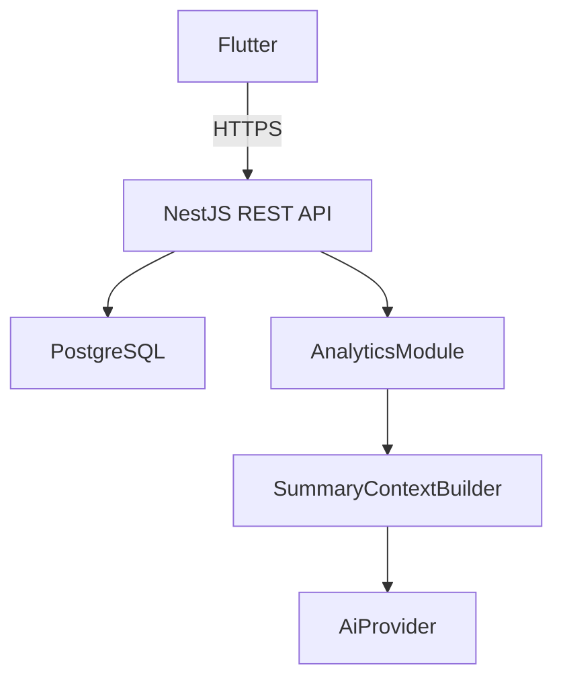
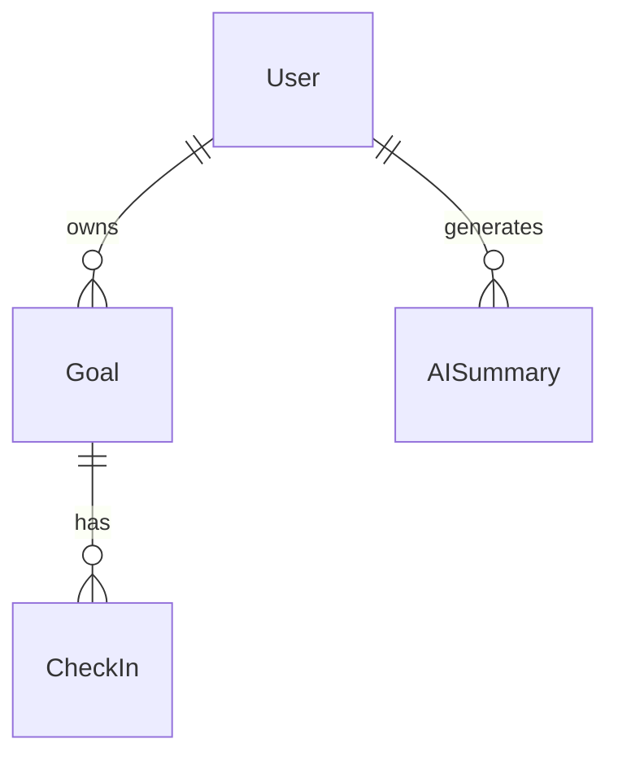

# Plan de Implementación — Avance 1

## Proyecto: NeuroConnect

**Materia:** Inteligencia Artificial (G)  
**Docente:** Arnulfo Alanis Garza  
**Estudiante:** Carlos Benjamín Armenta Márquez  
**Proyecto:** NeuroConnect — Plataforma Inteligente para el Seguimiento de Objetivos y Gestión de Redes de Apoyo en Personas Neurodivergentes  
**Entrega Avance 1:** 16 de octubre de 2026  

---

# 1. Objetivo de la iteración

El objetivo del Avance 1 será implementar y validar una primera versión funcional de NeuroConnect que cubra completamente el núcleo del sistema y el módulo inicial de analítica, dejando además iniciada la arquitectura correspondiente a la integración futura de inteligencia artificial generativa.

La meta formal de esta iteración será:

> **Avance 1 = MVP-0 terminado + MVP-1 terminado + MVP-2 iniciado técnicamente.**

El anteproyecto establece una estrategia incremental compuesta por:

- MVP-0: Núcleo.
- MVP-1: Analítica.
- MVP-2: Inteligencia Artificial.
- MVP-3: Red de apoyo.
- MVP-4: Cierre y validación.

Para esta entrega se desarrollarán por completo los dos primeros incrementos y se dejará preparada la infraestructura necesaria para continuar posteriormente con la integración real de IA generativa.

---

# 2. Baseline autoritativa del proyecto

El archivo:

```text
Anteproyecto_NeuroConnect_IA_G_Carlos_Armenta.pdf
```

se considera la documentación oficial y autoritativa del proyecto.

Codex deberá respetar todas las decisiones funcionales y arquitectónicas definidas en dicho documento.

No podrá modificar por iniciativa propia:

- objetivo general;
- dominio del sistema;
- población objetivo;
- delimitación clínica;
- arquitectura monolítica modular;
- uso de Flutter;
- uso de NestJS;
- uso de Prisma;
- uso de PostgreSQL;
- enfoque de análisis determinístico;
- separación entre cálculo analítico e IA generativa;
- definición conceptual de los MVP.

Cualquier desviación necesaria deberá:

1. detenerse;
2. documentarse;
3. justificarse;
4. quedar pendiente de aprobación manual.

---

# 3. Meta funcional del Avance 1

Al finalizar esta iteración deberá ser posible ejecutar localmente el siguiente flujo:

```text
Registro de usuario
        ↓
Inicio de sesión
        ↓
Creación de objetivo
        ↓
Registro de check-ins
        ↓
Consulta de historial
        ↓
Cálculo de indicadores
        ↓
Clasificación de tendencia
        ↓
Visualización en dashboard
        ↓
Preparación de contexto estructurado para IA
```

No deberán implementarse todavía:

```text
Red de apoyo
Permisos entre usuarios
LLM externo real
Deployment definitivo
Publicación en App Store
Publicación en Play Store
Compilación iOS obligatoria
```

---

# 4. Alcance técnico del Avance 1

El avance deberá contener:

## MVP-0

- autenticación;
- usuarios;
- objetivos;
- check-ins;
- persistencia;
- historial;
- validaciones;
- ownership de datos.

## MVP-1

- indicadores descriptivos;
- cálculo de tendencias;
- dashboard;
- visualización temporal;
- API analítica;
- pruebas unitarias y E2E.

## MVP-2 iniciado

- módulo de IA;
- interfaz de proveedor;
- construcción de contexto;
- construcción de prompt;
- proveedor mock;
- endpoint de previsualización;
- documentación del pipeline.

---

# 5. Estructura del repositorio

El proyecto se organizará en un único repositorio:

```text
neuroconnect/
│
├── backend/
│   ├── src/
│   ├── prisma/
│   ├── test/
│   ├── Dockerfile
│   ├── .env.example
│   └── README.md
│
├── app/
│   ├── lib/
│   ├── test/
│   ├── web/
│   ├── android/
│   └── README.md
│
├── docs/
│   ├── architecture/
│   ├── decisions/
│   ├── evidence/
│   └── AVANCE-1.md
│
├── docker-compose.yml
├── .gitignore
└── README.md
```

No deberán utilizarse:

- Nx;
- Turborepo;
- Kubernetes;
- microservicios.

---

# 6. Stack tecnológico

## Backend

```text
NestJS
Prisma
PostgreSQL 16
JWT
bcrypt o argon2
class-validator
Swagger / OpenAPI
Docker Compose
Jest
```

Dependencias adicionales:

```text
@nestjs/config
@nestjs/jwt
@nestjs/passport
passport-jwt
```

Configuraciones obligatorias:

- configuración por variables de entorno;
- validación global de DTO;
- CORS configurable;
- manejo consistente de errores;
- documentación Swagger;
- protección de endpoints mediante JWT.

---

# 7. Modelo de datos v1

Para este avance se implementarán las siguientes entidades.

---

## 7.1 User

```text
id UUID
email unique
passwordHash
displayName
createdAt
updatedAt
```

Reglas:

- `email` debe ser único;
- `passwordHash` nunca debe exponerse en respuestas;
- `displayName` es obligatorio.

---

## 7.2 Goal

```text
id UUID
ownerId UUID -> User

title
description nullable
category nullable

status
progress

targetDate nullable

createdAt
updatedAt
```

Estados:

```text
ACTIVE
PAUSED
COMPLETED
```

Reglas:

```text
progress ∈ [0,100]
```

Un usuario solo puede acceder a objetivos propios.

---

## 7.3 CheckIn

```text
id UUID
goalId UUID -> Goal

progress
difficulty
completion
notes nullable

createdAt
```

Validaciones:

```text
progress ∈ [0,100]
difficulty ∈ [1,5]
```

Estados de cumplimiento:

```text
NOT_MET
PARTIAL
MET
```

Regla principal:

> Un usuario solo puede crear y consultar check-ins pertenecientes a objetivos propios.

Cuando se crea un check-in:

```text
Goal.progress = CheckIn.progress
```

No deberá marcarse automáticamente el objetivo como `COMPLETED` cuando `progress = 100`.

El cambio de estado del objetivo deberá mantenerse explícito.

---

## 7.4 AISummary

El modelo se creará desde este avance para evitar cambios importantes posteriores.

```text
id UUID
userId UUID
periodStart
periodEnd

inputSnapshot Json
content Text nullable

provider nullable
model nullable

status

createdAt
```

Estados:

```text
PENDING
COMPLETED
FAILED
```

En el Avance 1 no se requerirá todavía persistir resultados generados por un proveedor real.

---

# 8. MVP-0 — Backend obligatorio

---

## 8.1 AuthModule

Endpoints:

```text
POST /auth/register
POST /auth/login
GET  /auth/me
```

Autenticación:

```text
JWT Bearer Token
```

Validaciones mínimas:

```text
email válido
password >= 8 caracteres
displayName obligatorio
```

Nunca devolver:

```text
passwordHash
```

---

## 8.2 UsersModule

Endpoints:

```text
GET   /users/me
PATCH /users/me
```

No implementar administración global de usuarios.

---

## 8.3 GoalsModule

Endpoints:

```text
POST   /goals
GET    /goals
GET    /goals/:id
PATCH  /goals/:id
DELETE /goals/:id
```

Todos los endpoints deberán estar protegidos.

Regla de ownership:

> Un usuario jamás puede consultar, modificar o eliminar objetivos pertenecientes a otro usuario.

DTO requeridos:

```text
CreateGoalDto
UpdateGoalDto
```

Validaciones:

```text
progress: 0..100
targetDate válida
status enum
```

---

# 9. CheckInsModule

La API deberá utilizar rutas anidadas.

Endpoints:

```text
POST /goals/:goalId/check-ins

GET /goals/:goalId/check-ins

GET /goals/:goalId/check-ins/:checkInId
```

En esta etapa no será necesario editar check-ins.

Los check-ins se consideran registros históricos.

Se podrá permitir:

```text
DELETE /goals/:goalId/check-ins/:checkInId
```

exclusivamente para eliminar registros creados por error.

Esta decisión deberá quedar documentada como provisional.

---

# 10. Seed reproducible

Codex deberá implementar:

```text
prisma/seed.ts
```

Usuario demo:

```text
demo@neuroconnect.local
```

El seed deberá crear como mínimo:

- 1 usuario;
- 3 objetivos;
- entre 4 y 6 check-ins por objetivo;
- fechas distribuidas en varias semanas.

Los tres objetivos deberán producir comportamientos distintos:

```text
Objetivo A → PROGRESSING

Objetivo B → STABLE

Objetivo C → INACTIVE
```

El dataset deberá ser reproducible.

Su propósito será:

- facilitar pruebas;
- alimentar el dashboard;
- generar capturas;
- validar analítica;
- utilizarlo durante la demostración.

---

# 11. MVP-1 — AnalyticsModule

La analítica deberá funcionar completamente sin IA.

El módulo debe ser:

```text
determinístico
reproducible
testeable
independiente del LLM
```

La inteligencia artificial únicamente explicará resultados ya calculados.

---

# 12. Endpoint global de analítica

Endpoint:

```text
GET /analytics/overview
```

Respuesta esperada:

```json
{
  "totalGoals": 3,
  "activeGoals": 2,
  "pausedGoals": 0,
  "completedGoals": 1,
  "completionRate": 33.33,
  "averageProgress": 68.4,
  "checkInsLast28Days": 12,
  "checkInFrequencyPerWeek": 3.0,
  "inactiveGoals": 1
}
```

---

# 13. Endpoint analítico por objetivo

Endpoint:

```text
GET /analytics/goals/:goalId
```

Respuesta esperada:

```json
{
  "goalId": "...",
  "currentProgress": 70,
  "previousProgress": 62,
  "progressDelta": 8,
  "averageDifficulty": 3.2,
  "totalCheckIns": 7,
  "checkInsLast28Days": 4,
  "daysSinceLastCheckIn": 2,
  "trend": "PROGRESSING",
  "insufficientHistory": false,
  "timeline": [
    {
      "date": "...",
      "progress": 45
    },
    {
      "date": "...",
      "progress": 58
    },
    {
      "date": "...",
      "progress": 70
    }
  ]
}
```

---

# 14. Reglas de tendencias

Las reglas deberán ser explícitas.

```text
INACTIVE
si no existen check-ins
o
si han pasado más de 7 días desde el último check-in
```

```text
PROGRESSING
si delta >= +5
```

```text
DECLINING
si delta <= -5
```

```text
STABLE
si -5 < delta < +5
```

Donde:

```text
delta =
último progreso
-
progreso anterior
```

Caso especial:

Si solo existe un check-in:

```text
trend = STABLE
insufficientHistory = true
```

Esto evita inferir tendencias sin historial suficiente.

---

# 15. Métricas obligatorias

---

## 15.1 Tasa de cumplimiento

```text
CompletionRate =
completedGoals / totalGoals × 100
```

---

## 15.2 Frecuencia de seguimiento

```text
CheckInFrequency =
checkIns durante periodo / semanas del periodo
```

Periodo por defecto:

```text
28 días
```

---

## 15.3 Variación del progreso

```text
ProgressDelta =
currentProgress - previousProgress
```

---

## 15.4 Métricas adicionales

```text
averageDifficulty
daysSinceLastCheckIn
averageProgress
checkInsLast28Days
inactiveGoals
```

Estas métricas no reemplazan las definidas oficialmente en el anteproyecto.

---

# 16. Pruebas backend

El MVP-1 no se considerará terminado si las pruebas no pasan.

---

## 16.1 Unit tests — Analytics

Casos obligatorios:

```text
sin check-ins → INACTIVE

último check-in > 7 días → INACTIVE

delta +10 → PROGRESSING

delta -10 → DECLINING

delta +2 → STABLE

1 check-in → STABLE + insufficientHistory=true

completionRate correcto

checkInFrequency correcta
```

---

## 16.2 Unit tests — Goals

Validaciones:

```text
progress < 0 → reject

progress > 100 → reject
```

---

## 16.3 Unit tests — Check-ins

Validaciones:

```text
difficulty = 0 → reject

difficulty = 6 → reject

progress > 100 → reject

progress < 0 → reject
```

---

# 17. Pruebas E2E

Flujo obligatorio:

```text
register
↓
login
↓
create goal
↓
create check-in
↓
create second check-in
↓
get goal
↓
get history
↓
get analytics
```

Prueba de aislamiento:

```text
User A crea objetivo

User B intenta acceder

Resultado:
404
```

Se prefiere devolver `404` en lugar de `403` para evitar filtrar la existencia del recurso.

---

# 18. Swagger / OpenAPI

Ruta obligatoria:

```text
/api/docs
```

Swagger deberá documentar:

- Auth;
- Users;
- Goals;
- Check-ins;
- Analytics;
- AI Preview.

La documentación servirá también como evidencia para el Avance 1.

---

# 19. Cliente Flutter

El cliente del Avance 1 será funcional pero limitado al alcance actual.

Arquitectura propuesta:

```text
lib/
├── core/
│   ├── api/
│   ├── auth/
│   ├── routing/
│   └── theme/
│
├── features/
│   ├── auth/
│   ├── goals/
│   ├── checkins/
│   └── dashboard/
│
└── main.dart
```

Dependencias:

```text
dio
go_router
flutter_riverpod
fl_chart
```

No utilizar:

- Bloc;
- arquitecturas excesivamente ceremoniales;
- Clean Architecture completa;
- capas innecesarias.

---

# 20. Pantallas requeridas

---

## 20.1 Login

Campos:

```text
email
password
```

Acciones:

```text
Entrar
Crear cuenta
```

---

## 20.2 Registro

Campos:

```text
nombre
email
password
```

---

## 20.3 Dashboard

El dashboard será la pantalla principal.

Mostrar:

```text
Objetivos activos
Objetivos completados
Progreso promedio
Check-ins últimas 4 semanas
```

Además deberá mostrar al menos una gráfica:

```text
Progreso histórico
```

Los datos deberán venir del backend real.

---

## 20.4 Lista de objetivos

Cada card deberá mostrar:

```text
Título
Estado
Progress bar
Porcentaje
```

Acción:

```text
Nuevo objetivo
```

---

## 20.5 Detalle de objetivo

Mostrar:

```text
Título
Descripción
Estado
Progreso
Historial
Tendencia
Último check-in
```

Acción:

```text
Registrar check-in
```

---

## 20.6 Formulario de check-in

Campos:

```text
Progreso       0..100
Dificultad     1..5
Cumplimiento
Comentario
```

---

# 21. Lineamientos visuales

La interfaz deberá utilizar:

```text
Material 3
contraste suficiente
jerarquía visual clara
espaciado amplio
labels explícitos
navegación simple
mínima sobrecarga visual
```

Evitar:

```text
animaciones permanentes
gradientes agresivos
uso excesivo de colores
pantallas saturadas
microinteracciones innecesarias
```

El diseño deberá priorizar claridad y legibilidad.

---

# 22. MVP-2 — IA iniciada

No deberá conectarse todavía un proveedor real de IA.

No utilizar:

```text
OpenAI real
Gemini real
Anthropic real
```

La meta será dejar implementado el pipeline técnico.

---

# 23. AiModule

Crear:

```text
AiModule
```

Componentes:

```text
AiSummaryService
SummaryContextBuilder
PromptBuilder
AiProvider
MockAiProvider
```

---

# 24. SummaryContextBuilder

Debe tomar datos reales del `AnalyticsModule`.

Ejemplo:

```json
{
  "periodDays": 28,
  "totalGoals": 3,
  "completedGoals": 1,
  "completionRate": 33.33,
  "checkInFrequencyPerWeek": 3,
  "goals": [
    {
      "title": "Organizar actividades académicas",
      "progress": 70,
      "trend": "PROGRESSING",
      "averageDifficulty": 3.2
    }
  ]
}
```

No incluir:

```text
email
passwordHash
JWT
tokens
credenciales
userId externo
datos innecesarios
```

---

# 25. PromptBuilder

El prompt deberá dividirse conceptualmente en:

```text
SYSTEM
USER
```

Prompt base:

```text
SYSTEM

Eres un asistente de apoyo informativo.

Debes resumir exclusivamente los datos proporcionados.

No diagnostiques condiciones psicológicas.

No proporciones recomendaciones médicas.

No inventes información.

No atribuyas emociones o intenciones al usuario.

Explica tendencias objetivas de manera breve, neutral y comprensible.
```

Entrada:

```text
USER

<JSON estructurado>
```

---

# 26. Endpoint AI Preview

Crear:

```text
GET /ai/summary/context
```

Respuesta esperada:

```json
{
  "context": {},
  "prompt": "...",
  "providerConfigured": false
}
```

Propósito:

> demostrar que el MVP-2 ya cuenta con un pipeline capaz de transformar resultados analíticos en un contexto estructurado preparado para un LLM.

---

# 27. AiProvider

Interfaz:

```typescript
interface AiProvider {
  generateSummary(
    context: SummaryContext
  ): Promise<GeneratedSummary>;
}
```

Implementación temporal:

```text
MockAiProvider
```

Este proveedor deberá generar una respuesta simple y determinística.

La documentación deberá indicar claramente:

```text
Development mock only
```

No deberá presentarse como IA real.

---

# 28. Funcionalidades fuera de alcance

Codex no deberá implementar:

```text
SupportNetworkModule
PermissionsModule
RAG
vector database
fine tuning
WebSockets
Redis
queues
microservices
GraphQL
social login
OAuth
password reset por email
push notifications
Docker Swarm
Kubernetes
CI/CD complejo
ML predictivo
modelos entrenados
diagnóstico psicológico
recomendaciones médicas
```

---

# 29. Docker Compose

Deberá existir:

```yaml
services:
  postgres:
  backend:
```

El cliente Flutter se ejecutará por separado durante desarrollo.

Flujo backend esperado:

```bash
docker compose up -d postgres

cd backend

npm install

npx prisma migrate dev

npm run seed

npm run start:dev
```

Flutter:

```bash
cd app

flutter pub get

flutter run -d chrome
```

---

# 30. Variables de entorno

Archivo obligatorio:

```text
backend/.env.example
```

Contenido:

```env
DATABASE_URL=

JWT_SECRET=
JWT_EXPIRES_IN=

PORT=
CORS_ORIGINS=

AI_PROVIDER=mock
AI_API_KEY=
AI_MODEL=
```

No deberán versionarse secretos reales.

---

# 31. Documentación técnica obligatoria

Crear:

```text
docs/architecture/ARCHITECTURE.md

docs/architecture/DATA_MODEL.md

docs/architecture/API.md

docs/architecture/ANALYTICS.md

docs/architecture/AI_PIPELINE.md

docs/AVANCE-1.md
```

---

# 32. ARCHITECTURE.md

Deberá explicar:

```text
monolito modular
REST
HTTPS
Flutter
NestJS
PostgreSQL
Prisma
Analytics
AI pipeline
```

Diagrama Mermaid sugerido:



---

# 33. DATA_MODEL.md

Diagrama Mermaid:



Deberá explicar cada entidad y sus relaciones.

---

# 34. API.md

Debe documentar:

- endpoint;
- método HTTP;
- autenticación requerida;
- request;
- response;
- errores;
- reglas de ownership.

---

# 35. ANALYTICS.md

Debe documentar:

```text
CompletionRate
CheckInFrequency
ProgressDelta

averageDifficulty
averageProgress
daysSinceLastCheckIn

PROGRESSING
STABLE
DECLINING
INACTIVE
```

Debe aclarar expresamente:

> Las tendencias son descripciones matemáticas del comportamiento de los datos y no representan diagnósticos psicológicos o clínicos.

---

# 36. AI_PIPELINE.md

Debe incluir:

```text
Data
 ↓
Deterministic Analytics
 ↓
Structured Context
 ↓
Prompt
 ↓
LLM Provider
 ↓
Generated Summary
```

Durante Avance 1:

```text
LLM Provider = MockAiProvider
```

Deberá dejar explícitamente pendiente:

> integración de proveedor externo para completar MVP-2.

---

# 37. AVANCE-1.md

Debe seguir exactamente la estructura solicitada por el profesor:

```text
1. Breve recordatorio del objetivo y planificación inicial

2. Actividades realizadas

   - ¿Qué se ha hecho?

   - Evidencias

   - Comparación con lo planificado

3. Porcentaje de avance

   - Cumplimiento de entregables

   - Modificaciones al plan inicial

4. Dificultades

   - Problemas

   - Soluciones aplicadas

5. Retroalimentación

6. Próximas actividades
```

No inventar:

- dificultades;
- retroalimentación;
- comentarios de usuarios;
- resultados de pruebas no ejecutadas.

Cuando no exista información real utilizar:

```text
[PENDIENTE DE VALIDACIÓN DEL AUTOR]
```

---

# 38. Evidencias requeridas para el PDF del Avance 1

Después de la validación manual deberán obtenerse capturas de:

1. estructura del repositorio;
2. Docker/PostgreSQL en ejecución;
3. migraciones Prisma;
4. Swagger;
5. registro;
6. login;
7. lista de objetivos;
8. creación de objetivo;
9. formulario de check-in;
10. historial de check-ins;
11. dashboard;
12. gráfica temporal;
13. endpoint `/analytics/overview`;
14. endpoint `/analytics/goals/:id`;
15. endpoint `/ai/summary/context`;
16. pruebas backend exitosas;
17. `flutter analyze`;
18. aplicación Flutter ejecutándose;
19. diagrama de arquitectura;
20. diagrama de base de datos.

---

# 39. Porcentaje de avance esperado

Estimación por incremento:

```text
MVP-0 = 100 %

MVP-1 = 100 %

MVP-2 = 20–30 %

MVP-3 = 0 %

MVP-4 = 0 %
```

Avance global aproximado:

```text
40–45 %
```

El porcentaje definitivo deberá calcularse después de validar realmente qué componentes fueron completados.

---

# 40. Definition of Done

Codex no podrá declarar terminada la iteración hasta verificar todos los siguientes puntos.

Backend:

```bash
npm test
```

Debe pasar.

```bash
npm run test:e2e
```

Debe pasar.

```bash
npm run build
```

Debe pasar.

Prisma:

```text
migración desde cero exitosa
seed exitoso
```

Flutter:

```bash
flutter analyze
```

Debe pasar.

```bash
flutter test
```

Debe pasar.

```bash
flutter build web
```

Debe pasar.

Además:

- Swagger debe abrir correctamente;
- PostgreSQL debe iniciar correctamente;
- Flutter Web debe conectarse al backend;
- el seed debe generar tendencias válidas;
- el ownership debe impedir acceso cruzado;
- el endpoint analítico debe devolver resultados correctos;
- AI Preview debe preparar contexto real.

Flujo final obligatorio:

```text
register
↓
login
↓
create goal
↓
create check-in
↓
analytics
↓
dashboard
```

---

# 41. Estrategia de commits

No realizar un único mega-commit.

Secuencia sugerida:

```text
chore: initialize neuroconnect workspace

feat(backend): add prisma postgres foundation

feat(auth): implement jwt authentication

feat(goals): implement goal management

feat(checkins): implement goal check-ins

feat(analytics): implement deterministic metrics

test(backend): add analytics and ownership coverage

feat(app): initialize flutter application

feat(app): add authentication flow

feat(app): add goals and check-ins

feat(app): add analytics dashboard

feat(ai): bootstrap summary pipeline

docs: add architecture and avance 1 documentation
```

---

# 42. Orden de implementación recomendado

## Fase 1 — Bootstrap

- crear repositorio;
- crear estructura;
- configurar Git;
- crear backend;
- crear Flutter;
- crear Docker Compose.

## Fase 2 — Persistencia

- PostgreSQL;
- Prisma;
- modelos;
- migraciones;
- seed.

## Fase 3 — Autenticación

- register;
- login;
- JWT;
- guards;
- usuario actual.

## Fase 4 — Objetivos

- CRUD;
- validaciones;
- ownership.

## Fase 5 — Check-ins

- creación;
- historial;
- ownership;
- sincronización de `Goal.progress`.

## Fase 6 — Analítica

- overview;
- endpoint por objetivo;
- métricas;
- tendencias;
- tests.

## Fase 7 — Swagger

- documentar módulos;
- validar respuestas;
- capturas potenciales.

## Fase 8 — Flutter Auth

- login;
- registro;
- manejo de token;
- navegación protegida.

## Fase 9 — Flutter Goals

- lista;
- detalle;
- creación;
- edición.

## Fase 10 — Flutter Check-ins

- formulario;
- historial;
- refresco de progreso.

## Fase 11 — Dashboard

- métricas;
- tarjetas;
- gráfica;
- estados de carga/error.

## Fase 12 — AI Bootstrap

- AiModule;
- SummaryContextBuilder;
- PromptBuilder;
- AiProvider;
- MockAiProvider;
- AI Preview.

## Fase 13 — Documentación

- arquitectura;
- modelo de datos;
- API;
- analítica;
- IA;
- Avance 1.

## Fase 14 — Validación final

- unit tests;
- E2E;
- backend build;
- migración limpia;
- seed;
- Flutter analyze;
- Flutter test;
- Flutter web build;
- recorrido manual.

---

# 43. Criterios de aceptación funcional

La iteración será aceptada únicamente si un usuario puede:

1. registrarse;
2. iniciar sesión;
3. crear un objetivo;
4. consultar sus objetivos;
5. editar un objetivo;
6. registrar check-ins;
7. consultar historial;
8. visualizar progreso;
9. consultar analítica;
10. visualizar dashboard;
11. observar una tendencia calculada;
12. consultar el contexto preparado para IA.

Además:

- no puede acceder a datos de otro usuario;
- los indicadores coinciden con los datos;
- las reglas de tendencia son reproducibles;
- el contexto de IA excluye datos sensibles.

---

# 44. Criterios de aceptación académica

El Avance 1 deberá demostrar:

```text
software funcional
+
persistencia real
+
autenticación
+
objetivos
+
check-ins
+
historial
+
analítica determinística
+
minería descriptiva
+
dashboard
+
pipeline inicial de IA
+
pruebas
+
documentación
```

El resultado no deberá presentarse únicamente como un prototipo visual.

Debe existir implementación real y verificable.

---

# 45. Resultado esperado del Avance 1

Al finalizar la iteración, NeuroConnect deberá contar con una base funcional suficiente para demostrar que el usuario puede registrar objetivos y check-ins, generar un historial temporal, obtener métricas objetivas y visualizar tendencias.

El sistema deberá haber iniciado además la transición hacia el MVP-2 mediante un pipeline que transforme resultados analíticos en contexto estructurado y prompts preparados para un proveedor externo de inteligencia artificial.

Esto permitirá que la siguiente etapa se concentre en:

- completar la integración del LLM;
- validar resúmenes;
- implementar la red de apoyo;
- implementar permisos;
- compartir información de forma controlada.

---

# 46. Próxima etapa después del Avance 1

Después de validar y entregar este avance se continuará con:

```text
MVP-2
```

Completando:

- proveedor real de LLM;
- generación de resúmenes;
- validación de consistencia;
- persistencia de AISummary.

Posteriormente:

```text
MVP-3
```

Implementando:

- red de apoyo;
- relaciones entre usuarios;
- permisos;
- expiración;
- revocación.

Finalmente:

```text
MVP-4
```

Incluyendo:

- pruebas finales;
- UX;
- seguridad;
- deployment;
- documentación final;
- preparación de presentación.

---

# 47. Instrucción operativa para Codex

Codex deberá ejecutar la implementación completa siguiendo este documento.

Reglas:

1. No alterar alcance sin autorización.
2. No agregar tecnologías fuera del plan.
3. No reemplazar decisiones del anteproyecto.
4. No implementar funcionalidades del MVP-3.
5. No conectar todavía un LLM real.
6. No declarar terminado el trabajo si falla una prueba.
7. No inventar resultados académicos.
8. Documentar cualquier desviación.
9. Trabajar mediante commits pequeños y semánticos.
10. Generar al final un reporte técnico de implementación.

El reporte final deberá incluir:

- archivos creados;
- estructura final;
- arquitectura;
- endpoints;
- modelo de datos;
- pruebas ejecutadas;
- resultados;
- decisiones tomadas;
- desviaciones;
- limitaciones;
- pendientes de MVP-2;
- instrucciones de ejecución;
- checklist de evidencias para el PDF del Avance 1.

---

# 48. Estado objetivo al finalizar

```text
MVP-0
██████████ 100 %

MVP-1
██████████ 100 %

MVP-2
███░░░░░░░ 20–30 %

MVP-3
░░░░░░░░░░ 0 %

MVP-4
░░░░░░░░░░ 0 %
```

Estado general esperado:

```text
Avance global aproximado: 40–45 %
```

El porcentaje definitivo será validado contra la implementación real antes de preparar el documento académico del Avance 1.
