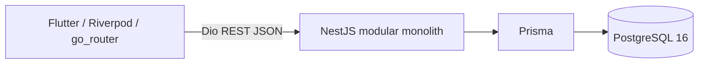

# Implemented architecture — MVP-0

This operational document describes the implementation; the accepted ADRs remain authoritative.

The client presents forms and remote state. Backend controllers delegate to domain services; JWT guards, DTO validation and ownership queries enforce access. Auth, Users, Goals and CheckIns are the MVP-0 modules. PrismaService owns the shared client lifecycle. There is no generic repository layer.

Local HTTP is used on loopback for development. Public deployment must use HTTPS. Docker packages the same backend artifact for local use and future hosting; PostgreSQL uses a named local volume. Flutter runs outside Docker. GitHub Actions validates both projects with PostgreSQL 16 for E2E.

Analytics, Dashboard, AI and SupportNetwork are subsequent increments and have no runtime modules in MVP-0.
