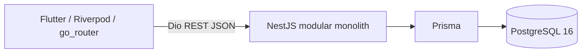

# Implemented architecture — Avance 1

This operational document describes the implementation; the accepted ADRs remain authoritative.

The client presents forms and remote state. Backend controllers delegate to domain services; JWT guards, DTO validation and ownership queries enforce access. Auth, Users, Goals and CheckIns are the MVP-0 modules. PrismaService owns the shared client lifecycle. There is no generic repository layer.

Local HTTP is used on loopback for development. Public deployment must use HTTPS. Docker packages independent backend and Flutter Web/Nginx artifacts; local Compose runs both plus PostgreSQL16 with a named DB volume. Production PostgreSQL is external via DATABASE_URL. GitHub Actions validates both projects, real PostgreSQL E2E and Docker builds.

AnalyticsModule computes read-only metrics/trends from Goal/CheckIn. Flutter consumes these through repositories/providers and displays dashboard/chart; it never classifies trends independently.

AiModule is started, not complete: AnalyticsService.summarySource (one owner/RepeatableRead snapshot) → SummaryContextBuilder allowlist → PromptBuilder fixed SYSTEM + JSON USER → authenticated technical preview. Preview is feature-gated and does not invoke a provider or write AISummary. AiProvider has an internal deterministic MockAiProvider for development/tests, explicitly not real AI. No model SDK/network generation, production summary lifecycle or SupportNetwork exists. AISummary is only a database scaffold required for this advance. See ADR-005 and the operational handoff report for deferred work.
