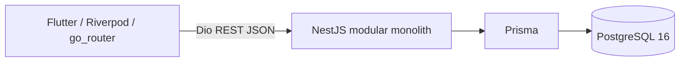

# Implemented architecture — MVP-1.5

This operational document describes the implementation; the accepted ADRs remain authoritative.

The client presents forms and remote state. Backend controllers delegate to domain services; JWT guards, DTO validation and ownership queries enforce access. Auth, Users, Goals and CheckIns are the MVP-0 modules. PrismaService owns the shared client lifecycle. There is no generic repository layer.

Local HTTP is used on loopback for development. Public deployment must use HTTPS. Docker packages independent backend and Flutter Web/Nginx artifacts; local Compose runs both plus PostgreSQL16 with a named DB volume. Production PostgreSQL is external via DATABASE_URL. GitHub Actions validates both projects, real PostgreSQL E2E and Docker builds.

AnalyticsModule computes read-only metrics/trends from Goal/CheckIn. Flutter consumes these through repositories/providers and displays dashboard/chart; it never classifies trends independently.

AiModule is started, not complete: AnalyticsService.summarySource (one owner/RepeatableRead snapshot) → SummaryContextBuilder allowlist → PromptBuilder fixed SYSTEM + JSON USER → authenticated technical preview. Preview is feature-gated and does not invoke a provider or write AISummary. AiProvider has an internal deterministic MockAiProvider for development/tests, explicitly not real AI. No model SDK/network generation or productive summary lifecycle exists. CANCELLED remains explicit and is not interpreted as failure or a clinical/emotional condition.

ADR-008 adds AuditModule (private paginated owner activity) and SupportNetworkModule. SupportAccessService checks relationship/expiry/revocation/permission for every delegated request; a shared relationship row lock holds authorization while the safe projection is read. Owner permission/revoke/reactivate writes take an exclusive relationship lock. No permission cache, worker or global role is used. Delegated routes expose only safe fields; notes never cross the boundary. Critical writes plus minimized append-only audit share a PostgreSQL transaction.

Flutter adds separate owner network, supported owners, shared read-only and activity features. Navigation is available from Perfil, without a role switch. Typed repositories isolate HTTP from widgets; session-dependent auto-disposed providers avoid cross-identity data. Refresh fetches both permissions and shared goals, removing stale projections if access is lost. Voided CheckIns are excluded from functional history; cancelled Goals remain visible in own/shared lists and Dashboard.
