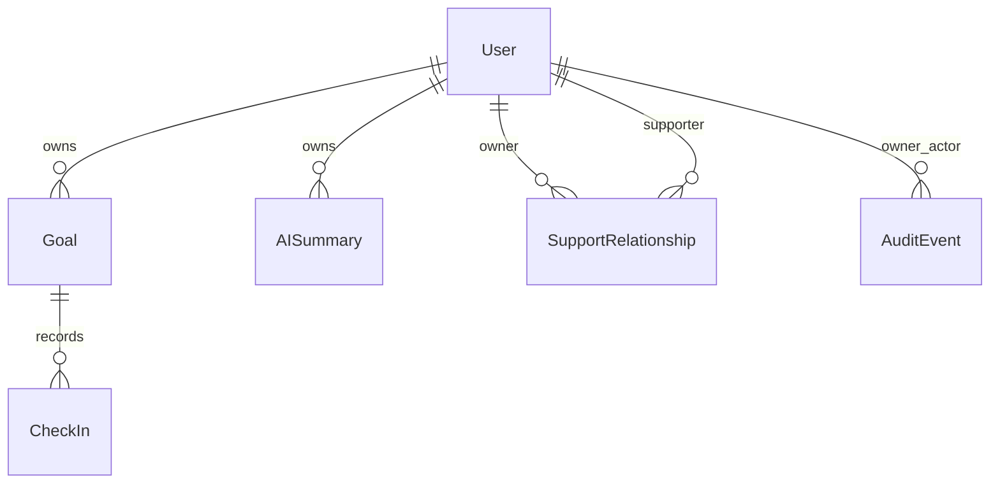

# Implemented persistence — MVP-1.5 / ADR-008

UUID primary/foreign keys and UTC `TIMESTAMPTZ(3)` follow ADR-001. Email is normalized before persistence and unique. API projections exclude passwordHash. Goal belongs to one owner; CheckIn belongs to one Goal. Referential cascades remain solely for controlled internal test cleanup. There is no account deletion API or physical domain deletion during normal product use.

Goal starts ACTIVE with progress 0; statuses are ACTIVE/PAUSED/COMPLETED/CANCELLED. Progress is the snapshot of the latest effective CheckIn. Cancellation retains all data. CheckIn has nullable UTC voidedAt; voiding retains its values and recalculates progress from the latest non-voided record, or zero. Creation/void, snapshot and audit insert share one transaction and parent row lock. SQL CHECK independently enforces progress 0..100 and difficulty 1..5.

Indexes cover ownerId, (ownerId,status), goalId and (goalId,createdAt). Analytics remain calculated, never persisted. SupportRelationship contains id, ownerId/supporterId, three permission booleans, authorizedAt/expiresAt/revokedAt. Unique pair, owner/supporter indexes and SQL checks prevent self and invalid permissions. Revocation retains the row; reactivation reuses it. No User.role exists.

AuditEvent contains id, ownerId, actorId, action enum, entityType enum, UUID entityId, minimized JSONB payload and UTC occurredAt. Indexes cover (ownerId,occurredAt) and (ownerId,entityType,entityId). Application code exposes append/read only; SQL triggers reject updates and direct deletes. Nested FK cascades allow internal test cleanup. No historical events are invented for data predating adoption. New migrations: `20261015000100_support_audit_history`, `20261015000200_audit_append_only`; baseline migrations are unchanged.

AISummary scaffold follows ADR-001 §§27–33 and PLAN §7.4: UUID/userId FK cascading on user deletion, UTC periodStart/periodEnd/createdAt, JSONB inputSnapshot, nullable content/provider/model, PENDING default and COMPLETED/FAILED enum values. Indexes: userId and (userId,createdAt). SQL CHECK prevents reversed periods. Migration `20261014000200_ai_summary_scaffold` extends the MVP-0 chain without changing existing records. AI Preview and development mock never persist rows; future MVP-2 generation/history lifecycle is deferred.
