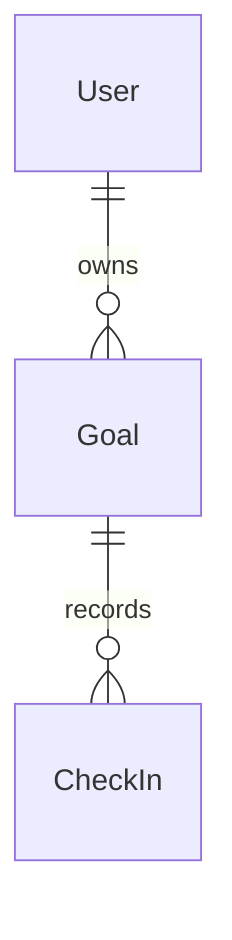

# Implemented persistence — MVP-0

UUID primary/foreign keys and UTC `TIMESTAMPTZ(3)` follow ADR-001. Email is normalized before persistence and unique. API projections exclude passwordHash. Goal belongs to one owner; CheckIn belongs to one Goal. Deleting User cascades to Goals, and deleting Goal cascades to CheckIns.

Goal starts ACTIVE with progress 0. Progress is an integer snapshot of the latest CheckIn. CheckIn creation and snapshot update are one transaction. Deleting the latest CheckIn restores the preceding progress, or zero with no history. Database CHECK constraints independently enforce progress 0..100 and difficulty 1..5. CheckIns cannot be edited.

Indexes cover ownerId, (ownerId,status), goalId and (goalId,createdAt). No history table or persisted analytics exists. AISummary and SupportRelationship migrations are deferred to their increments.
